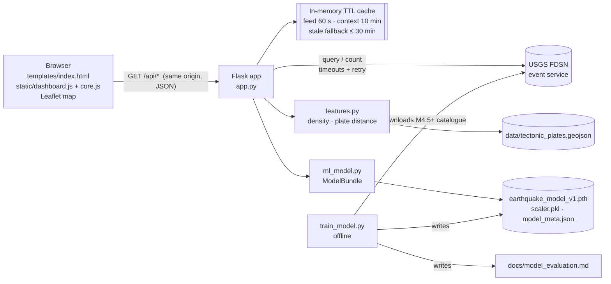
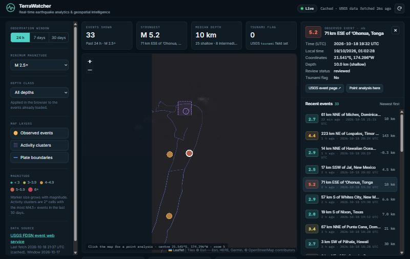
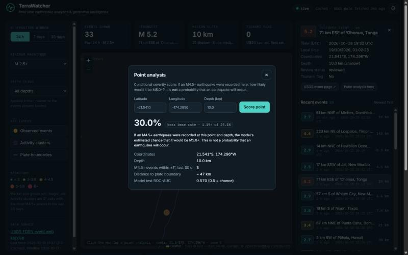
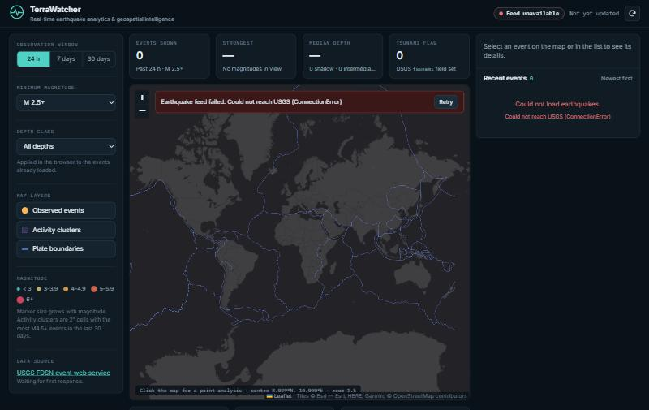

# TerraWatcher — Real-Time Earthquake Analytics & Geospatial Intelligence

TerraWatcher is a Flask + Leaflet web application. It shows recent earthquakes from the public
**USGS FDSN event web service** on an interactive map, summarises them, highlights where M4.5+
activity has clustered over the last 30 days, and includes a small, honestly evaluated machine-learning
model that estimates a **conditional severity score**.


> **What TerraWatcher is not:** it is not an earthquake forecasting or early-warning system. It does not
> predict whether, when or where an earthquake will happen. For alerts, use official agencies (USGS,
> national geological surveys, tsunami warning centres).

📘 **Learning guide:** [`docs/learning-guide.pdf`](docs/learning-guide.pdf) (source: [`docs/learning-guide.md`](docs/learning-guide.md))
explains every part of the system in depth: architecture, data pipeline, ML, evaluation, testing and interview preparation.

---

## What it does

| Capability | Kind of output | Details |
|---|---|---|
| Event feed and map | **Observed data** | Events from the last 24 h, 7 days or 30 days at a chosen minimum magnitude, drawn at their reported epicentres. The marker colour and size encode magnitude. |
| Event details | **Observed data** | Magnitude and type, place, UTC and local time, coordinates, depth class, review status, tsunami flag, and a link to the USGS event page. |
| Statistics | **Computed from returned data** | Count, strongest event, median depth, depth-class split, magnitude and depth histograms, tsunami-flag count. |
| Activity clusters | **Historical pattern (observed)** | The 2° grid cells with the most M4.5+ events in the last 30 days. Recent clustering is *not* evidence of future events. |
| Plate boundaries | **Reference data** | The bundled plate-boundary polylines (Mueller et al., 1987 compilation). |
| Point analysis | **Model estimate (exploratory)** | For any coordinate and depth: if an M4.5+ earthquake were recorded there, what is the estimated probability it would be M5.0+? The result is shown next to the training base rate. |

**Reliability features.**
* Data-quality handling: records without valid coordinates or times are dropped, never guessed.
* Freshness labels: each response is marked fresh, cached or stale, and the UI shows when data was last fetched.
* Upstream resilience: USGS calls have timeouts and retries, and truncation is reported explicitly.
* Clear failures: errors are visible and recoverable in the UI, and no fake events are ever substituted.

## Architecture



**Request flow for the map.** The browser calls `/api/earthquakes?days=&min_mag=`. Flask checks the
cache. On a miss it asks USGS for events in `[now − days, now)`, then validates and normalises each GeoJSON
feature (`usgs_client.normalize_feature`) and returns flat JSON. The browser validates the payload again
(`core.normalizeEvents`), applies the optional depth filter, and renders markers, the list and the statistics.

**Request flow for point analysis.** `/api/predict?lat=&lon=&depth=` loads (or reuses) a cached 30-day
M4.5+ "context" catalogue. It counts the context events within ±1° (`local_density_30d`), computes the
distance to the nearest plate boundary, scales the five features with the training `StandardScaler`, and
runs the MLP.

### Repository layout

```text
app.py                  Flask routes, validation, caching, error handling, security headers
config.py               All tunables, overridable by environment variables
usgs_client.py          USGS HTTP client: timeouts, retry, validation, normalisation, de-duplication
features.py             Shared feature definitions (training == serving)
ml_model.py             EarthquakeNN architecture and validated artifact loading (ModelBundle)
train_model.py          Offline download → features → chronological split → train → evaluate → save
earthquake_model_v1.pth Trained weights      ┐
scaler.pkl              Fitted StandardScaler ├ produced together by train_model.py
model_meta.json         Schema, metrics, data ┘
data/tectonic_plates.geojson   Plate boundary polylines (241 features, 6051 segments)
templates/index.html    Dashboard markup
static/core.js          Pure browser logic (validation, statistics, formatting) — unit-tested in Node
static/dashboard.js     State, API calls, Leaflet layers and rendering
static/dashboard.css    Theme and responsive layout
tests/                  pytest suites (offline, fake USGS) + tests/frontend (node:test)
docs/                   Learning guide, model evaluation, engineering audit, screenshots
```

## Tech stack

* **Backend:** Python 3.12 and Flask 3.1. It uses `requests` for USGS, NumPy/pandas for vectorised feature
  computation, and the standard library for caching (no Redis or database is needed).
* **ML:** a PyTorch MLP (5-32-64-32-1 with ReLU, BatchNorm1d and a sigmoid output), with a scikit-learn
  `StandardScaler`, a logistic-regression baseline, and the metrics.
* **Frontend:** plain HTML, CSS and JavaScript (no build step), with Leaflet 1.9.4 loaded from unpkg with SRI
  and Esri World Dark Gray tiles.
* **Tests:** pytest 9 and Node's built-in `node:test`.

## Setup

Prerequisites: **Python 3.12** and Git. Node.js 18+ is needed only to run the frontend unit tests.
Internet access is required to reach `earthquake.usgs.gov`, the map tiles and the Leaflet CDN.

```bash
git clone https://github.com/Rase240/Real-Time-Earthquake-Monitoring-Geospatial-Analytics.git
cd Real-Time-Earthquake-Monitoring-Geospatial-Analytics
python -m venv .venv
```

Activate the environment. On Windows (PowerShell):

```bash
.\.venv\Scripts\Activate.ps1
```

On Linux/macOS:

```bash
source .venv/bin/activate
```

Install the dependencies (`requirements-dev.txt` adds pytest to the runtime requirements):

```bash
pip install -r requirements-dev.txt
```

### Run

```bash
python app.py
```

Open <http://127.0.0.1:5000>. Stop the server with `Ctrl+C`. The trained artifacts are committed, so no
training is needed to run the app.

### Configuration (environment variables, all optional)

| Variable | Default | Meaning |
|---|---|---|
| `TERRAWATCHER_HOST` | `127.0.0.1` | Bind address (use `0.0.0.0` only on a trusted network). |
| `TERRAWATCHER_PORT` | `5000` | Port. |
| `TERRAWATCHER_DEBUG` | `0` | Flask debug mode. Never enable on a shared network. |
| `TERRAWATCHER_LOG_LEVEL` | `INFO` | Python logging level. |
| `TERRAWATCHER_USGS_URL` | `https://earthquake.usgs.gov/fdsnws/event/1` | FDSN base URL. |
| `TERRAWATCHER_USGS_TIMEOUT` | `15` | Seconds per USGS request. |
| `TERRAWATCHER_USGS_RETRIES` | `1` | Retries on timeout / 429 / 5xx. |
| `TERRAWATCHER_FEED_CACHE_TTL` | `60` | Event-feed cache lifetime (s). |
| `TERRAWATCHER_CONTEXT_CACHE_TTL` | `600` | Context catalogue cache lifetime (s). |
| `TERRAWATCHER_STALE_MAX_AGE` | `1800` | Maximum age (s) of a cached copy served when USGS fails. |

No secrets or API keys are used.

## API

All endpoints are `GET` and return JSON. Errors always have the form
`{"error": "<message>", "code": "<machine code>", "status": <http status>}`.

| Endpoint | Parameters | Purpose |
|---|---|---|
| `/api/health` | — | Readiness: model loaded, plate data loaded, context cache age. |
| `/api/earthquakes` | `days` int 1–30 (default 1), `min_mag` −1–10 (default 2.5) | Observed events, newest first (≤ 2000). |
| `/api/hotspots` | `limit` int 1–50 (default 12) | Observed M4.5+ activity clusters (2° cells, last 30 days). |
| `/api/predict` | `lat` −90–90, `lon` (or `lng`) −180–180, `depth` 0–700 km (default 10) | Conditional severity score. |
| `/api/model-info` | — | Model schema, training configuration, evaluation and baselines. |
| `/api/plates` | — | Plate-boundary GeoJSON for the map overlay. |

Real responses captured on 2026-10-18 (lists shortened):

```http
GET /api/earthquakes?days=1&min_mag=4.5
```
```json
{
  "events": [{
    "id": "us6000u37h", "time": 1792351948734, "time_iso": "2026-10-18T19:32:28.734Z",
    "latitude": -21.541, "longitude": -174.2956, "depth_km": 10.0, "mag": 5.2, "mag_type": "mb",
    "place": "71 km ESE of ʻOhonua, Tonga", "status": "reviewed", "tsunami": false, "alert": null,
    "url": "https://earthquake.usgs.gov/earthquakes/eventpage/us6000u37h", "...": "..."
  }],
  "count": 7, "truncated": false, "total_available": 7,
  "query": {"days": 1, "min_mag": 4.5, "start": "2026-10-17T21:38:24Z", "end": "2026-10-18T21:38:24Z", "limit": 2000},
  "fetched_at": "2026-10-18T21:38:24Z", "dropped_invalid": 0, "duplicates_removed": 0,
  "source": "USGS FDSN event web service",
  "cache": {"hit": false, "age_seconds": 0, "stale": false, "warning": null}
}
```

```http
GET /api/predict?lat=38.3&lon=142.4&depth=30
```
```json
{
  "probability": 0.2834, "base_rate": 0.2515, "relative_to_base_rate": 1.127, "band": "near_base_rate",
  "features": {"latitude": 38.3, "longitude": 142.4, "depth_km": 30.0, "local_density_30d": 1, "plate_distance_km": 134.1},
  "interpretation": "If an M4.5+ earthquake were recorded at this point and depth, the model's estimated chance that it would be M5.0+. This is not a probability that an earthquake will occur.",
  "model": {"trained_at": "2026-10-18T21:35:45Z", "test_roc_auc": 0.5703},
  "context": {"fetched_at": "2026-10-18T21:37:35Z", "stale": false}
}
```

```http
GET /api/hotspots?limit=1
```
```json
{
  "hotspots": [{"latitude": 7.617, "longitude": -80.917,
                "cell": {"lat_min": 6.0, "lat_max": 8.0, "lon_min": -82.0, "lon_max": -80.0},
                "event_count": 63, "max_mag": 7.7, "latest_time": 1792339975030,
                "median_depth_km": 10.0, "model_probability": 0.1565}],
  "definition": "2 degree grid cells with the most M4.5+ events recorded in the last 30 days (observed activity, not a forecast).",
  "window_days": 30, "min_mag": 4.5, "cell_deg": 2.0, "catalog_events": 613, "model_status": "loaded", "...": "..."
}
```

```http
GET /api/predict?lat=95&lon=0          → 400 {"error": "Parameter 'lat' must be between -90.0 and 90.0", "code": "out_of_range", "status": 400}
GET /api/earthquakes?days=abc          → 400 {"error": "Parameter 'days' must be a whole number", "code": "invalid_parameter", "status": 400}
```

Other status codes: 502/504 when USGS fails and no recent cached copy exists; 503 `model_unavailable` or
`context_unavailable` from `/api/predict` (no score is invented); 404/405 as JSON for unknown API routes;
and a generic 500 for unexpected errors, with details logged server-side only.

## Machine learning

**Question.** Given that an earthquake of **M ≥ 4.5** has been recorded, is its magnitude **≥ 5.0**?

**Features** (`features.py`, identical in training and serving):

| Feature | Unit | Definition |
|---|---|---|
| `latitude`, `longitude` | degrees | Epicentre (WGS84). |
| `depth_km` | km | Hypocentre depth. |
| `local_density_30d` | count | M4.5+ events within ±1° lat/lon in the 30 days **strictly before** the event (no look-ahead). |
| `plate_distance_km` | km | Distance to the nearest plate-boundary segment (local equirectangular approximation, antimeridian-safe). |

**Why M4.5?** Below about M4.5 the global catalogue's completeness depends on regional network density.
With an M2.5 catalogue the label would partly encode *where seismometers are dense*. This is a design
argument and was not measured here.

**Pipeline** (`python train_model.py`):
1. Download 24 months of M4.5+ events (30-day chunks, deduplicated).
2. Compute features.
3. Drop the first 30 days (incomplete look-back).
4. Split **chronologically** 70/15/15.
5. Fit the scaler on train only.
6. Train with Adam, BCE loss and mini-batches, with early stopping on the validation period and a fixed seed.
7. Evaluate on the untouched test period against baselines.
8. Write the artifacts, `model_meta.json` and [`docs/model_evaluation.md`](docs/model_evaluation.md).

`python train_model.py --offline` re-trains from the cached `data/training_catalog.csv`. That file is not
committed; run without `--offline` once to create it.

### Measured results

From the current artifacts: data 2024-11-28 → 2026-10-18 (15,855 events; 15,362 samples). The test period
is 2026-07-11 → 2026-10-18 (2,305 events, 27.2 % positive).

| Model | ROC-AUC | Avg. precision | Brier | Log loss |
|---|---:|---:|---:|---:|
| **MLP (served)** | **0.570** | **0.331** | **0.197** | **0.584** |
| Logistic regression (same features) | 0.552 | 0.323 | 0.197 | 0.582 |
| 5° regional rate from training history | 0.524 | 0.295 | 0.199 | 0.588 |
| Constant training base rate (0.252) | 0.500 | 0.272 | 0.198 | 0.586 |

The Brier skill score against the base rate is **+0.006**. In plain terms, the model is only marginally
better than always predicting the base rate, and it is statistically comparable to logistic regression.
The threshold tuned for F1 on validation (0.152) gives recall 0.97 but precision 0.28 on test, while a
majority-class rule would already score 72.8 % accuracy. These results agree with the seismological
expectation that magnitudes are close to independent of these features (Gutenberg–Richter). The model is an
**exploratory teaching component**, not a validated forecaster. See
[`docs/model_evaluation.md`](docs/model_evaluation.md) for the confusion matrix and the calibration table.

### Limitations

* The score is conditional on an event occurring. It is **not** a probability of occurrence, and it
  carries no information about timing.
* The model is evaluated on one recent three-month period. Aftershock sequences make adjacent periods
  correlated, and the model is not validated on regions missing from training.
* USGS magnitude types (mb, Mww, ml, …) are mixed as reported.
* Plate distance uses a planar approximation and a 1987 boundary compilation.
* The development server is single-process. Caches are per process and reset on restart.

## Testing

```bash
python -m pytest -q
```

```bash
node --test "tests/frontend/*.test.js"
```

The pytest suites never call USGS: a fake transport is injected in `tests/conftest.py`. They cover:

* **USGS client:** parsing, validation, retries, timeouts and malformed payloads.
* **Features:** antimeridian geometry and causal density.
* **Model artifacts:** schema validation, corrupt or missing files, and determinism.
* **Training:** a no-look-ahead check, the chronological split, metrics and seeded reproducibility.
* **API:** every route's contract, error codes, caching, stale fallback and truncation.

The Node tests cover payload validation, statistics and formatting in `static/core.js`. A scikit-learn
version mismatch with `scaler.pkl` is turned into a test failure (see `pytest.ini`).

### Verification (2026-10-19, Windows 11, Python 3.12.10)

| Check | Result |
|---|---|
| `python -m pytest -q` (project venv and a fresh clone + new venv) | 91 passed |
| `node --test "tests/frontend/*.test.js"` | 10 passed |
| `ruff check --select E,F,W,B` (run from a temporary tool venv; not a project dependency) | no findings |
| `pip-audit -r requirements-dev.txt` | no known vulnerabilities |
| Live server: all endpoints against the real USGS API | 200 responses as documented; invalid inputs 400 |
| Browser (in-app Chromium, 1440×900 / 768×1024 / 375×812) | Dashboard renders without console errors. Window and depth filters change counts consistently with the API. Selected-event details match the API record. Point analysis matches `/api/predict`. With USGS unreachable (second instance with a bad `TERRAWATCHER_USGS_URL`), the UI shows an error banner, no events and an explicit "no score" message. After a simulated client-side failure, Retry recovers. No horizontal scroll on mobile. |

Not verified: behaviour under sustained USGS rate limiting (only simulated in unit tests), long-running
memory use, and browsers other than Chromium.

## Troubleshooting

| Symptom | Likely cause / fix |
|---|---|
| "Feed unavailable" banner | USGS unreachable or slow. Check `curl https://earthquake.usgs.gov/fdsnws/event/1/version`. Raise `TERRAWATCHER_USGS_TIMEOUT`. |
| Model card says "Unavailable" | An artifact is missing or inconsistent. `/api/model-info` → `load_error` gives the reason. Re-run `python train_model.py`. |
| Test failure mentioning `InconsistentVersionWarning` | The installed scikit-learn differs from the one that pickled `scaler.pkl`. Install from `requirements.txt` or retrain. |
| Blank map but the event list works | The Leaflet CDN (unpkg) or the Esri tiles are blocked by the network. |
| Port already in use | Set `TERRAWATCHER_PORT=5001`. |
| `ModuleNotFoundError` | The virtual environment is not activated. Run `pip install -r requirements-dev.txt`. |

## Further documentation

* [`docs/learning-guide.pdf`](docs/learning-guide.pdf) — the comprehensive technical learning guide (55 pages).
  Rebuild it after code changes with `pip install -r requirements-docs.txt`, then `python docs/build_guide.py`.
  This needs Chrome or Edge, and the build fails if any code excerpt no longer matches the source.
* [`docs/model_evaluation.md`](docs/model_evaluation.md) — generated evaluation report.
* [`docs/ENGINEERING_AUDIT.md`](docs/ENGINEERING_AUDIT.md) — the defects found and the fixes made.

| Event detail | Point analysis | USGS unreachable |
|---|---|---|
|  |  |  |

Data: USGS Earthquake Hazards Program (public domain). Tiles © Esri. Plate boundaries: Mueller et al. (1987),
as bundled in `data/tectonic_plates.geojson`. The repository has no license file; add one before reuse.
