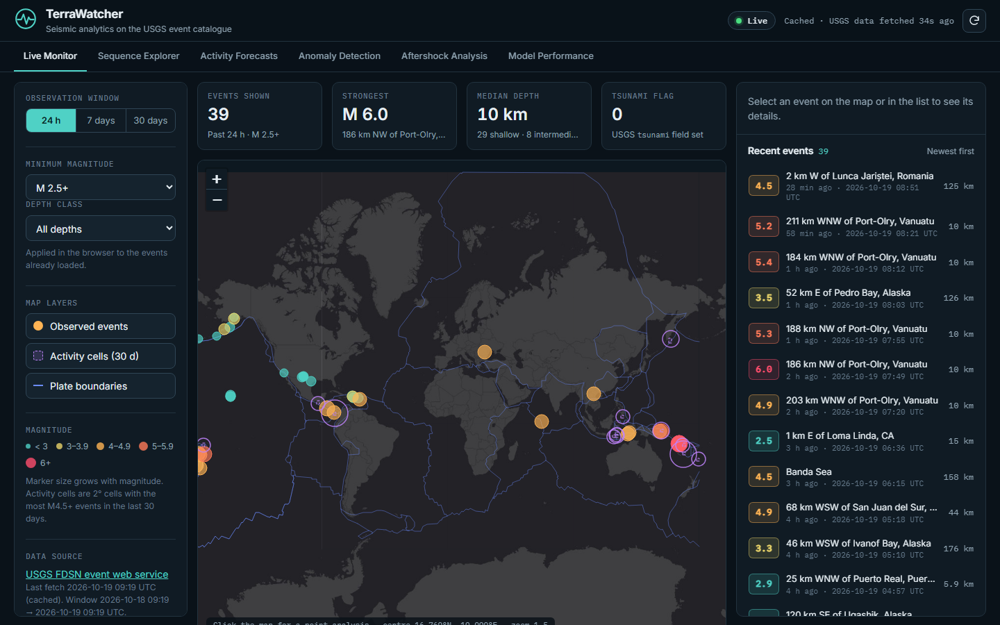
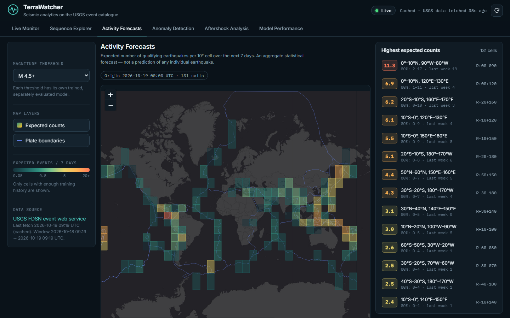
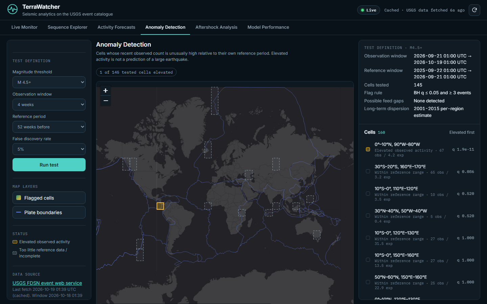
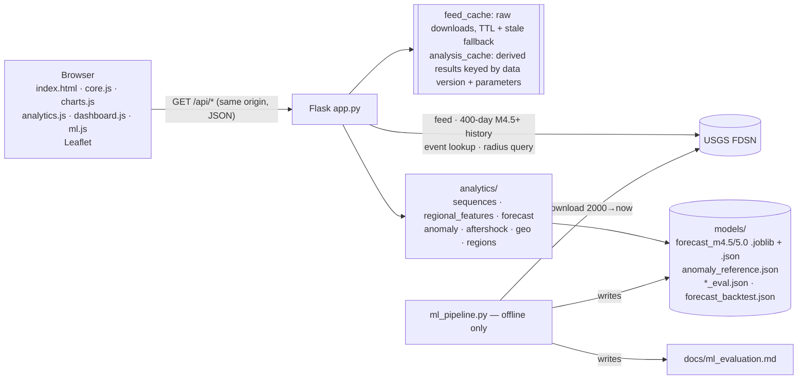

# TerraWatcher — Seismic Analytics on the USGS Earthquake Catalogue

TerraWatcher is a Flask + Leaflet application that combines live data from the public **USGS FDSN event
web service** with four evaluated analytical modules:

1. **Sequence Explorer**: unsupervised space-time clustering (DBSCAN on Earth-centred coordinates).
2. **Activity Forecasts**: seven-day regional event-count forecasts (Poisson GLM or gradient boosting with
   negative-binomial intervals), evaluated walk-forward against baselines.
3. **Anomaly Detection**: elevated observed activity per region against its own history
   (negative-binomial reference, Benjamini–Hochberg correction).
4. **Aftershock Analysis**: event-centred statistics and a modified Omori–Utsu fit, shown only when it
   passes validity checks.

A **Model Performance** view shows the evaluation results of every module, read from the generated
files. A **Live Monitor** keeps the original event feed, map and point analysis.



> **What TerraWatcher does not do.** It does not predict the time, place or magnitude of any individual
> earthquake. Forecasts are aggregate counts for 10° cells over seven days. An "elevated activity" flag
> describes what was observed, usually an ongoing sequence, and is not a warning. For alerts, use
> official agencies (USGS, national geological surveys, tsunami warning centres).

📘 **Learning guide:** [`docs/learning-guide.pdf`](docs/learning-guide.pdf) (source:
[`docs/learning-guide.md`](docs/learning-guide.md)). **Evaluation report:**
[`docs/ml_evaluation.md`](docs/ml_evaluation.md), generated from `models/*.json`.

---

## Contents

[Features](#features) · [Architecture](#architecture) · [Setup](#setup) · [Configuration](#configuration) ·
[API](#api) · [Methods](#methods) · [Evaluation results](#evaluation-results) · [Limitations](#limitations) ·
[Testing](#testing) · [Troubleshooting](#troubleshooting) · [Future work](#future-work)

## Features

| View | What it shows | Kind of output |
|---|---|---|
| **Live Monitor** | Events from the last 24 h / 7 d / 30 d, filters, statistics, freshness, plate boundaries, observed M4.5+ activity cells, event detail. | Observed data |
| **Sequence Explorer** | DBSCAN sequences of the current feed with adjustable ε (km, hours) and minimum core size. For each sequence: statistics, magnitude and depth histograms, timeline, member events, and why the events were grouped. | Unsupervised analysis |
| **Activity Forecasts** | For each 10° cell: expected M4.5+ (or M5.0+) count for the next 7 days, 80 % / 95 % intervals, P(≥ 1), baselines, inputs at the origin, the cell's test-period metrics, and observed weekly counts next to out-of-sample forecasts. | Model estimate |
| **Anomaly Detection** | Cells with elevated observed activity versus their reference period: observed vs expected, p and q values, dispersion, contributing events, explanation, data-gap status. | Statistical test on observed data |
| **Aftershock Analysis** | For a chosen reference event (from the feed, a sequence, an anomaly or a typed USGS id): timeline, cumulative count, rate on log–log axes, magnitude, depth and distance histograms, pre/post comparison, an Omori–Utsu fit with uncertainty and diagnostics (or the reasons it was rejected), and comparison of up to four sequences. | Descriptive statistics + statistical model |
| **Model Performance** | Validation vs final-test metrics, baseline comparisons, by-year stability and reliability for both forecast thresholds; synthetic clustering scores; anomaly false-alert, injection and missing-data results; Omori–Utsu results across historical sequences; the legacy classifier. | Evaluation results |

| Activity Forecasts | Anomaly Detection |
|---|---|
|  |  |

Shared behaviour:

* Every view has explicit loading, empty, error, stale and retry states.
* A newer request supersedes an older one, so a stale response never overwrites a newer view.
* A failed USGS request or missing model gives an error message. It is never turned into empty data or a fabricated result.
* The live monitor keeps working if any analytical model cannot be loaded (`/api/health` → `degraded`).

## Architecture



* **Live data.** The feed (`/api/earthquakes`, also clustered by `/api/sequences`) and a 400-day global
  M4.5+ history (forecast features and anomaly windows) are each downloaded once per cache lifetime. The
  download is single-flight: concurrent cold requests share it. A truncated history download (20 000-event
  limit) is refused, not silently used.
* **No training or refitting per request.** Forecast models are trained offline and loaded at start-up
  with schema and version checks. Anomaly tests and Omori–Utsu fits are cheap and deterministic: they are
  computed on demand and memoised under keys that include every parameter and the data version.
* **One feature definition.** `analytics/regional_features.features_at` builds the forecast inputs for
  both training (many origins) and serving (one live origin). A test checks that both paths give
  identical features.

### Repository layout

```text
app.py                      Flask routes, validation, caching, errors, security headers
config.py                   Tunables (environment-overridable)
usgs_client.py              USGS client: timeouts, retry, validation, de-duplication, event lookup, radius search
analytics/
  geo.py                    Great-circle distance, Earth-centred vectors, spherical centroid, longitude span
  catalog.py                One table-validation rule set; historical catalogue download (chunked, never gappy)
  regions.py                10° grid, region ids, neighbours (antimeridian-aware), weekly count matrices
  regional_features.py      Forecast-origin features: definitions, units, leakage contract
  sequences.py              Module A — space-time DBSCAN and sequence summaries
  forecast.py               Module B — models, NB predictive distribution, metrics, artifact loading
  forecast_training.py      Module B — dataset, validation selection, walk-forward test, served fit
  anomaly.py                Module C — NB reference, BH correction, gap detection
  aftershock.py             Module D — selection, binned statistics, Omori–Utsu MLE and diagnostics
  evaluation.py             Offline evaluation of modules A, C and D
  report.py                 Builds docs/ml_evaluation.md from models/*.json
ml_pipeline.py              CLI: download / forecast / anomaly / sequences / aftershock / all / report
models/                     Trained forecast models, evaluation results, backtests (generated, committed)
features.py, ml_model.py,   Legacy conditional severity classifier (point analysis), unchanged
train_model.py, *.pth, scaler.pkl, model_meta.json
static/core.js              Feed validation, statistics, formatting (Node-tested)
static/charts.js            Dependency-free SVG charts with labelled axes (Node-tested)
static/analytics.js         View helpers: response validation, request supersession, explanations (Node-tested)
static/dashboard.js         Live Monitor, map, shared fetch layer
static/ml.js                The five analytical views
tests/                      pytest (offline, fake USGS) + tests/frontend (node:test)
docs/                       Learning guide (+ build script), ml_evaluation.md, audit, images
```

## Setup

Prerequisites: **Python 3.12** and Git. **Node.js 18+** is needed only for the frontend unit tests. The
app needs internet access to reach `earthquake.usgs.gov`, the Esri tiles and the Leaflet CDN.

```bash
git clone https://github.com/Rase240/Real-Time-Earthquake-Monitoring-Geospatial-Analytics.git
```

```bash
cd Real-Time-Earthquake-Monitoring-Geospatial-Analytics
```

```bash
python -m venv .venv
```

Activate the virtual environment (Windows PowerShell: `.\.venv\Scripts\Activate.ps1`; Linux/macOS:
`source .venv/bin/activate`), then install the dependencies:

```bash
pip install -r requirements-dev.txt
```

`requirements-dev.txt` adds the test runner and the linter (pytest, Ruff) to the runtime dependencies in
`requirements.txt`; the app itself needs only `requirements.txt`.

Run the app and open <http://127.0.0.1:5000>:

```bash
python app.py
```

The trained models and evaluation files are committed, so no training is needed. The first visit to
Activity Forecasts or Anomaly Detection downloads about a year of global M4.5+ events (about 9 000
records, typically 5–10 s). After that it is served from memory for an hour.

### Reproducing the models and evaluations

Download the historical catalogue once (≈ 188 000 events, 2000-01-01 to the last Monday, about 10 MB,
not committed):

```bash
python ml_pipeline.py download
```

Then train and evaluate everything and rebuild `docs/ml_evaluation.md` (≈ 10 minutes on a laptop CPU):

```bash
python ml_pipeline.py all
```

Single steps: `forecast`, `anomaly`, `sequences` (synthetic scenarios; the real-catalogue split check is
skipped without a download), `aftershock` and `report`. Seeds are fixed. Repeated runs on the same
catalogue produced identical artifacts apart from timestamps. The remaining source of variation is the catalogue itself: USGS revises magnitudes and
locations over time, so a later download can change the numbers slightly. The served forecast
artifacts depend on the scikit-learn version (pinned `<1.8`). A different version is refused at load
time, not used.

## Configuration

All settings are optional environment variables. No secrets or API keys are used.

| Variable | Default | Meaning |
|---|---|---|
| `TERRAWATCHER_HOST` / `TERRAWATCHER_PORT` | `127.0.0.1` / `5000` | Bind address and port. |
| `TERRAWATCHER_DEBUG` | `0` | Flask debug mode (never on a shared network). |
| `TERRAWATCHER_LOG_LEVEL` | `INFO` | Logging level. |
| `TERRAWATCHER_USGS_URL` | `https://earthquake.usgs.gov/fdsnws/event/1` | FDSN base URL. |
| `TERRAWATCHER_USGS_TIMEOUT` / `_RETRIES` | `15` s / `1` | Per-request timeout and retries on timeout / 429 / 5xx. |
| `TERRAWATCHER_FEED_CACHE_TTL` | `60` s | Event-feed cache lifetime. |
| `TERRAWATCHER_CONTEXT_CACHE_TTL` | `600` s | 30-day context for the legacy point analysis. |
| `TERRAWATCHER_STALE_MAX_AGE` | `1800` s | Maximum age of a labelled stale copy when USGS fails. |
| `TERRAWATCHER_HISTORY_CACHE_TTL` / `_HISTORY_STALE_MAX_AGE` | `3600` / `21600` s | 400-day analytical history. |
| `TERRAWATCHER_AFTERSHOCK_CACHE_TTL` | `600` s | Event lookup and radius queries. |
| `TERRAWATCHER_MODEL_DIR` | `models/` | Location of forecast and evaluation artifacts. |

## API

All endpoints are `GET` and return JSON. Errors always look like
`{"error": "<message>", "code": "<machine code>", "status": <http status>}`, and raw exception text is never returned.

| Endpoint | Parameters (validated) | Returns |
|---|---|---|
| `/api/health` | — | Overall status, plus per-module readiness (`forecast` per threshold, `anomaly_long_term_dispersion`, `evaluations`) and cache ages. |
| `/api/earthquakes` | `days` 1–30, `min_mag` −1–10 | Observed events (≤ 2000, newest first), truncation, query window, freshness. |
| `/api/sequences` | `days`, `min_mag` as above; `eps_km` 5–500 (50), `eps_hours` 1–720 (72), `min_samples` 2–50 (4) | Sequences (id, counts, start/end, duration, magnitude and depth distributions and histograms, centroid, extent incl. antimeridian flag, linking statistics, member ids), compact events with assignments, summary, explanation, limitations. |
| `/api/forecast` | `threshold` ∈ {4.5, 5.0} | Origin, valid window, target definition, model (incl. `dispersion_curve`, `interval_method`) and test metrics, data window, and for each eligible cell: expected count, 80 % / 95 % intervals, P(≥1), baselines. |
| `/api/forecast/<region>` | `threshold`; region id like `R+30+140` | The cell's forecast, 52 observed weekly counts, input features with units and definitions, walk-forward backtest series, and the cell's test metrics. |
| `/api/anomalies` | `threshold` ∈ {4.5, 5.0}, `window_weeks` ∈ {1, 2, 4}, `reference_weeks` ∈ {26, 52}, `fdr` ∈ {0.01, 0.05, 0.1} | Observation and reference windows, data-quality block (possible gap days, dispersion source), `method_id` and method text, and for each cell: status, observed, expected, p, q, ratio, dispersion, largest event. |
| `/api/anomalies/<region>` | same | The cell's result, weekly counts (reference + observation) and contributing events. |
| `/api/aftershocks` | `event_id` (USGS id); `radius_km` 5–1000 (default: rupture-length rule); `pre_days` 0–365 (30); `post_days` 1–365 (60); `min_mag` 0–8 (4.5); `min_depth`, `max_depth` 0–800; `fit_start_hours` 0–72 (6) | Reference event, parameters, selection rules, statistics (daily, hourly, log-time bins, cumulative, histograms, pre/post test), fit (status, parameters, SE, 95 % parameter CI, parameter covariance, diagnostics, reasons/notes, curve inside the fit window), member events, data window. |
| `/api/model-performance` | — | Evaluation results of every module, read from `models/*.json`, and the legacy classifier. |
| `/api/hotspots`, `/api/predict`, `/api/model-info`, `/api/plates` | as before | Observed activity cells; legacy conditional severity score and its metadata; plate boundaries. |

Example (real response, 2026-10-19, lists shortened):

```http
GET /api/anomalies?threshold=4.5&window_weeks=4
```
```json
{
  "observation_window": {"from": "2026-09-21T08:00:00Z", "to": "2026-10-19T08:00:00Z"},
  "reference_window": {"from": "2025-09-22T08:00:00Z", "to": "2026-09-21T08:00:00Z"},
  "regions_tested": 145, "regions_elevated": 2,
  "results": [{"region": "R+00-090", "label": "0°–10°N, 90°W–80°W", "status": "elevated", "observed": 67,
               "expected": 4.154, "ratio": 16.13, "p_value": 1.671e-12, "q_value": 2.407e-10,
               "largest_event": {"id": "us6000u18k", "mag": 7.7, "place": "12 km WSW of Pitaloza Arriba, Panama"}}],
  "...": "..."
}
```

Error examples: `GET /api/forecast?threshold=4.7` gives 400 `invalid_parameter`.
`GET /api/forecast/R+35+140` gives 404 `unknown_region`. A cell without enough history gives 404
`insufficient_history`. Missing model artifacts give 503 `model_unavailable`. A failed or truncated
history download gives 503 `history_unavailable` ("No result was computed"). An unknown USGS event gives
404 `event_not_found`. `min_depth > max_depth` gives 400 `out_of_range`.

## Methods

### Data

* **Source and roles.** The USGS FDSN event service (`eventtype=earthquake`) supplies everything:
  * the live feed (any magnitude, ≤ 30 days);
  * a 400-day global M4.5+ history for forecasts and anomalies;
  * radius queries around a reference event;
  * the offline catalogue M4.5+ 2000-01-01 → 2026-10-19 (187 784 events, 82 chunks of 120 days; no
    invalid records or duplicates in this download).
* **Completeness.** M4.5 is roughly where the global catalogue is complete. Below it, coverage
  depends on regional networks. Completeness also improved over 2000–2026 and is worse right after
  large earthquakes. This is why forecasts and anomaly tests compare each cell only with its own history.
* **Validation rules** (`analytics/catalog.events_to_frame`, shared by every module):
  * Rows without finite time and valid coordinates are dropped and counted.
  * Duplicate ids keep the latest `updated` copy.
  * A missing magnitude or depth stays missing. It never becomes 0, and it never satisfies a magnitude threshold.
* **Truncation.** Queries reaching the 20 000-event limit are split (offline) or refused (history,
  aftershock fit). The feed reports `truncated` with the USGS total.
* **Gaps vs zeros.** The offline download aborts on a failed chunk instead of leaving a hole. In live
  data, a UTC day with no M4.5+ event anywhere on Earth (expected about 20 per day; none occurred in
  2000–2026) is treated as a possible feed gap. It is not treated as zero activity.
* **Time.** Every timestamp is UTC epoch milliseconds or ISO-8601 with `Z`, and every Python datetime
  is timezone-aware. Week bins are half-open `[start, start + 7 d)`.

### Module A — sequence clustering

* **Distance.** Events are mapped to Earth-centred unit vectors scaled by the chord of ε_km, and time
  is scaled by ε_hours. DBSCAN then runs with ε = 1, so two events are neighbours when
  (chord/chord(ε_km))² + (Δt/ε_h)² ≤ 1. The spatial part is exact great-circle distance at Δt = 0, and
  the antimeridian and the poles need no special cases.
* **Why DBSCAN.** It needs no cluster count, labels isolated events as noise, handles irregular shapes
  and is deterministic. Alternatives were compared on the same synthetic scenarios and on real M7.5+
  aftershock zones (see Evaluation results). None replaced the defaults:
  * smaller ε separates the synthetic overlap case but splits real aftershock sequences more often;
  * HDBSCAN separates it but absorbs or drops noise elsewhere;
  * a "possibly merged" check (HDBSCAN inside each sequence) caught every synthetic merge but also
    fired on about a third of real M7+ aftershock sequences, so it is not served.
* **What is not in the distance.** Depth and magnitude are excluded and only summarised afterwards.
* **Outputs per sequence.** A stable id (hash of the earliest member's id), counts, time span,
  magnitude and depth statistics, a spherical centroid, extent with an antimeridian-aware longitude
  span, linking statistics, and ambiguous border events (border events reachable from two sequences;
  DBSCAN assigns them to one).
* **Terminology.** Results are always called *detected sequences*, with no causal claim.

### Module B — seven-day regional count forecast

* **Target.** y(r, T) is the number of catalogue events with M ≥ m (4.5 or 5.0) and epicentre in the
  10° cell r, in [T, T + 7 d).
* **Grid.** 648 equal-angle cells. A cell is eligible if its 2001–2015 mean is ≥ 0.1 events per week
  (131 cells at M4.5, 68 at M5.0).
* **Features at origin T.** Only the weeks before T are used (`analytics/regional_features.py`):
  * counts in the last week and the week before;
  * mean weekly counts over 4, 13 and 52 weeks;
  * 13-week standard deviation;
  * the 4-week mean summed over the 8 neighbouring cells (longitude wraps);
  * the number of M ≥ 6 events in the last 4 weeks;
  * weeks since the last qualifying event (capped at 52).

  There is no imputation, because a zero week in a complete download is a real zero.
* **Leakage control.** Features read only columns before the origin. Tests change the target week and
  later weeks and check that the features are unchanged. Training-side and serving-side features are
  tested for equality.
* **Temporal design.** Weekly origins on Mondays (epoch 2000-01-03, 52-week warm-up):
  * train targets ≤ 2016-01-04;
  * validation 2016-01-04 → 2020-01-06, used for model and hyperparameter choice and the NB dispersion;
  * final test 2020-01-06 → 2026-10-19, evaluated **walk-forward**: for each year, every model is refit
    on all targets that end before that year, then predicts it.

  No shuffling. Preprocessing (log1p + standardisation for the GLM) is fitted inside each training window.
* **Candidates.**
  * Baselines: the historical regional mean (training window), and the rolling 4-week and 52-week means.
  * A Poisson GLM (L2 grid).
  * Poisson-loss gradient-boosted trees (two sizes; deterministic, no early stopping).

  Rule: the lowest validation mean Poisson deviance within each family. Trees are chosen over the GLM
  only if they are more than 1 % better (interpretability). The result: trees at M4.5 (2.3 % better on
  validation), the GLM at M5.0 (0.75 %).
* **Uncertainty.** NB2 predictive distribution, Var = μ + α(μ)μ², with α(μ) = exp(a + b·log μ) fitted by
  maximum likelihood on the validation predictions. On validation, low-mean cells were relatively more
  overdispersed (b ≈ −0.6). A 2-fold split inside validation beat one constant α at both thresholds
  (NB log score 1.0598 → 1.0386 at M4.5, 0.7226 → 0.7188 at M5.0), so the curve is used.
* **Intervals.** Counts are integers and most cells put more than 10 % of their probability on 0, so the
  old equal-tailed "80 %" interval [q₀.₁, q₀.₉] actually held 93–97 % of the predictive probability. That,
  not a wrong α, is why it covered about 95 % of test weeks. The served intervals are now the
  **shortest** integer intervals holding at least the nominal probability. Their test coverage is
  reported next to the *model-implied* coverage (the probability the forecast gives its own interval):
  calibration means the two agree, not that coverage equals 80 %.
* **Served model.** The selected configuration is refit on every available week. Its expected quality is
  the walk-forward test result.

### Module C — anomaly detection

For each cell (threshold 4.5 or 5.0) the observed count y in the last k weeks (1/2/4) is compared with
the preceding n weeks (26/52) of the same cell:

* weekly counts are modelled as independent NB2 with an unknown mean μ and dispersion α;
* α is the larger of the reference-window method-of-moments estimate and the cell's 2001–2015
  maximum-likelihood dispersion (`models/anomaly_reference.json`);
* the one-sided p-value is conditional on the total N of both windows: y given N is
  BetaBinomial(N, k/α, n/α), or Binomial(N, k/(n+k)) when α = 0. Conditioning removes the unknown mean
  exactly, so no estimate of μ enters the p-value;
* `expected` (kμ̂) and `reference_sd` (√(k·w + k²·w/n), w = μ̂ + αμ̂²) are reported for context.

Benjamini–Hochberg q-values are computed across all tested cells. A cell is **elevated** when q ≤ FDR
and at least 3 events were observed. Other statuses:

* `not_elevated`;
* `insufficient_reference`: fewer than 5 reference events;
* `data_incomplete`: possible feed gaps, so a normal-looking count is not confirmed as normal.

Only excess activity is tested. The design came from the null simulation:

* With the reference window alone, 35 % of null runs produced at least one false alert.
* The plug-in NB (estimated mean, 2001–2015 moment-dispersion floor) still gave 13.65 %.
* Given the true dispersion but the estimated mean, 11.3 % of runs still had a false alert. The
  estimated mean was the main cause, because quiet reference windows underestimate μ. Conditioning
  removes μ.
* The moment floor (median α 4.4 over the 140 simulated cells, dominated by single megathrust
  sequences) left almost no power. The MLE floor (median 2.4) restores some, and the conditional test
  keeps the false alerts down.

Five alternatives were compared on the same null runs and injection trials: an empirical null at the
95th and 99th percentiles, the MLE floor with and without conditioning, and conditioning with the old
floor (details in [docs/learning-guide.md](docs/learning-guide.md) §8.5). Declustering was not
evaluated, because it would remove the aftershock sequences this module mainly finds.

Isolation Forest was not used: sparse, overdispersed counts need a count model with an explicit
reference, and its scores would not be interpretable as p-values.

**What "FDR 0.05" does and does not mean.** The test holds its level when weekly counts follow its NB
model with a dispersion no larger than the one it uses: with the simulated dispersion capped at each
cell's floor, 1.7 % of null runs had a false alert. The excess in the full null (5.6–7.65 % across
independent random streams) comes from the 64 of 140 cells whose 2016–2019 dispersion exceeded their
2001–2015 floor, usually because a large sequence struck a cell that had been quieter. Real weekly
counts are burstier than any NB: when real 2016–2019 weeks are resampled at random, the detector fires
in about 40 % of runs, because a resampled sequence week landing in the window is exactly what it is
built to flag. So the FDR level is a property of the model, not a real-world false-alarm rate. Raising
the dispersion floor (the moment floor) lowers simulated false alerts to 3.5–4.9 % but more than halves
detection, so the MLE floor was kept. A discrete (Tarone-type) multiplicity filter was also checked; no
tested cell was unable to reach significance, so it would change nothing.

### Module D — aftershock analysis

* **Selection rules** (deterministic):
  * great-circle distance ≤ radius (default: Wells & Coppersmith 1994 rupture length, clipped to 30–1000 km);
  * magnitude ≥ the threshold;
  * optional depth limits;
  * a pre window and a post window;
  * the reference event itself is excluded.

  Nearby events are not assumed to be caused by the reference event.
* **Model.** λ(t) = μ + K/(t + c)^p, with μ fixed to the pre-event rate. K, c and p are estimated by
  inhomogeneous-Poisson MLE (L-BFGS-B, nine starts) after the first `fit_start_hours`, because
  catalogues miss early aftershocks. If c is shorter than the data can resolve, it is fixed at its bound
  and only K and p are estimated, and the UI says so.
* **When a fit is attempted and shown.** It needs at least 20 events. It is shown only if all of
  these hold:
  * the optimiser converged;
  * no parameter is at a bound;
  * the Hessian is positive definite (standard errors and 95 % CIs exist);
  * the transformed-time KS test gives p ≥ 0.05;
  * ΔAIC ≥ 2 against a constant-rate model.

  Otherwise the observed data are shown with the reasons. The fitted curve is drawn only inside the fit
  window, with no extrapolation.
* **Parameter vs predictive uncertainty.** The 95 % intervals shown for K, c and p are Wald confidence
  intervals for the *parameters* (from the inverse Hessian, also returned as `covariance`). They are not
  prediction intervals for future counts, which must add count variability and are much wider.
  Predictive intervals were evaluated offline only (`analytics.aftershock.predictive_count`) and are not
  shown in the app (see Evaluation results).

## Evaluation results

All numbers below are from `models/*.json` (generated 2026-10-19 by `python ml_pipeline.py all`, data
to 2026-10-19). Full tables: [`docs/ml_evaluation.md`](docs/ml_evaluation.md).

**Forecast, M4.5, final test 2020-01-06 → 2026-10-19 (walk-forward, 46 374 cell-weeks):**

| Model | MAE | RMSE | Mean Poisson deviance | NB log score | 80 % cov. | 95 % cov. |
|---|---:|---:|---:|---:|---:|---:|
| **Gradient boosting (selected)** | **0.933** | 4.644 | **1.985** | **1.065** | 0.889 | 0.977 |
| Poisson GLM | 0.963 | **4.609** | 2.027 | 1.079 | 0.888 | 0.978 |
| Historical mean | 0.966 | 4.787 | 2.304 | 1.100 | 0.876 | 0.972 |
| Rolling 52-week mean | 0.971 | 4.765 | 2.175 | 1.090 | 0.883 | 0.972 |
| Rolling 4-week mean | 1.003 | 5.019 | 4.030 | 1.917 | 0.850 | 0.921 |

* The selected model has 13.9 % lower deviance than the historical mean (95 % interval from resampling
  whole weeks: 10.3–17.3 %) and 8.7 % lower than the 52-week mean (6.5–10.9 %).
* It is better than the historical mean in every test year.
* The MAE gain is small (0.933 vs 0.966).
* By cell it is mixed: it beats the historical mean in 67 of 131 cells and the 52-week mean in 94. The
  gain grows with activity (deviance skill vs historical mean +3 % in the least active third of cells,
  +19 % in the most active). Per-cell skill is noisy and not a ranking.

**Forecast, M5.0 (24 072 cell-weeks):**

* The selected Poisson GLM has deviance 1.310 against 1.402 for the historical mean (6.6 % better,
  interval 2.9–9.9 %), and a better NB log score (0.736 vs 0.743).
* Its **MAE is slightly worse** (0.553 vs 0.546 for the historical mean and 0.530 for the 52-week mean).
  The mean minimises deviance, not MAE, so this is expected for skewed counts.
* It beats the historical mean in only **24 of 68 cells**: the aggregate gain at M5.0 comes from a minority
  of active cells.
* Trees, not selected on validation, were 1.5 % better on test (interval −3.1 to +0.2 %). This was not
  used to change the selection.

**Intervals (test, selected model):**

| Threshold | Construction | Empirical 80 % coverage | Model-implied | Mean width (events) |
|---|---|---:|---:|---:|
| M4.5 | equal-tailed, one α (previous) | 0.958 | 0.942 | 2.86 |
| M4.5 | shortest, α(μ) (served) | 0.889 | 0.863 | 1.61 |
| M5.0 | equal-tailed, one α (previous) | 0.966 | 0.950 | 1.51 |
| M5.0 | shortest, α(μ) (served) | 0.889 | 0.869 | 0.60 |

The served 80 % intervals are 44 % (M4.5) and 60 % (M5.0) narrower. They still cover a little more than
they claim (0.889 vs 0.863–0.869), and the randomised PIT has too few weeks in its top decile (0.077–0.079
instead of 0.100): the predictive upper tail is still slightly too heavy. The test NB log score
improved at both thresholds (1.091 → 1.065 and 0.740 → 0.736).

**Features.** Three origin-time features were tried on validation only: an Omori-weighted (1/lag) sum of
the last 52 weekly counts, the largest week in 52, and the 52-week neighbour mean. The rule, fixed
before the run, was to adopt them only if the selected family improved validation deviance by more than
1 % in both halves of the validation period. They improved it by 0.67 % (M4.5) and 0.68 % (M5.0), so they
were not added.

**Sequence clustering (synthetic, 5 seeds; the labels are synthetic, not real events):**

* ARI 1.000 for dense clusters with noise, simultaneous separated clusters, same place at different
  times, antimeridian, high latitude (85°–89.9°), and duplicates/invalid rows (4 invalid and 10
  duplicates removed).
* Plain Euclidean distance on degrees scores ARI 0.814 at the antimeridian and 0.474 at high latitude.
  Ignoring time scores 0 on same place, different times.
* **Two overlapping sequences 60 km apart merge** at the default ε = 50 km (ARI 0). They separate only
  at ε ≈ 15 km (ARI 0.82).
* **Alternatives** (10 seeds, 12 scenarios incl. overlaps at 30–150 km and a dense/sparse pair): mean ARI
  0.817 for the default, 0.844 for ε 25 km, 0.824 for 72→24 h, 0.778 for ε 15 km, 0.785/0.766 for HDBSCAN.
  The rule fixed before the comparison (higher mean ARI, no scenario more than 0.02 worse) was passed by
  ε 25 km and by 24 h. Because the synthetic clusters are compact, both were then checked on 99 real
  M7.5+ aftershock zones (added after seeing the synthetic result): the share of mainshocks with less
  than half of their 30-day zone events in their own sequence rose from 8 % (default) to 25 % (ε 25 km)
  and 17 % (24 h). They split real sequences more often, so the defaults stay.
* At 30 km and 30 h apart, no method separated the two sequences; catalogue locations and times alone
  cannot always resolve them.

**Anomaly detection:**

* **Null simulation** (2 000 runs × 140 cells, stationary NB counts from 2016–2019, M4.5, 4-week window):
  * 5.6 % of runs had at least one false alert (95 % CI 4.7–6.7 %; nominal 5 %), against 13.65 % for
    the previous plug-in test. An independent random stream of the same null gave 7.65 % (6.6–8.9 %), so
    the realistic figure is about 6–7 %, not 5.6 %.
  * The false-alert rate per cell test was 0.046 %. The rolling 2× rule's was 10.2 %.
  * Across all 12 threshold/window/reference settings the rate is below the previous test's. It is above
    5 % in 7 of them, and in 4 (all M4.5) the whole 95 % interval is above 5 % (worst 8.1 %, 6.6–10.0 %,
    with a 4-week window and 26-week reference).
  * Cause (separate stream, 2 000 runs per null): with each cell's simulated dispersion capped at its
    2001–2015 floor the rate is 1.7 %, and with the true dispersion 1.8 %. The test is calibrated when
    its dispersion is right; the excess comes from cells whose dispersion rose after 2015.
* **Injected excess** (every unflagged cell of each of the 88 held-out windows, 12 592 trials per
  factor):
  * detection after BH was 0.1 %, 0.4 %, 3.3 % and 15.1 % at +0.5×, +1×, +2× and +4× the expected count
    (previous test: 1.6 % at +2× and 9.1 % at +4×);
  * for comparison, unadjusted p ≤ 0.05 reached 60 % at +4× and the rolling rule 91 %.
  * The low overall rate is mostly a sparse-count effect: at +4×, detection is 0.4 % in cells expecting
    under 1 event per window and 2.4 % at 1–2 events (63 % of trials together), but 16 % at 2–5, 57 % at
    5–10 and 63 % at 10 or more.
  * The detector is conservative and flags only strong excesses.
* **Held-out 2020–2026, M4.5, 4-week windows:** 80 flags in 88 runs (previous test: 70). There is no
  ground truth, so more flags is not evidence of better detection.
* **Missing data:** removing 3 days was always detected by the gap check.

**Omori–Utsu (USGS M ≥ 7.0 2001–2026, M4.5+ events in the rupture-length radius):**

* 356 sequences analysed; 90-day fits: 103 fitted, 43 unreliable, 210 insufficient data. Median p of
  reliable fits 1.32 (IQR 1.09–1.62).
* Out of sample (fit days 0.25–30, predict days 30–90, 103 sequences), median |log ratio| was 0.41
  for Omori–Utsu, 0.94 for the last-week rate and 1.25 for the background rate alone.
* The Poisson 95 % coverage was only 0.58. The prediction is unbiased (median signed log ratio +0.02),
  so the intervals were too narrow, for two reasons:
  * parameter uncertainty: propagating the fit's covariance lifts 80 %/95 % coverage to 0.67/0.82;
  * extra-Poisson variability (secondary aftershocks, misspecification), which grows with sequence size:
    with parameter uncertainty alone, sequences with ≥ 150 fit events were covered only 41 %/55 %.
* Adding a negative-binomial count stage, with its dispersion (d = 0.19) fitted only on mainshocks before
  2013, gave **0.81 (0.68–0.90) / 0.91 (0.80–0.97)** coverage on the 47 later mainshocks, out of sample.
  The price is width: the median 95 % interval spans 34 events, upper bound about 12× the lower.
* These predictive intervals are evaluated offline only. The app shows fitted decay of past data, never
  a forecast of future aftershocks.

**Legacy classifier** (point analysis, unchanged): test ROC-AUC 0.570 against 0.500 for the base rate.
It is exploratory.

## Limitations

* Forecasts are cell-level aggregates. Most of their skill is persistence of ongoing sequences, and they
  cannot anticipate a sequence that has not started. The dispersion depends on the predicted mean but
  not on the cell, so intervals are still miscalibrated in some cells, and they remain slightly too wide
  overall. At M5.0 the model beats the historical mean in only a third of cells.
* Cells are equal-angle (smaller near the poles). Catalogue completeness differs by region and over time.
* Live forecast features use the USGS feed up to the start of the current UTC day. Events posted late
  lower the most recent count.
* DBSCAN uses one density threshold everywhere, merges sequences that overlap within tens of km and about
  a day, and cuts sequences at the window edges. No tested alternative fixed the merges without splitting
  real sequences. There is no ground truth for real sequences.
* The anomaly test is conservative (15 % detection at +4× the expected count, near zero where a cell
  expects under 2 events). Its run-level false-alert rate under the NB null is about 6–7 % at the default
  setting and up to 8.1 % with a 26-week reference, from cells whose dispersion rose after 2015. Under
  resampled real weeks it fires far more often, so "FDR 0.05" is not a real-world false-alarm rate. It
  flags sequences after large earthquakes, by design. It does not test for quiescence.
* Omori–Utsu fits at M4.5+ see few events per sequence. The default radius is a heuristic, and
  overlapping sequences and the exclusion of complex sequences bias the historical evaluation. Calibrated
  30→90-day predictive intervals exist only offline, for M7+ mainshocks at M4.5+; they were not validated
  for other magnitudes, radii or horizons, so the app does not show forecasts.
* Caches are per process (single-process development server). The analytical history is a ~9 000-event
  in-memory table.

## Testing

```bash
python -m pytest -q
```

```bash
node --test "tests/frontend/*.test.js"
```

* **Offline.** pytest never contacts USGS: `tests/conftest.py` injects a fake transport, with per-query
  handlers for the event lookup and the radius search.
* **Backend coverage** (217 tests):
  * USGS parsing, retries and failures;
  * geometry: antimeridian, poles, centroid, longitude span;
  * the region grid and week-bin boundaries;
  * feature definitions against hand calculations, no look-ahead, and training/serving equality;
  * dispersion MLE and dispersion-curve recovery; shortest intervals checked by brute force; model-implied
    coverage, randomised PIT and the week-bootstrap skill interval;
  * a full walk-forward training run on synthetic data, checking period ordering per fold;
  * artifact loading and refusal of incompatible artifacts;
  * DBSCAN edge cases (antimeridian, high latitude, time separation, ambiguous border events, missing
    magnitudes, stable ids);
  * Benjamini–Hochberg values, the conditional test (exact against the NB convolution, level held for
    any mean, accurate far in the upper tail), consistency of every reported row field (expected,
    dispersion, p, q, status), dispersion MLE robustness, insufficient reference, gap handling, Wilson
    intervals against SciPy, reproducible null simulation, injection strata, artifact/method agreement;
  * Omori–Utsu parameter recovery on simulated sequences, insufficient data, rejection of constant-rate
    data, covariance vs standard errors, predictive counts (Poisson limit, widening with parameter and
    count uncertainty, determinism) and recovery of the count dispersion;
  * the contract of every endpoint, including error codes, caching, truncation and model-unavailable behaviour.
* **Frontend coverage** (26 tests): feed validation and statistics, validation of every analytical
  response, superseded requests, sequence-layer highlighting, explanation texts, comparison rules, and
  SVG chart output (accessibility, empty states, log axes).

### Verification performed (2026-10-19, Windows 11, Python 3.12.10, Node 24.18)

| Check | Result |
|---|---|
| `python -m pytest -q` | 217 passed |
| `node --test "tests/frontend/*.test.js"` | 26 passed |
| `ruff check .` (ruff 0.17.1, now pinned in `requirements-dev.txt`; config in `ruff.toml`) | no findings |
| `pip-audit --path .venv/Lib/site-packages` (pip-audit in a separate throwaway venv) | no known vulnerabilities in the project's dependencies; 6 advisories in the venv's own installer, pip 25.0.1 (fixed in pip ≥ 26.2; upgrade with `python -m pip install --upgrade pip`) |
| `python docs/build_guide.py` | all source excerpts verified verbatim; PDF rebuilt |
| Reproduction before changes | all five committed `models/*.json` reproduced exactly from the code and catalogue |
| `python ml_pipeline.py all` after the changes, run twice | identical artifacts apart from timestamps; forecast `.joblib` files and `anomaly_reference.json` unchanged from before |
| Live server against real USGS | 131 forecasts (M4.5) with the new intervals, 144 cells tested (2 elevated), 60 sequences in 30 days of M2.5+ |
| Browser (in-app Chromium, desktop size) | Model Performance renders every new block (skill intervals, model-implied coverage, false-alert diagnosis, clustering alternatives, aftershock predictive coverage) without console errors; Sequence Explorer runs on the live feed. |

Not re-verified after these changes: the mobile layout, the empty-model-directory states, the anomaly →
aftershock hand-offs, and the screenshots in `docs/images/` (taken before; the views they show have not
changed visually except the Model Performance tables). Also not verified: sustained USGS rate limiting
(simulated only), memory under long uptime, browsers other than Chromium, and screen-reader behaviour
beyond ARIA roles and labels. Known display bug: the "Test deviance by year" chart labels its year
axis "2k" instead of the year.

## Troubleshooting

| Symptom | Fix |
|---|---|
| "Forecast unavailable: … Missing forecast artifact" | Run `python ml_pipeline.py download`, then `python ml_pipeline.py forecast`. `/api/health` → `modules` shows the reason. |
| "trained with scikit-learn X, running Y" | Install from `requirements.txt`, or retrain. |
| "Historical USGS data could not be loaded" | USGS is unreachable or slow (the history query can take > 15 s). The app retries on the next request; raise `TERRAWATCHER_USGS_TIMEOUT` if needed. |
| A new view looks broken after an update | Static files are versioned by modification time, so a normal reload is enough. |
| Blank map, lists work | The Leaflet CDN or the Esri tiles are blocked. |
| Port in use | `TERRAWATCHER_PORT=5001`. |

## Future work

* Rate-based (per-area) comparisons, and an equal-area grid or tectonic regionalisation.
* Per-cell (or tectonic-regime) dispersion: the mean-dependent α(μ) improved calibration overall, but
  coverage still varies by cell.
* Serving aftershock predictive intervals only after validating them for other magnitudes, radii and
  horizons than the offline M7+ / 30→90-day setting.
* ETAS modelling (space-time branching) instead of separate DBSCAN and Omori–Utsu steps.
* Declustering before anomaly testing, to separate background-rate changes from aftershock sequences.
* Magnitude-of-completeness estimation (e.g. maximum curvature) per region and time.
* A shared cache (e.g. Redis) and a production WSGI server for multi-process deployment.

---

Data: USGS Earthquake Hazards Program (public domain). Tiles © Esri. Plate boundaries: Mueller et al. (1987),
as bundled in `data/tectonic_plates.geojson`. The repository has no license file; add one before reuse.
