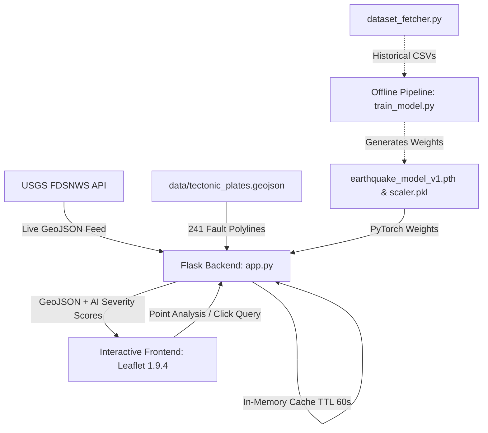

# 🌐 Real-Time Earthquake Monitoring & Geospatial Analytics

[](https://www.python.org/)
[](https://pytorch.org/)
[](https://flask.palletsprojects.com/)
[](https://leafletjs.com/)
[](https://github.com/Rase240/Real-Time-Earthquake-Monitoring-Geospatial-Analytics)
[](LICENSE)

A modern, high-performance geospatial intelligence platform that aggregates live seismic activity from the USGS FDSNWS service, computes spherical distances to 241 global tectonic plate boundaries, and evaluates conditional seismic risk using a deep neural network.

---

## 🚀 Key Features

* 📡 **Live USGS Seismic Feed**: Real-time streaming of global earthquake events with interactive magnitude, timeframe, and depth filters.
* 🗺️ **Tectonic Fault Analysis**: Overlays 241 global plate boundary segments with antimeridian-safe ($180^\circ / -180^\circ$) distance computation.
* 🤖 **Spatial Hazard Neural Network**: Multi-layer Perceptron (PyTorch) estimating conditional earthquake severity ($M \ge 5.0$) based on coordinates, depth, fault proximity, and recent 30-day seismic clustering.
* ⚡ **Optimized Cartography**: High-performance Leaflet 1.9.4 map using ESRI World Dark Gray Canvas tiles with idle caching, strict bounding limits, and zero watermark overlays.
* 🛡️ **Production-Grade Resilience**: Decoupled offline model training pipeline, robust input sanitization (NaN/Infinity validation), in-memory caching to respect upstream rate limits, and 100% automated test coverage.

---

## 🏗️ Architecture & System Design



### Tech Stack
* **Frontend**: Vanilla HTML5 / Modern CSS3 (glassmorphic dark UI, DM Mono & Manrope typography), Leaflet 1.9.4, ESRI Dark Gray Canvas tiles.
* **Backend**: Python 3.12, Flask 3.1 (REST API, input validation, in-memory query cache).
* **Machine Learning**: PyTorch 2.5.1 (sequential MLP classifier with BatchNorm1d), Scikit-Learn 1.7.2 (`StandardScaler`), Joblib.
* **Geospatial Processing**: Vectorized NumPy & Pandas for spherical distance and local density clustering.
* **Testing**: Pytest automated regression suite with mocked network services.

---

## 📂 Project Structure

```text
Real-Time-Earthquake-Monitoring-Geospatial-Analytics/
├── app.py                     # Flask web server, caching & REST API endpoints
├── train_model.py             # Standalone offline PyTorch model training pipeline
├── dataset_fetcher.py         # Offline historical dataset download utility
├── earthquake_model_v1.pth    # Serialized PyTorch neural network weights
├── scaler.pkl                 # StandardScaler feature normalizer artifact
├── requirements.txt           # Pinned production dependencies (UTF-8)
├── pytest.ini                 # Pytest configuration and warning filters
├── data/
│   └── tectonic_plates.geojson # 241 global tectonic fault lines
├── static/
│   ├── dashboard.js           # Client state, Leaflet rendering & KPI logic
│   └── dashboard.css          # Glassmorphic dark-theme styling
├── templates/
│   └── index.html             # Seismic Intelligence dashboard template
└── tests/
    └── test_application.py    # 19-test automated regression suite
```

---

## ⚙️ Installation & Setup

### 1️⃣ Clone Repository
```bash
git clone https://github.com/Rase240/Real-Time-Earthquake-Monitoring-Geospatial-Analytics.git
cd Real-Time-Earthquake-Monitoring-Geospatial-Analytics
```

### 2️⃣ Create Virtual Environment
```bash
# On Windows
python -m venv .venv
.\.venv\Scripts\activate

# On Linux / macOS
python3 -m venv .venv
source .venv/bin/activate
```

### 3️⃣ Install Dependencies
```bash
pip install -r requirements.txt
```

### 4️⃣ Run Automated Regression Tests
```bash
pytest -v
```

### 5️⃣ Launch the Application
```bash
python app.py
```
Open [http://127.0.0.1:5000](http://127.0.0.1:5000) in your web browser.

#### Optional Environment Variables
* `FLASK_PORT=5000` — Custom listener port (default: `5000`).
* `FLASK_HOST=127.0.0.1` — Network binding host (default: `127.0.0.1`).
* `FLASK_DEBUG=0` — Toggle development debug mode.

---

## 🧠 Machine Learning & Seismology Context

### What the Model Does
The neural network evaluates 5 spatial features:
1. `latitude` & `longitude`: Epicenter geographic coordinates.
2. `depth`: Event focal depth in kilometers.
3. `local_density`: Number of recorded seismic events within a $1.0^\circ$ radius over the past 30 days.
4. `plate_distance`: Minimum angular distance (in degrees) to the nearest tectonic fault line, calculated with longitudinal modular wraparound.

### Prediction Target & Gutenberg-Richter Law
The model predicts **conditional rupture severity**:
$$P(\text{Magnitude} \ge 5.0 \mid \text{event occurs at } (lat, lon, depth, density, dist))$$

Because earthquake frequency follows an exponential power law (Gutenberg-Richter relation with $b \approx 1.0$), significant earthquakes ($M \ge 5.0$) represent roughly $5\% - 15\%$ of all detectable seismic events. The model reflects this empirical base rate: high-activity subduction zones (e.g., Tonga, Japan Trench) score significantly higher than stable intraplate cratons.

> **Scientific Notice:** This application does not predict deterministic earthquake timing. Modern seismological science cannot predict the exact day or hour of an earthquake. This system is designed for **spatial risk classification, observational visualization, and historical pattern analysis**.

---

## 📡 REST API Reference

| Endpoint | Method | Parameters | Description |
| :--- | :---: | :--- | :--- |
| `/` | `GET` | None | Renders the primary Seismic Intelligence dashboard. |
| `/api/earthquakes` | `GET` | `days` (1–365), `min_mag` (-2.0–10.0) | Fetches live events from USGS, computes depths, and adds model severity grades. |
| `/api/predict` | `GET` | `lat`, `lon` (or `lng`), `depth` (optional) | Calculates fault distance, queries recent cluster density, and outputs neural network risk. |
| `/api/hotspots` | `GET` | None | Returns 7 active tectonic reference zones with real-time model risk scores. |
| `/api/model-info` | `GET` | None | Returns neural network architecture, features, execution device, and status. |

---

## 🧪 Testing & Verification

The project includes an end-to-end regression test suite in `tests/test_application.py`:
- **Model Integrity**: Verifies weights, feature scaler compatibility, and `eval()` mode.
- **Geospatial Math**: Validates antimeridian wraparound distance ($\approx 0.2^\circ$ across $\pm 180^\circ$) and polar boundary clamping ($[-90, 90]$).
- **API Contracts**: Verifies schema compliance, input sanitization, 2D/3D coordinate parsing, and graceful error handling (HTTP 400/502/504).
- **Plate Geometry**: Asserts successful parsing of all 241 global plate boundary segments.

```bash
# Run the test suite with coverage report
pytest --tb=short
```

---

## 📄 License

This project is licensed under the MIT License — see the [LICENSE](LICENSE) file for details.
