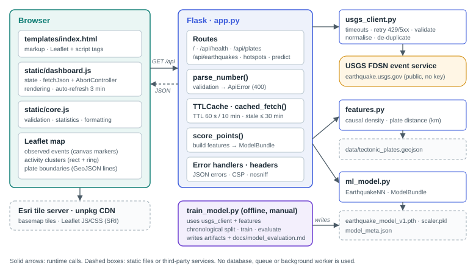
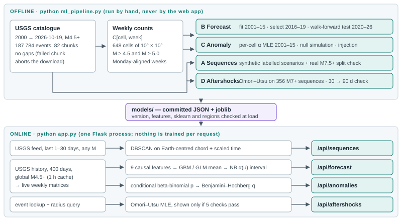
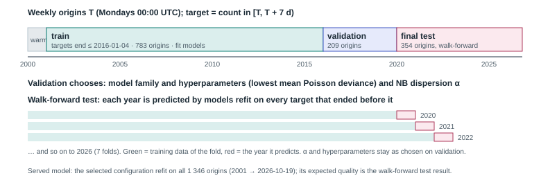

<!--
  TerraWatcher interview-preparation guide (Markdown source).
  Build the PDF with:  python docs/build_guide.py
  Code blocks preceded by an HTML comment of the form "src: <path>" are verified against that file
  at build time; a line containing only "..." inside such a block marks omitted lines.
  Every number is taken from models/*.json, model_meta.json, data/history_catalog.json or a live API
  response (dated where it is live). Proposed work is labelled "Future work".
-->

# 1 Quick revision sheet

<div class="sheet" markdown="1">

**One line.** TerraWatcher is a Flask + Leaflet dashboard on live USGS earthquake data with four evaluated
analytical modules: space-time clustering, 7-day regional count forecasts, an elevated-activity test and
Omori–Utsu aftershock fits. It does **not** predict individual earthquakes.

**Three kinds of output.** *Observed* (USGS events) · *statistical findings* (clusters, anomaly flags:
deterministic given data + parameters) · *model estimates* (forecast counts with intervals; legacy score).

**B · Forecast.** Target y = count of M ≥ 4.5 (or 5.0) events in a 10° cell over [T, T+7 d). 9 causal
features from weekly counts before T. Candidates: 3 baselines, Poisson GLM, Poisson GBM; lowest
*validation* Poisson deviance wins, GBM only if > 1 % better. Split: train 2001–2015, validation
2016–2019, test 2020-01-06 → 2026-10-19 walk-forward with yearly refits.
**M4.5 (GBM):** deviance skill vs historical mean **+13.9 %** (95 % CI 10.3–17.3, week bootstrap), better
in every test year, in 67 of 131 cells. **M5.0 (GLM):** +6.6 % (2.9–9.9), MAE slightly worse.
Uncertainty: NB2 with α(μ) = exp(a + b log μ) fitted on validation; **shortest integer intervals**.
80 % coverage 0.958 → **0.889** (model-implied 0.863), width 2.86 → 1.61 events.

**C · Anomaly.** Per cell: window count y (k weeks) vs reference total X (n weeks). Conditional test
Y | X+Y ~ BetaBinomial(N, k/α, n/α) removes the unknown mean; α ≥ per-cell 2001–2015 MLE; BH FDR 5 %;
elevated if q ≤ 0.05 and y ≥ 3. **Null runs with any false alert 0.056** (CI 0.047–0.067; 0.0765 on an
independent stream) vs 0.1365 before. Held-out detection of +4× excess **0.151** (was 0.091); 0.4 %
when < 1 event expected, 63 % at ≥ 10. Real counts are burstier than NB: FDR is a model property.

**D · Aftershocks.** λ(t) = μ + K/(t+c)<sup>p</sup>, MLE from 9 starts, fit from 6 h. Shown only if ≥ 20
events, converged, no bound hit, Hessian PD, KS p ≥ 0.05, ΔAIC ≥ 2. 356 M7+ sequences: 103 reliable,
median p 1.32. 30 → 90-day count error 0.41 vs 0.94 (last-week rate). Interval coverage (80/95 %,
2013+): Poisson 0.51/0.62 → +parameter uncertainty 0.68/0.83 → +NB stage (d = 0.19, fitted pre-2013)
**0.81/0.91**. Evaluated offline; the app never extrapolates.

**A · Clustering.** DBSCAN (ε = 50 km, 72 h, min 4) on Earth-centred chord + scaled time: no
antimeridian or pole errors. Synthetic ARI 1.0 on 6 of 7 scenarios; overlapping sequences 60 km apart
merge (ARI 0). 25 km and 24 h passed the synthetic rule but split real M7.5+ zones more often (25 % /
17 % vs 8 %); HDBSCAN failed it: default kept. "Possibly merged" flag rejected (fired on
30 % of real M7+ sequences).

**Data and failure.** USGS FDSN only. 15 s timeout, 1 retry (timeout, connection, 429, 5xx); 400 never
retried. Invalid records dropped and counted, never guessed. TTL cache (feed 60 s, history 1 h),
single-flight per key; on failure a labelled stale copy (≤ 30 min, history ≤ 6 h) or an error; never
fabricated data. Missing models → 503 + `/api/health` degraded; live map keeps working.

**Quality.** 217 pytest + 27 Node tests, Ruff clean, pip-audit clean (2026-10-19). Leakage tests:
changing future weeks leaves features unchanged; training and serving features bit-identical.

**Weakest points.** Retrospective evaluation only; skill mostly from persistence of ongoing sequences;
anomaly test misses moderate excesses; per-cell dispersion not modelled in forecasts; dev server, no
rate limiting.

**Next.** ETAS model, per-cell dispersion, declustered background-rate test, prospective log of frozen
forecasts, spatial-block validation.

</div>

# 2 Telling the story {: .pb }

## 2.1 The 30-second version

"TerraWatcher is an earthquake analytics dashboard I built in Python and JavaScript on the live USGS
catalogue. Besides the live map it has four analytical modules: it groups events into sequences, forecasts
the number of earthquakes per region for the next week, flags regions with unusually high activity and
fits aftershock decay curves. What I focused on is evaluation: chronological splits, baselines, calibrated
uncertainty and honest failure states. For example, the weekly forecast beats the historical average by
about 14 % in Poisson deviance on six held-out years, and I can tell you exactly where it doesn't work."

## 2.2 The two-minute version

"The backend is one Flask process. A client module talks to the USGS FDSN service with timeouts,
retries and validation; invalid records are dropped and counted, never guessed. Results are cached with
a single-flight lock, and if USGS fails the app serves a clearly labelled stale copy or an error.

The ML runs offline from a 26-year catalogue of 188 000 M4.5+ events. The forecast predicts weekly
counts in 10-degree cells. Features are lagged counts and trailing means computed strictly before the
forecast origin, and two tests prove there is no look-ahead. I trained on 2001–2015, chose the model on
2016–2019 and tested walk-forward on 2020–2026 with yearly refits. A Poisson gradient-boosting model
reduced deviance by 13.9 % against the historical mean, with a bootstrap interval of 10 to 17 %. I also
found that my 80 % intervals were covering 96 % of weeks: with integer counts the equal-tailed
interval held far more than 80 % probability. Switching to the shortest integer interval and a
mean-dependent dispersion made them 44 % narrower and correctly calibrated.

The anomaly detector is a conditional beta-binomial test with Benjamini–Hochberg control, and I
measured its false-alert rate by simulation and its power by injecting synthetic excesses. The aftershock
module fits Omori–Utsu by maximum likelihood and only shows a curve that passes goodness-of-fit checks.
Every module documents what it cannot do; none of it predicts individual earthquakes."

## 2.3 The five-minute walk-through (order and figure)

1. **Problem and outputs** (§3.1): observed vs finding vs estimate.
2. **Architecture** (Figure 1, Figure 2): one process, offline training, committed artifacts.
3. **Data reliability** (§4): validation, caching, stale semantics, error contract.
4. **Forecast** (§5): target, causal features, temporal split, baselines, the interval story.
5. **Anomaly** (§6): why conditioning, what the simulations showed, power by expected count.
6. **What I rejected** (§12): clustering alternatives, the merged-sequence flag, extra features.
7. **Limits and next steps** (§14).

# 3 System architecture and data flow {: .pb }

## 3.1 Problem statement and what each module answers

Raw catalogues are hard to read and easy to over-interpret. TerraWatcher turns the USGS feed into an
explorable map and adds four analyses, each with a precise question and an explicit kind of output:

| Module | Question | Method | Output kind | Time direction |
|---|---|---|---|---|
| A Sequences | Which recent events belong together in space and time? | DBSCAN (unsupervised) | Statistical grouping | Retrospective |
| B Forecast | How many M ≥ 4.5 / 5.0 events will a 10° cell record in the next 7 days? | Supervised count regression + NB2 | Model estimate + interval | **Forecast** |
| C Anomaly | Is a cell's recent count unusually high for that cell? | Conditional hypothesis test + FDR | Statistical finding | Retrospective (now vs past) |
| D Aftershocks | How did activity decay after a chosen event; does Omori–Utsu fit? | Point-process MLE + checks | Statistics; fit only if checks pass | Retrospective |
| Legacy | If an M4.5+ event were recorded here, how likely is it M5+? | 5-feature MLP | Conditional probability | Neither: hypothetical |

<div class="warn" markdown="1"><span class="label">Distinguish</span>
Only Module B looks forward, and it forecasts *aggregate counts* for an ~1100 km cell and a week. Module
C describes the past few weeks against the past year. Module D describes a sequence that already
happened. Elevated activity and fitted decay are not predictions of a future large earthquake.
</div>

## 3.2 Architecture

<figure><figcaption><b>Figure 1.</b> Runtime components. The browser talks only to Flask (same origin), except for map tiles and the Leaflet library. Flask talks to USGS through <code>usgs_client.py</code>. Models and evaluation files are loaded once at start-up.</figcaption></figure>

* **One process** (`python app.py`): HTML page, static JS/CSS, JSON API. State is in memory: two bounded
  TTL caches, loaded models and the plate geometry. No database, queue or worker.
* **Training is offline** (`python ml_pipeline.py …`), writes `models/*.json|joblib`, which are committed
  and validated at load (artifact version, feature names, scikit-learn version, region list).
* **Frontend**: plain JavaScript, no build step. Pure logic (`core.js`, `analytics.js`, `charts.js`) is
  unit-tested in Node; `dashboard.js` (live map) and `ml.js` (five analytical views) handle the DOM.

## 3.3 ML data flow: offline training, online inference

<figure><figcaption><b>Figure 2.</b> What runs offline and what runs per request. The live server only applies frozen models and deterministic tests to freshly downloaded data.</figcaption></figure>

| Step | Offline (`ml_pipeline.py`) | Online (`app.py`) |
|---|---|---|
| Data | 2000 → 2026-10-19 M4.5+, 187 784 events, 82 chunks, 0 invalid, 0 duplicates | Feed (1–30 days), 400-day M4.5+ history, event + radius queries |
| Shared transform | `events_to_frame` → weekly count matrix C[cell, week] | Same functions (`live_matrices`), so features are identical |
| Forecast | fit, select, calibrate α(μ), walk-forward test | load model, predict at origin = start of current UTC day |
| Anomaly | per-cell α MLE (2001–2015), simulations | conditional test on last k weeks vs n reference weeks |
| Clustering | synthetic benchmark, real split check | DBSCAN on the requested feed |
| Aftershocks | fits on 356 historical sequences | one MLE fit for the chosen event |

# 4 Data pipeline and failure handling

## 4.1 Source and normalisation

The only earthquake source is the USGS FDSN event service (`query` with `eventtype=earthquake`, and
`count` when a query returns exactly its limit). `normalize_feature` unpacks GeoJSON
`[lon, lat, depth]` once into named fields:

* Records without a finite time, a latitude in [−90, 90] or a longitude in [−180, 180] are **dropped and
  counted** (`dropped_invalid`). Duplicate ids are removed and counted.
* Optional fields (magnitude, depth, place) stay `null`. The original code replaced missing coordinates
  with 0, 0 and missing depth with 10 km; that invented data and was removed.
* The feed asks for at most 2000 events; if exactly 2000 return, the `count` endpoint gives the true
  total so the UI can say "newest 2000 of N".

## 4.2 Timeouts, retries and the error contract

<!-- src: usgs_client.py -->
```python
            if resp.status_code == 400:
                # Our query was rejected; retrying will not help.
                raise UpstreamError("USGS rejected the query parameters", status=502, code="upstream_bad_request")
            if resp.status_code == 429 or resp.status_code >= 500:
```

| Condition | Behaviour | Returned |
|---|---|---|
| Timeout (15 s) / connection error | 1 retry | 504 `upstream_timeout` / 502 `upstream_unreachable` |
| 429 / 5xx | wait `Retry-After` (≤ 5 s) or 1 s, 1 retry | 502 `upstream_rate_limited` / `upstream_server_error` |
| 400, invalid JSON | no retry | 502 `upstream_bad_request` / `upstream_malformed` |
| Any of the above with a cached copy ≤ 30 min old | serve the copy | 200 with `cache.stale = true` and a warning |
| 400-day history fails or is truncated (20 000 limit) | no partial result | 503 `history_unavailable`, "No result was computed" |

Every error has one shape, `{"error", "code", "status"}`: 400 bad input, 404 unknown cell or event,
502/504 upstream, 503 not ready (`model_unavailable`), 500 generic (traceback only in the log).

## 4.3 Caching: fresh, stale, never fabricated

<!-- src: app.py -->
```python
    with _lock_for(key):
        cached, age = feed_cache.get(key)          # another request may have refreshed it meanwhile
        if cached is not None and age < ttl:
            return cached, {"hit": True, "age_seconds": int(age), "stale": False, "warning": None}
        try:
            payload = fetch()
        except UpstreamError as exc:
            if cached is not None and age < stale_max:
```

* TTLs: feed 60 s, context catalogue 10 min, analytical history 1 h. Bounded LRU (32 entries).
* **Single flight:** one lock per key and a re-check after acquiring it, so ten cold requests for the
  forecast cause one 400-day download.
* Derived results go to a second cache keyed by every parameter **and** the data's `fetched_at`, so a
  result can never mix data versions.

## 4.4 From events to weekly counts

* **Grid:** 18 × 36 cells of 10°, ids like `R+00-090` (lower-left corner); longitude wraps, poles do not.
  Cells are equal-angle (a cell at 60° has half the area), so counts are only compared within a cell.
* **Weeks** are half-open, `[epoch + 7w d, epoch + 7(w+1) d)`, from the Monday 2000-01-03.
* **Gaps vs zeros:** a failed request is an error, never an empty table. A UTC day with no M4.5+ event
  anywhere is treated as a possible feed gap; no such day exists in 2000–2026 (about 20 per day occur).

# 5 Module B — seven-day regional count forecast

## 5.1 What it predicts

> y(r, T) = number of USGS events with magnitude ≥ m (4.5 or 5.0) and epicentre in 10° cell r during
> [T, T + 7 d).

The output is the predictive **mean** plus a predictive **distribution** (80 % and 95 % intervals,
P(y ≥ 1)). It says nothing about where in the cell, when in the week or how large any event will be.
Eligible cells: training-period mean ≥ 0.1 events/week (131 cells at M4.5, 68 at M5.0).

## 5.2 Features (all from weeks strictly before T)

| Feature | Definition | Intuition |
|---|---|---|
| `lag1`, `lag2` | counts in [T−7 d, T) and [T−14 d, T−7 d) | ongoing sequences persist |
| `mean_4w`, `mean_13w`, `mean_52w` | trailing mean weekly counts | short vs long memory |
| `std_13w` | population SD of the 13 weekly counts | burstiness |
| `neighbor_mean_4w` | 4-week mean summed over the ≤ 8 neighbouring cells | activity spilling across cell edges |
| `large_4w` | M ≥ 6 events in the cell in the last 4 weeks | large events drive aftershocks |
| `weeks_since_last` | weeks since the last non-zero week (cap 52) | quiescence |

<!-- src: analytics/regional_features.py -->
```python
    def window_sum(cs, w):
        return cs[:, ks] - cs[:, ks - w]                  # (regions, origins)
```

`cs[:, k]` is the cumulative sum of the columns *before* k, so every window ends exactly at the origin.
Two tests guard leakage: changing the target week and every later week leaves the features unchanged,
and a training matrix and a live matrix built from the same events give bit-identical features.

## 5.3 Temporal design

<figure><figcaption><b>Figure 3.</b> Weekly origins after a 52-week warm-up. Validation chooses the model family, hyperparameters and dispersion; the test period is predicted walk-forward with yearly refits.</figcaption></figure>

| Split | Origins | Use |
|---|---:|---|
| Train 2001-01-01 → 2016-01-04 | 783 | fit candidate models |
| Validation 2016-01-04 → 2020-01-06 | 209 | choose model, hyperparameters, dispersion curve |
| Test 2020-01-06 → 2026-10-19 | 354 | report only; 7 yearly folds, each refit on all targets ending before the year |

<!-- src: analytics/forecast_training.py -->
```python
    for year in years:
        fold_k = np.array([k for k in k_test if datetime.fromtimestamp((epoch_ms + k * WEEK_MS) / 1000,
                                                                       tz=timezone.utc).year == year])
        k_fit = k_all[k_all + 1 <= fold_k.min()]
```

`k + 1 ≤ first test origin` means every training target ends before the test year starts (asserted by a
test). The served model is the selected configuration refit on all 1 346 origins.

## 5.4 Models and selection

| Candidate | Why it is there |
|---|---|
| Historical mean (training window), rolling 4-week and 52-week means | baselines a skeptic would propose |
| Poisson GLM, L2 ∈ {10⁻⁴, 10⁻³, 10⁻², 10⁻¹} (log1p + standardisation in the pipeline) | interpretable log-linear rate model |
| Poisson gradient boosting, 15 or 31 leaves, learning rate 0.05, 300 iterations, seed 42 | non-linear interactions (e.g. lag × large events) |

**Rule (fixed before the test):** lowest validation mean Poisson deviance within each family; trees
replace the GLM only if > 1 % better. Result: GBM at M4.5 (validation 1.667 vs 1.706, 2.3 % better),
GLM at M5.0 (1.135 vs 1.144, 0.75 %). Deep learning was not tried: 9 features, ~100 000 sparse counts.

**Why Poisson deviance.** It is the proper loss for counts, D = 2 Σ [y log(y/μ) − (y − μ)]. It punishes
predicting 0 when an event occurs (the rolling 4-week mean's failure mode); MAE does not. MAPE is
undefined at y = 0 and is not reported.

## 5.5 Uncertainty: NB2 with a mean-dependent dispersion

<div class="eq">Y ~ NB2(μ, α):  Var(Y) = μ + α(μ)·μ²,   α(μ) = exp(a + b·log μ)</div>

* a, b fitted by maximum likelihood on **validation** predictions (M4.5: a = 0.247, b = −0.621; M5.0:
  a = 0.258, b = −0.572). b < 0: quiet cells are relatively more overdispersed.
* Chosen over one constant α on validation only: each half of validation fitted, the other half scored.
  NB log score 1.0598 → 1.0386 (M4.5), 0.7226 → 0.7188 (M5.0).
* **Shortest integer interval** with probability ≥ level replaced the equal-tailed [q₀.₁, q₀.₉].

<div class="note" markdown="1"><span class="label">The interval bug</span>
For a count with P(0) > 10 %, the equal-tailed lower bound is 0 and nothing is cut from the lower
tail, so the "80 %" interval actually held 93–97 % probability. That, not a wrong α, explains the 96 %
coverage. Because no integer interval holds exactly 80 %, the evaluation reports **model-implied
coverage** (the probability the forecast gives its own interval) next to empirical coverage:
calibration means the two agree.
</div>

**Worked example** (M4.5 curve, computed with `analytics.forecast`):

| μ | α(μ) | Var | P(0) | Equal-tailed 80 % (mass) | Shortest 80 % (mass) |
|---:|---:|---:|---:|---|---|
| 0.35 | 2.46 | 0.65 | 0.777 | [0, 1] (0.923) | [0, 1] (0.923) |
| 2.0 | 0.83 | 5.33 | 0.308 | [0, 5] (0.919) | [0, 3] (0.804) |
| 11.31 | 0.28 | 47.6 | 0.006 | [4, 21] (0.822) | [2, 17] (0.808) |

The last row is live: on 2026-10-19 the Panama cell (0–10° N, 90–80° W, M7.7 sequence) was forecast at
11.31 events (80 %: 2–17; 95 %: 1–25; P(≥ 1) = 0.994) after 19 events the previous week, against a
2001–2015 mean of 0.65 per week. The forecast is high because the sequence is ongoing.

## 5.6 Results on the held-out test (2020–2026)

| M4.5 model | MAE | RMSE | Poisson deviance | NB log score | 80 % coverage |
|---|---:|---:|---:|---:|---:|
| **GBM (selected)** | **0.933** | 4.644 | **1.985** | **1.065** | 0.889 |
| Poisson GLM (l2 = 0.01) | 0.963 | 4.609 | 2.027 | 1.079 | 0.888 |
| Rolling 52-week mean | 0.971 | 4.765 | 2.175 | 1.090 | 0.883 |
| Historical mean | 0.966 | 4.787 | 2.304 | 1.100 | 0.876 |
| Rolling 4-week mean | 1.003 | 5.019 | 4.030 | 1.917 | 0.850 |

<div class="eq">deviance skill = 1 − D<sub>model</sub> / D<sub>baseline</sub> = 1 − 1.985 / 2.304 = 0.139</div>

| Comparison (deviance skill, 95 % CI from resampling whole weeks) | M4.5 (GBM) | M5.0 (GLM) |
|---|---|---|
| vs historical mean | +13.9 % (10.3, 17.3) | +6.6 % (2.9, 9.9) |
| vs rolling 52-week mean | +8.7 % (6.5, 10.9) | +5.6 % (1.9, 9.1) |
| vs the other family | +2.1 % (0.8, 3.6) vs GLM | −1.5 % (−3.1, 0.2) vs GBM |
| Test years better than historical mean | 7 of 7 | 6 of 7 (2023 marginally worse) |
| Cells better than historical mean | 67 of 131 | 24 of 68 |

* Skill grows with activity (M4.5 tiers of 44/43/44 cells): +3.3 % in the quietest third (86 % zero
  weeks), +10.6 % middle, +18.5 % most active. It comes mostly from persistence of ongoing sequences.
* At M5.0 the GLM has a slightly worse MAE than the historical mean (0.553 vs 0.546), and the GBM it was
  not chosen over is 1.5 % better on test. The selection rule was applied as fixed; the test was not
  used to change it.

**Interval calibration (test).**

| Threshold | Construction | Empirical 80 % | Model-implied | Mean width |
|---|---|---:|---:|---:|
| M4.5 | equal-tailed, one α (previous) | 0.958 | 0.942 | 2.86 |
| M4.5 | shortest, α(μ) (served) | **0.889** | 0.863 | **1.61** |
| M5.0 | equal-tailed, one α (previous) | 0.966 | 0.950 | 1.51 |
| M5.0 | shortest, α(μ) (served) | **0.889** | 0.869 | **0.60** |

Remaining miscalibration: about 2 points over-coverage, and the randomised PIT has 0.077 (M4.5) and
0.079 (M5.0) in its top decile instead of 0.100, so the predictive upper tail is still slightly heavy.
Coverage varies by cell because α depends on μ but not on the cell.

## 5.7 Weaknesses and alternatives

| Weakness | Evidence | Alternative (future work) |
|---|---|---|
| Cannot anticipate a sequence that has not started | skill +3 % in quiet cells | ETAS (space-time branching) model |
| One dispersion curve for all cells | coverage varies by cell | per-cell or covariate-dependent α |
| Coarse 10° cells, equal-angle | design | equal-area grid; finer cells with pooling |
| Completeness varies by region/time | not measured | per-region magnitude of completeness |
| Late-posted events lower the last live count | documented in model limitations | delay-aware features |

Features tried and **not** added: an Omori-weighted 52-week sum, the largest week in 52 and a 52-week
neighbour mean. Rule fixed in advance: > 1 % validation gain in both halves of validation. Gains were
0.67 % (M4.5) and 0.68 % (M5.0), so the feature set stayed.

# 6 Module C — elevated-activity (anomaly) detection

## 6.1 What it tests

For each cell: observed total y in the last k weeks (1, 2 or 4) vs reference total X in the n weeks
before (26 or 52). Weekly counts are modelled as independent NB2(μ, α) with **unknown μ**.

<div class="eq">X ~ NB(shape n/α), Y ~ NB(shape k/α), same scale ⇒ Y | X + Y = N ~ BetaBinomial(N, k/α, n/α)</div>

The one-sided p-value P(Y ≥ y | N) does not depend on μ. With α = 0 it reduces to the classical
Binomial(N, k/(n + k)) test for two Poisson counts.

<!-- src: analytics/anomaly.py -->
```python
def conditional_p_value(observed, reference_total, k, n, alpha):
...
    total = x + y
    out = np.ones(y.shape)
    pois, nb = (y > 0) & (a <= 0), (y > 0) & (a > 0)
    out[pois] = stats.binom.sf(y[pois] - 1, total[pois], k / (n + k))
    r = 1.0 / a[nb]
    out[nb] = stats.betabinom.sf(y[nb] - 1, total[nb], k * r, n * r)
```

**Pipeline per request.** α = max(reference-window moment estimate, cell's 2001–2015 MLE) → p-values →
Benjamini–Hochberg q-values across all tested cells → **elevated** if q ≤ FDR and y ≥ 3. Cells with < 5
reference events are `insufficient_reference`, never "normal"; with suspected feed gaps, unflagged cells
are `data_incomplete`. Extreme tails are summed from the pmf because SciPy's 1 − CDF rounds to 0.

**Worked example** (n = 52, X = 52, k = 4, y = 12; expected ≈ 4):

| Dispersion α | 0 (Poisson) | 1.0 | 2.4 |
|---|---:|---:|---:|
| p-value | 0.00175 | 0.0262 | 0.0622 |

Burstier cells need much larger excesses. BH example: p = (0.001, 0.008, 0.039, 0.041, 0.6) gives
q = (0.005, 0.020, 0.051, 0.051, 0.6); at FDR 0.05 only the first two are flagged.

**Live (2026-10-19, M4.5, 4 weeks vs 52):** 144 cells tested, 2 elevated. Panama: 67 observed vs 4.15
expected (α = 0.86, q = 2.3 × 10⁻¹⁰). New Caledonia (M6.7 Loyalty Islands sequence): 66 vs 3.15
(α = 4.48, q = 0.0021).

## 6.2 How it was evaluated

* **Null simulation** (2 000 runs × 140 cells): stationary NB counts with each cell's *2016–2019* mean and
  variance; the floor comes from 2001–2015, so it is never scored on its own data. Every flag is false; BH
  at 5 % should leave about 5 % of runs with any flag.
* **Power by injection:** extra events added to one unflagged cell at a time in each of 88 held-out
  4-week windows (12 592 trials per factor).
* **Held-out behaviour** 2020–2026 (no ground truth: counts of flags only).
* Choice made on null simulation + 2016–2019 injection; held-out columns computed afterwards.

| Variant | Null runs with a false alert | Held-out detection +4× |
|---|---:|---:|
| Previous: plug-in NB mean, moment floor | 0.1365 | 0.091 |
| Plug-in NB mean, MLE floor | 0.190 | 0.181 |
| Conditional, moment floor | 0.0345 | 0.063 |
| **Conditional, MLE floor (adopted)** | **0.056** | **0.151** |

Only the adopted variant improves both. Diagnosis of the old method: with the true α but an estimated
mean, 11.3 % of runs still had false alerts; with both true, 3.55 %. Heavy-tailed 52-week windows usually
*underestimate* μ, and conditioning removes μ instead of estimating it. The moment floor (quartiles
2.0 / 4.4 / 10.8) was inflated by single megathrust sequences; the MLE floor (1.0 / 2.4 / 4.6) restored power.

| Injected excess | +0.5× | +1× | +2× | +4× |
|---|---:|---:|---:|---:|
| Detected after BH | 0.0014 | 0.0039 | 0.033 | 0.151 |
| p ≤ 0.05 before correction | 0.056 | 0.111 | 0.281 | 0.605 |
| Naive rolling rule (≥ 2× mean) | 0.18 | 0.32 | 0.73 | 0.91 |

At +4×, detection is 0.4 % in cells expecting < 1 event, 2.4 % at 1–2, 16 % at 2–5, 57 % at 5–10 and
63 % at ≥ 10. A few extra events among ~140 cells cannot be separated from chance at a 5 % run-level
error rate. The rolling rule "detects" more at about 200 × the false-alert rate per cell test (0.102 vs
0.00046).

## 6.3 Why false alerts remain, and what FDR means here

| Null (2 000 runs, independent stream) | Adopted | Moment floor | Oracle (true α) |
|---|---:|---:|---:|
| NB with 2016–2019 mean and variance | 0.0765 | 0.049 | 0.018 |
| Same, dispersion capped at the 2001–2015 floor | 0.017 | 0.005 | 0.016 |
| Real 2016–2019 weeks resampled | 0.398 | 0.231 | 0.065 |

* Calibrated when α is right (capped and oracle rows). In 64 of 140 cells the 2016–2019 dispersion
  exceeds the floor; the excess comes from them. Honest summary: about 6–7 % run-level false alerts
  under the NB null; 7 of 12 parameter settings are above 5 %, and 5 have their whole 95 % CI above it
  (worst 0.081, M4.5, 4-week window, 26-week reference).
* Real weekly counts are burstier than any NB: a resampled sequence week in the window gets flagged.
  So **the FDR level is a property of the model, not a real-world false-alarm rate**, and the API text
  says so. A higher floor gives 3.5–4.9 % false alerts but cuts +4× detection from 15 % to 6 %.

**Rejected:** Isolation Forest (no explicit reference, scores are not probabilities on sparse counts);
empirical-quantile floors (move along the trade-off, no principled quantile); declustering (would remove
the sequences the module is meant to find; future work as a separate "background-rate change" test).

# 7 Module D — aftershock analysis

## 7.1 Selection and model

Deterministic selection, listed in every response: great-circle distance ≤ radius (default Wells &
Coppersmith rupture length 10<sup>−2.44 + 0.59 M</sup> km, clipped to 30–1000 km; 127 km for M7.7),
magnitude ≥ threshold (default 4.5), pre-event 30 days, post-event 60 days (never past now), reference
event excluded. USGS does the radius query (`maxradiuskm`).

<div class="eq">λ(t) = μ + K / (t + c)<sup>p</sup>,   log L = Σ log λ(tᵢ) − μ(b − a) − ∫ₐᵇ K/(t + c)<sup>p</sup> dt</div>

<!-- src: analytics/aftershock.py -->
```python
def _nll(theta, t, mu, a, b):
    logK, logc, p = theta
    K, c = math.exp(logK), math.exp(logc)
    lam = mu + K * (t + c) ** (-p)
    if np.any(lam <= 0) or not np.all(np.isfinite(lam)):
        return 1e12
    return -(np.log(lam).sum() - mu * (b - a) - _integral(K, c, p, a, b))
```

* μ fixed to the pre-event rate. L-BFGS-B on (log K, log c, p) from 9 starts (c₀ ∈ {0.01, 0.1, 1},
  p₀ ∈ {0.8, 1.1, 1.5}); p ∈ [0.2, 3], c ∈ [10⁻⁴, 5] days.
* The fit starts 6 h after the event, because catalogues miss early aftershocks in the mainshock coda.
  If c hits its lower bound it is not resolvable from data starting hours later: c is fixed, K and p
  re-estimated, and the UI says so.
* **Shown only if** ≥ 20 events and all pass: converged, no parameter at a bound, Hessian positive
  definite (standard errors exist), KS test of transformed times p ≥ 0.05, ΔAIC ≥ 2 vs a constant rate.
  Otherwise `unreliable` / `insufficient_data` with reasons; the curve is never extrapolated.

**Live (2026-10-19, M7.7 Panama `us6000u18k`, defaults):** 45 events in the fit window 0.25–9.6 days;
p = 1.24 (95 % CI 0.43–2.04), K = 13.6, c = 0.015 d; KS p = 0.66; ΔAIC = 65.4. The Wald interval for c is
uninformative (0 to ~10¹⁷): c is barely constrained, which is exactly why the API separates parameter
intervals from prediction intervals (`confidence_note`).

## 7.2 Evaluation across 356 sequences

* 381 M ≥ 7 candidates (2000–2026, each with a year of prior data); 25 excluded because a larger event
  occurred shortly before or inside the window.
* 90-day fits: 103 reliable, 43 unreliable, 210 too few events. Median p 1.32 (IQR 1.09–1.62),
  consistent with published values around 1.
* **Out of sample:** fit days 0.25–30, predict the count in days 30–90. Median |log((obs+1)/(pred+1))|:
  0.41 Omori–Utsu, 0.94 last-week rate held constant, 1.25 background only.
* The prediction is unbiased but the Poisson intervals were far too narrow. Two causes, two fixes:

<!-- src: analytics/aftershock.py -->
```python
    if dispersion > 0:
        lam = lam * rng.gamma(1.0 / dispersion, dispersion, len(lam))
    counts = rng.poisson(lam)
```

| Mainshocks 2013–2026 (out of sample, n = 47) | 80 % coverage | 95 % coverage | Median 95 % width |
|---|---:|---:|---:|
| Poisson, parameters fixed | 0.51 | 0.62 | 12 events |
| + parameter uncertainty (draws from inverse Hessian) | 0.68 | 0.83 | 26 events |
| + NB count stage, d = 0.19 fitted on 56 pre-2013 mainshocks | **0.81** | **0.91** | 34 events |

The calibrated intervals are honest but wide (95 % upper bound ≈ 12 × lower). They were validated only for
M ≥ 7, M4.5+ events, the rupture-length radius and a 30 → 90-day horizon, so the app **does not serve**
count forecasts; it shows the fitted decay and parameter CIs.

# 8 Module A — space-time clustering

## 8.1 Method

<!-- src: analytics/sequences.py -->
```python
def scaled_coordinates(lats, lons, times_ms, eps_km, eps_hours):
    """4-D coordinates in which the neighbourhood above is the Euclidean unit ball."""
    xyz = geo.unit_vectors(lats, lons) / geo.chord_for_arc_km(eps_km)
    t = (np.asarray(times_ms, np.int64) - int(np.min(times_ms))) / HOUR_MS / eps_hours
    return np.column_stack([xyz, t])
```

<div class="eq">neighbours ⇔ (chord / chord(ε<sub>km</sub>))² + (Δt / ε<sub>h</sub>)² ≤ 1,  DBSCAN eps = 1, min_samples = 4</div>

* Unit vectors on the sphere: 179.9° and −179.9° are neighbours, and a degree of longitude near the pole
  is not mistaken for 111 km. At Δt = 0 the rule is exactly "great-circle distance ≤ ε<sub>km</sub>".
* Example (defaults 50 km, 72 h): two events 30 km and 24 h apart give 0.6² + 0.33² = 0.47 ≤ 1, so they
  are neighbours.
* **Why DBSCAN:** no cluster count, explicit noise (most events), arbitrary shapes along faults,
  deterministic. Depth and magnitude are summarised, not used in the distance.

## 8.2 Evaluation (synthetic labels; no accuracy claimed on real data)

| Scenario (5 seeds) | ARI, this method | ARI, Euclidean on degrees | ARI, space only |
|---|---:|---:|---:|
| Dense clusters + noise; simultaneous 400 km apart; duplicates/invalid | 1.000 | 0.998–1.000 | 1.000 |
| Same place, 20 days apart | 1.000 | 1.000 | 0.000 |
| Cluster on the antimeridian | 1.000 | 0.814 | 1.000 |
| Clusters at 84.5° and 89.9° N | 1.000 | 0.474 | 1.000 |
| Two overlapping sequences 60 km apart | **0.000** | 0.000 | 0.000 |

**The overlap limitation and what was tried.** DBSCAN chains density-connected groups. Seven methods on
twelve scenarios × ten seeds; rule fixed in advance: replace the default only if mean ARI rises and no
scenario drops by > 0.02.

| Method | Mean ARI | Largest drop | Real M7.5+ zones split (< ½ in own sequence) |
|---|---:|---:|---:|
| DBSCAN 50 km / 72 h (default) | 0.817 | — | **8 %** (4–15 %) |
| DBSCAN 25 km / 72 h | 0.844 | 0.011 | 25 % (18–35 %) |
| DBSCAN 50 km / 24 h | 0.824 | 0.008 | 17 % (11–26 %) |
| DBSCAN 15 km / 72 h | 0.778 | 0.182 | — |
| HDBSCAN min cluster 5 / 8 | 0.785 / 0.766 | 0.538 / 0.709 | — |

Two methods passed the synthetic rule, but synthetic clusters are compact and real ruptures are long.
On 99 real M7.5+ mainshocks (a check added after seeing the synthetic result, reported as such) both split
real sequences more often, so the default stayed. A "possibly merged" flag (HDBSCAN inside each
sequence) caught 42 of 42 synthetic merges with 27 of 396 false flags, but fired on the live M7.7 Panama
sequence and on 53 of 177 real M7+ sequences (30 %): evaluated, documented, **not served**.

Internal indices (silhouette) are not reported: they assume convex clusters and have no notion of noise.

# 9 Legacy point-analysis classifier

**Question.** P(M ≥ 5.0 | an M ≥ 4.5 event has been recorded at this latitude, longitude and depth, with
these surroundings). It classifies recorded events; scoring a map point is the hypothetical "if an M4.5+
event happened here".

| Item | Value |
|---|---|
| Features | latitude, longitude, depth, `local_density_30d` (M4.5+ within ±1° in the 30 days strictly before), `plate_distance_km` (nearest of 6051 segments, antimeridian-aware) |
| Data | 15 855 M4.5+ events over 24 months; 15 362 samples after a 30-day warm-up |
| Split | chronological 70/15/15: train 10 753 (25.2 % positive), validation 2 304, test 2 305 (27.2 %) |
| Model | `EarthquakeNN`: 5 → 32 → 64 → 32 → 1, ReLU, BatchNorm after the first two layers, sigmoid; 4 609 parameters |
| Training | BCE, Adam (lr 10⁻³, weight decay 10⁻⁴), batch 256, early stopping (patience 15; best epoch 10), seed 42, no class weights |
| Guards | scaler fitted on train only; feature names stored and checked at load; `torch.load(weights_only=True)`; `model.eval()` for BatchNorm |

| Test (2026-07-11 → 2026-10-18) | ROC-AUC | Avg. precision | Brier | Log loss |
|---|---:|---:|---:|---:|
| MLP (served) | 0.570 | 0.331 | 0.1970 | 0.5837 |
| Logistic regression, same features | 0.552 | 0.323 | 0.1967 | 0.5819 |
| 5° regional rate (training) | 0.524 | 0.295 | 0.1989 | 0.5882 |
| Constant base rate 0.2515 | 0.500 | 0.272 | 0.1982 | 0.5859 |

Brier skill vs base rate +0.006. Always predicting "< M5" is 72.8 % accurate, so accuracy is not the
headline. Threshold 0.152 (max F1 on validation) gives precision 0.28, recall 0.97 on test. **Reading:**
ranks slightly better than chance, probabilities almost no better than the base rate, as the
Gutenberg–Richter law suggests. No confidence intervals were computed for this model.

# 10 Evaluation principles, as applied here

| Topic | What was done | Where |
|---|---|---|
| **Leakage** | Features only from weeks before T; tests for future-invariance and train/serve identity; scaler, α, eligibility and dispersion floors from training/validation periods only | §5.2, §6.2, §9 |
| **Temporal validation** | Chronological splits; walk-forward test with expanding refits; fold order asserted by a test | §5.3 |
| **Baselines** | Historical, rolling 4- and 52-week means; GLM vs GBM; naive rolling rule for anomalies; last-week rate and background for aftershocks; base rate and logistic regression for the classifier | all modules |
| **Proper scoring** | Poisson deviance and NB log score for counts; Brier and log loss for probabilities; MAE reported but not used for selection | §5.6, §9 |
| **Calibration** | Empirical vs model-implied coverage, randomised PIT; reliability bins; null-simulation false-alert rate | §5.6, §6.3, §9 |
| **Uncertainty** | Week-block bootstrap CIs on skill; Wilson CIs on rates; parameter covariance and simulation for Omori | §5.6, §6, §7 |
| **Imbalance / sparsity** | Most cell-weeks are 0; no MAPE; skill reported by activity tier and by expected count; for the classifier AUC/AP/Brier instead of accuracy | §5.6, §6.2, §9 |
| **Overfitting control** | Every choice on validation with a rule fixed in advance; test touched once; features rejected under a 1 % rule; validation skill (8.7 % M4.5, 2.4 % M5.0) not higher than test skill (13.9 %, 6.6 %) | §5.4, §5.7 |
| **Negative results** | Rejected flags, features, clustering variants and the rolling-rule "detector" are documented with numbers | §6, §8, §12 |

<div class="warn" markdown="1"><span class="label">Why it cannot predict earthquakes</span>
Prediction means a specific time, place and magnitude narrow enough to act on. No reliable precursor is
known; rupture growth makes magnitude largely unpredictable (Gutenberg–Richter: each unit ~10× rarer); large
events on a fault recur over centuries. What works scientifically is probabilistic forecasting of
aggregate rates (Omori–Utsu, ETAS) evaluated prospectively. TerraWatcher's forecast is that kind of
aggregate statistic, evaluated retrospectively.
</div>

# 11 API, frontend, testing and deployment

## 11.1 Endpoints

| Endpoint | Returns | Notable errors |
|---|---|---|
| `/api/earthquakes?days&min_mag` | validated events, `truncated`, `total_available`, `cache{hit, age, stale, warning}` | 400, 502, 504 |
| `/api/sequences` | DBSCAN sequences, statistics, linking rule, limitations | 400, 502 |
| `/api/forecast[/<cell>]?threshold` | mean, 80/95 % intervals, P(≥ 1), baselines; cell: 52 observed weeks + backtest | 404 `insufficient_history`, 503 `model_unavailable` / `history_unavailable` |
| `/api/anomalies[/<cell>]` | status, observed, expected, p, q, `method_id`, method text | 400, 503 |
| `/api/aftershocks?event_id` | selection rules, statistics, fit or reasons | 404 `event_not_found` |
| `/api/model-performance` | every evaluation file, validation vs test | — |
| `/api/predict`, `/api/hotspots` | legacy score; 2° activity cells (≥ 3 M4.5+ in 30 days) | 503 `context_unavailable` |
| `/api/health` | `ok` / `degraded`, model status, cache ages (never calls USGS) | — |

## 11.2 Frontend behaviour

* `fetchJson`: 25 s timeout, abortable; a new filter aborts the superseded request (`AbortController`).
* Responses are validated again in the browser (coordinates, time, USGS-only URLs); malformed analytical
  payloads are refused with a message. All dynamic HTML is escaped.
* Leaflet canvas renderer (2000 markers), list capped at 200 rows, refresh every 3 min only while the
  tab is visible. Tabs with keyboard support, `#hash` routing, charts with `role="img"` and titles.
* Checked on 2026-10-19 at 1440×900 and 375×812: no horizontal page scroll in any of the six views.

## 11.3 Tests

| Area | Tests | Highlights |
|---|---:|---|
| USGS client, API (`FakeUSGS` replaces the transport; no test reaches the internet) | 23 + 39 + 26 | timeouts, retries, stale labelling, generic 500, error codes |
| Forecast and region grid | 29 + 12 | leakage invariance, train/serve identity, fold order, shortest interval vs brute force, artifact checks |
| Anomaly | 26 | conditional test vs binomial and NB convolution, level holds whatever the mean, extreme-tail accuracy, BH, Wilson CIs vs SciPy |
| Aftershocks | 14 | parameter recovery on simulated sequences, covariance vs SE, dispersion calibration recovery |
| Sequences | 19 | antimeridian, poles, overlap merge, metrics |
| Legacy model and features | 9 + 13 + 7 | schema mismatch refused, single row = batch, seeded reproducibility, no look-ahead |
| Frontend (Node) | 27 | validation, supersession, charts (including year axes) |

Total 217 pytest + 27 Node tests passing; Ruff 0.17.1 clean; `pip-audit` reports no known vulnerabilities
(2026-10-19).

## 11.4 Deployment limitations

* Werkzeug development server, one process, per-process caches; no WSGI server, HTTPS or reverse proxy.
* No inbound rate limiting; the cache bound limits memory, not USGS traffic.
* CDN dependencies: Leaflet from unpkg (pinned with SRI), Esri tiles, Google Fonts.
* `joblib`/pickle artifacts must be trusted; scikit-learn pinned to the version that wrote them.
* Retraining is manual (`python ml_pipeline.py download` then `all`); no drift monitoring or scheduled
  retraining. No load test has been run.

# 12 Engineering decisions, rejected alternatives and failure cases

| Decision | Why | Rejected alternative and evidence |
|---|---|---|
| Count forecasts per 10° cell, not event prediction | testable with proper scoring; honest scope | event-level prediction: not scientifically supported |
| GLM preferred unless GBM > 1 % better | interpretability as a tie-breaker | — (GBM won at M4.5 by 2.3 %) |
| NB2 with α(μ) | quiet cells more overdispersed (b ≈ −0.6) | constant α: worse out-of-fold log score |
| Shortest integer intervals | equal-tailed intervals over-cover discrete counts | equal-tailed: 0.958 coverage at nominal 0.80 |
| Conditional beta-binomial + MLE floor | removes the biased mean estimate; restores power | plug-in NB (0.137 false alerts), empirical floors, Isolation Forest |
| DBSCAN 50 km / 72 h kept | fewest splits of real aftershock zones | 25 km and 24 h (split 25 % / 17 % of real zones); HDBSCAN (failed the synthetic rule) |
| No served merged-sequence flag | fires on 30 % of real M7+ sequences | HDBSCAN substructure flag |
| No served aftershock count forecast | validated only for one setting | NB-calibrated intervals (kept as evaluation) |
| No database, no Docker | nothing to persist; venv is enough at this scale | — |

**Known failure cases.** Overlapping sequences tens of km and about a day apart merge into one. Forecasts
miss the start of new sequences. The anomaly test misses moderate excesses in quiet cells and exceeds its
nominal false-alert rate when a cell's burstiness exceeds its 2001–2015 record (e.g. Kaikōura, South
Sandwich Islands in simulation). Omori fits fail or are unreliable for small or complex sequences
(253 of 356). Late USGS postings lower the most recent live count. USGS outage longer than the stale
window → errors, by design.

# 13 Interview questions and answers {: .pb }

## 13.1 Project-specific

<div class="qa" markdown="1">
**What exactly does your model predict?**

The main model predicts the number of M ≥ 4.5 (or ≥ 5.0) earthquakes that USGS will record in a 10° × 10°
cell during the next seven days, as a mean and a negative-binomial predictive distribution with 80 % and
95 % intervals. It does not say where in the cell, when in the week or how big. The legacy classifier
predicts P(M ≥ 5 | an M4.5+ event was recorded), not whether an event will occur.
</div>

<div class="qa" markdown="1">
**How did you evaluate it?**

Chronologically. Train 2001–2015, validation 2016–2019 for every choice (model, hyperparameters,
dispersion), and a final test 2020–2026 predicted walk-forward with yearly refits so every prediction
uses only the past. I score with Poisson deviance and NB log score, report coverage against
model-implied coverage, and bootstrap whole weeks for confidence intervals.
</div>

<div class="qa" markdown="1">
**How do you know it beats a baseline?**

Three baselines were evaluated identically. Against the historical mean, deviance skill is +13.9 % with a
week-bootstrap 95 % interval of 10.3–17.3 %, so the interval excludes zero; it is better in all seven test
years. Against the stronger 52-week mean it is +8.7 % (6.5–10.9). I also say where it does not win: only
67 of 131 cells, and +3 % in the quietest cells. At M5.0 the margin is smaller (+6.6 %) and MAE is
slightly worse.
</div>

<div class="qa" markdown="1">
**What happens when the USGS API fails?**

One retry for timeouts, connection errors, 429 and 5xx (never for 400). If a cached copy is young enough
(30 min for the feed, 6 h for the history) it is served with `stale: true` and a warning the UI shows.
Otherwise the API returns 502/504, or 503 `history_unavailable` with "No result was computed". Nothing is
fabricated, and the health endpoint never calls USGS.
</div>

<div class="qa" markdown="1">
**What would you improve next?**

An ETAS model, because it unifies clustering, forecasting and aftershocks and is the scientific reference;
per-cell dispersion for the forecast intervals; a prospective log of frozen weekly forecasts to score
later; spatial-block validation; a declustered background-rate test. Operationally: a WSGI server, rate
limiting and scheduled retraining with drift checks. None of these is implemented.
</div>

<div class="qa" markdown="1">
**What was the hardest bug?**

The forecast intervals covered 96 % of weeks at a nominal 80 %. A larger α would not fix it: the cause was
the equal-tailed construction on integer counts, where the lower quantile is 0 and the "80 %" interval
holds 93–97 % probability. Shortest intervals plus a mean-dependent dispersion fixed it: coverage 0.889
against model-implied 0.863, 44 % narrower.
</div>

<div class="qa" markdown="1">
**What did you decide not to ship, and why?**

Two clustering settings passed my synthetic rule but split real aftershock zones far more often (25 % and
17 % vs 8 %), so I kept the default. A merged-sequence warning caught every synthetic merge but fired on
30 % of real M7+ sequences, so it was not served. Calibrated aftershock count intervals were validated for
only one setting, so the app shows fitted decay, not count forecasts.
</div>

## 13.2 Difficult follow-ups

<div class="qa" markdown="1">
**How do you know there is no data leakage?**

Every feature is a window ending at the origin (cumulative sums of earlier columns). One test changes the
target week and all later weeks and checks that features are unchanged; another builds training and live
matrices from the same events and checks the features are bit-identical. Fold boundaries are asserted.
Eligibility, dispersion and anomaly floors use only training-period data.
</div>

<div class="qa" markdown="1">
**Why not a random split or ordinary k-fold?**

Earthquakes cluster. A random split puts aftershocks of the same sequence in train and test, so the
model recognises the sequence and the score is inflated. Walk-forward evaluation matches deployment:
predict next week from the past.
</div>

<div class="qa" markdown="1">
**Did you overfit the validation set?**

Every choice used a rule written before the run, and rules rejected things too (features with 0.67 %
gain). Validation skill was 8.7 % (M4.5) and 2.4 % (M5.0); test skill 13.9 % and 6.6 %, so there is no
sign of optimistic selection. The test period was never used to change a decision, including at M5.0,
where the unchosen GBM turned out 1.5 % better on test.
</div>

<div class="qa" markdown="1">
**Is the forecast calibrated?**

Mostly. 80 % intervals cover 0.889 against a model-implied 0.863; 95 % cover 0.977 against 0.966. The PIT's
top decile is 0.077 instead of 0.10, so the upper tail is slightly too heavy, and coverage varies by cell
because dispersion is shared across cells.
</div>

<div class="qa" markdown="1">
**How do you handle imbalance and sparsity?**

For counts, most cell-weeks are zero (86 % in the quietest third), so I use deviance and log score,
report skill per activity tier, and avoid MAPE. For the anomaly test, flags are rare, so I control FDR
and measure power by expected count. For the classifier (25 % positive) I report AUC, AP and Brier, not
accuracy, and did not class-weight because that distorts probabilities.
</div>

<div class="qa" markdown="1">
**Your FDR is 5 % but false alerts are 6–7 %. Is the test wrong?**

It is calibrated when its dispersion is right: capped and oracle nulls give under 2 %. Excess comes from
cells whose recent burstiness exceeds their 2001–2015 record. A floor high enough to remove it cuts
detection at +4× from 15 % to 6 %, so I chose power and documented the miscalibration. Real data are
burstier still, so FDR is a model property, not a real-world false-alarm rate.
</div>

<div class="qa" markdown="1">
**Why not deep learning or an LSTM?**

Nine features, about 100 000 sparse counts and a skill that comes mostly from persistence. A Poisson GBM
already captures non-linearity, the GLM is within 2 %, and a deep model would add opacity without a
plausible gain. I did not test one, so I would not claim it cannot help.
</div>

<div class="qa" markdown="1">
**Can this predict the time and place of the next big earthquake?**

No. No reliable precursor is known, magnitude is largely unpredictable from how a rupture starts, and
large events on a fault recur over centuries. My forecast is an aggregate weekly count with measured,
modest skill, which comes mainly from ongoing sequences; it cannot anticipate one that has not started.
</div>

<div class="qa" markdown="1">
**Why should anyone trust the Omori fits?**

Only fits that pass five checks are shown, including a KS test on transformed times and ΔAIC ≥ 2 over a
constant rate. Across 356 sequences the reliable fits give median p 1.32, in line with the literature,
and the 30 → 90-day prediction error is less than half that of a last-week-rate baseline.
</div>

<div class="qa" markdown="1">
**How would it scale?**

Most requests hit the cache, so USGS traffic is roughly constant in the number of users. I would run
several WSGI workers (each with its own cache) and add rate limiting. I have not load-tested it.
</div>

# 14 Future work and open questions

<div class="future" markdown="1"><span class="label">Future work (not implemented)</span>

| Proposal | Benefit |
|---|---|
| ETAS model for forecasts and aftershocks | scientific reference; unifies modules A, B and D |
| Per-cell or covariate-dependent dispersion | cell-level interval calibration |
| Prospective log of frozen weekly forecasts | the only real test of forecasting skill |
| Spatial-block validation | geographic generalisation |
| Declustered background-rate test | separates sequences from rate changes |
| Magnitude-of-completeness per region and time | removes a known bias in counts |
| WSGI server, rate limiting, scheduled retraining, drift checks | deployability |

</div>

**Questions the repository cannot answer yet** (no evidence exists; say so in an interview):

* Prospective performance after 2026-10-19, and comparison with ETAS or CSEP reference models.
* Generalisation to regions held out spatially (only temporal splits were run).
* Which features the GBM relies on: no importance analysis was computed (GLM coefficients exist at M5.0).
* Real-world precision of anomaly flags: there are no ground-truth labels.
* Aftershock interval validity for other magnitudes, radii or horizons.
* Confidence intervals for the legacy classifier metrics.
* Latency and memory under concurrent load; Firefox/Safari and screen-reader behaviour.
* How much USGS catalogue revisions change the reported metrics.

**Commands.**

```bash
python -m pytest -q                      # 217 tests
node --test tests/frontend/*.test.js     # 27 tests
python ml_pipeline.py download           # catalogue -> data/history_catalog.csv
python ml_pipeline.py all                # retrain + evaluate + docs/ml_evaluation.md
python app.py                            # http://127.0.0.1:5000
python docs/build_guide.py               # this PDF
```
