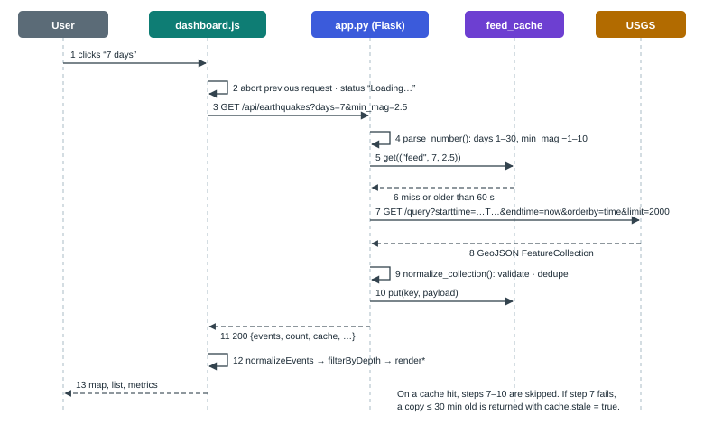
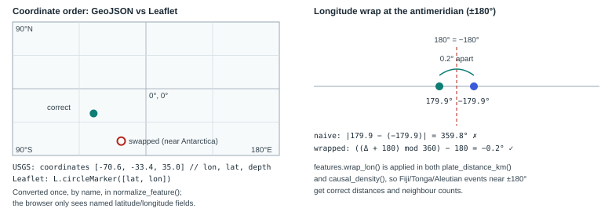
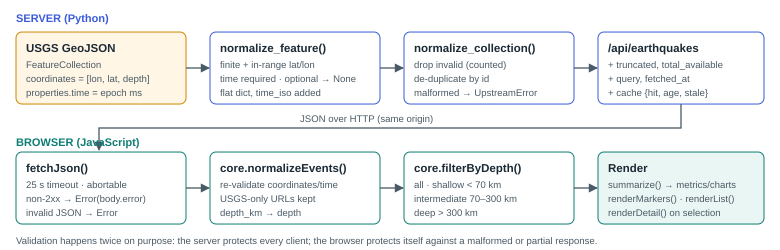
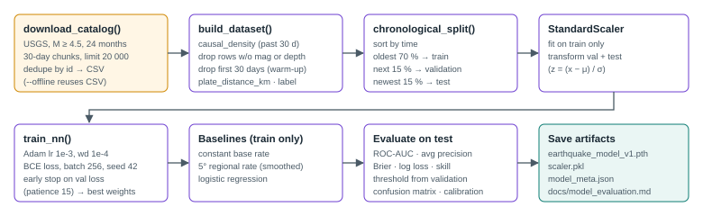
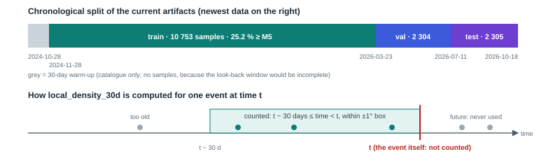
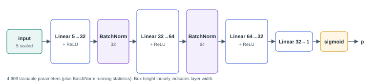
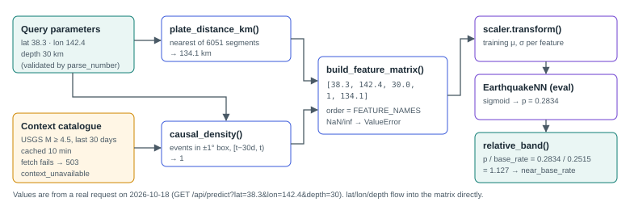

<!--
  TerraWatcher technical learning guide (Markdown source).
  Build the PDF with:  python docs/build_guide.py
  Code blocks preceded by an HTML comment of the form "src: <path>" are verified against that file
  at build time; a line containing only "..." inside such a block marks omitted lines.
-->

# 1 Project overview

## 1.1 What TerraWatcher does

TerraWatcher is a web application. It downloads recent earthquake records from the United States
Geological Survey (USGS), shows them on an interactive world map and summarises them with live
statistics. It also includes a small machine-learning model whose output is shown alongside an honest
account of how well (or how poorly) that model performs.

In one sentence for an interviewer: *TerraWatcher is a Flask and Leaflet dashboard for real-time USGS
earthquake data, with a validated data pipeline and an exploratory PyTorch model evaluated
chronologically against baselines.*

The application has three layers, and keeping them apart is the most important idea in this guide:

| Layer | Example in TerraWatcher | Source of truth | Can it be wrong? |
|---|---|---|---|
| **Observed data** | "An M 5.2 earthquake occurred 71 km ESE of ʻOhonua, Tonga at 19:32 UTC" | USGS catalogue, passed through unchanged | Only if USGS revises it (records have a `status` of `automatic` or `reviewed`) |
| **Derived statistics and patterns** | median depth, magnitude histogram, "63 M4.5+ events in this 2° cell in 30 days" | Computed by TerraWatcher from observed data | Only through bugs; the arithmetic is deterministic |
| **Model estimates** | "If an M4.5+ event were recorded here, 28 % chance it is M5+" | `EarthquakeNN`, trained on past data | Yes, often. It is a statistical estimate with measured, limited skill |

TerraWatcher has **no fourth layer**: there are no validated forecasts. Nothing in the application
predicts that an earthquake will happen at a particular place or time.

## 1.2 The problem it addresses

Raw seismic catalogues are hard for non-specialists to read. The USGS FDSN event service returns
GeoJSON with dozens of fields per event, epoch-millisecond timestamps and `[longitude, latitude, depth]`
arrays. TerraWatcher turns that feed into something a person can explore in seconds: where earthquakes
are happening now, how deep they are, which areas have been unusually active this month, and how
those events relate to plate boundaries.

As an engineering project, it demonstrates several skills:

* **Integration.** It consumes an external API robustly, with timeouts, retries, validation,
  de-duplication and stale-data handling.
* **Geospatial computation.** It handles coordinate order, antimeridian wrap-around, approximate
  distances on a sphere and spatial binning.
* **Honest ML.** It defines a label carefully, avoids leakage, splits data chronologically, compares
  against baselines and reports metrics that are not flattering.
* **Frontend work.** It manages state, cancels superseded requests, and has accessible controls and
  clear loading, empty and error states.

## 1.3 Intended users and use cases

* **Students and learners** exploring global seismicity and plate tectonics.
* **Recruiters and interviewers** evaluating the project as a portfolio piece; the demo checklist in
  Chapter 15 is written for them.
* **The developer** (you), who needs to explain, debug and extend the system.

TerraWatcher is *not* intended for emergency decisions. The footer and every model output say so.

## 1.4 Implemented features

| Feature | Where it lives | Kind of output |
|---|---|---|
| Event feed for the last 24 h / 7 d / 30 d with a minimum-magnitude filter | `/api/earthquakes`, `loadFeed()` | Observed |
| Map markers sized and coloured by magnitude, with tooltips | `renderMarkers()` | Observed |
| Event list (newest first, up to 200 rows) and an event detail panel | `renderList()`, `renderDetail()` | Observed |
| Client-side depth-class filter (shallow / intermediate / deep) | `core.filterByDepth()` | Derived |
| Metrics: count, strongest event, median depth, tsunami-flag count | `core.summarize()` | Derived |
| Magnitude and depth histograms | `renderBars()` | Derived |
| Activity clusters: 2° cells with the most M4.5+ events in 30 days | `/api/hotspots` | Derived (historical pattern) |
| Plate-boundary overlay | `/api/plates`, `loadPlates()` | Reference data |
| Point analysis: conditional severity score at any coordinate | `/api/predict`, `scorePoint()` | Model estimate |
| Model card with test metrics against baselines | `/api/model-info`, `renderModel()` | Model evaluation |
| Freshness labels (fresh / cached / stale), truncation notice, error banner with Retry | `renderFreshness()`, `loadFeed()` | System status |
| Health endpoint | `/api/health` | System status |

## 1.5 Technology stack and why each piece is used

| Technology | Role | Why this choice |
|---|---|---|
| **Python 3.12** | Backend language | Mature scientific ecosystem; the project's venv uses 3.12.10. |
| **Flask 3.1** | HTTP server and routing | Small and explicit. Six JSON routes and one HTML page do not need a larger framework. |
| **requests** | HTTP client for USGS | Simple API with timeouts; easy to replace with a fake in tests. |
| **NumPy / pandas** | Vectorised feature computation, training data frames | Plate distance for thousands of points runs as array arithmetic instead of Python loops. |
| **PyTorch** | The neural network | Already used by the original project; small models train in seconds on a CPU. |
| **scikit-learn** | `StandardScaler`, logistic-regression baseline, metrics | The standard, well-tested implementations. |
| **Leaflet 1.9.4** | Interactive map | Lightweight, no API key, canvas rendering for thousands of markers. |
| **Plain HTML/CSS/JS** | Frontend | No build step. Pure logic is isolated in `core.js` so it can be unit-tested with Node. |
| **pytest / node:test** | Tests | pytest for Python; Node's built-in runner, so the frontend needs no npm dependencies. |

Deliberately *absent*: a database, Redis, background workers, Docker and a frontend framework. Each
would add operational weight without solving a problem the project has (see Chapter 11).

## 1.6 Monitoring, analysis, hotspots and forecasting

These four words are often blurred together. TerraWatcher keeps them separate:

1. **Monitoring.** Showing what has been recorded. TerraWatcher does this with real USGS data. Its
   freshness is limited by USGS processing delays (minutes for automatic solutions) plus the 60-second
   feed cache.
2. **Historical analysis.** Describing past events, for example "most events this week were shallow".
   TerraWatcher does this for the loaded window only (at most 30 days).
3. **Hotspot estimation.** TerraWatcher's "activity clusters" are a *count of recent observed events per
   grid cell*. They show where activity *has been*, not where it *will be*. Recent activity does raise
   short-term probabilities in some statistical models (aftershock clustering), but TerraWatcher does not
   implement or validate any such model.
4. **Scientifically validated forecasting.** This is not implemented. It would require a model that
   issues probabilities for future time windows, tested prospectively against what actually happened
   (Chapter 8 describes what that would involve).

## 1.7 What the application can and cannot claim

**Can claim:**

* It displays USGS events with their reported coordinates, magnitudes, depths and times.
* It reports when the data was fetched and whether a response came from cache or is stale.
* Its model, *for events that have already been recorded at M ≥ 4.5*, separates M ≥ 5 events from
  smaller ones slightly better than chance. On the 2026-07-11 → 2026-10-18 test period it scored
  ROC-AUC 0.570, against 0.552 for logistic regression and 0.500 for a constant base rate.

**Cannot claim:**

* That any location is "at risk" of an earthquake on any time scale.
* That the model has practical predictive value. Its Brier skill over the base rate is +0.006, which is
  close to zero.
* That empty areas of the map are safe. An empty map only means USGS recorded nothing above the chosen
  magnitude in the chosen window.

## 1.8 High-level architecture

<figure><figcaption><b>Figure 1.</b> Components that actually exist. The browser talks only to Flask (same origin), except for map tiles and the Leaflet library. Flask talks to USGS through <code>usgs_client.py</code>. The model and plate data are files loaded once at start-up. Training is an offline script run by hand.</figcaption></figure>

There is **one process** at runtime: `python app.py`. It serves the HTML page, the static JavaScript
and CSS, and the JSON API. State lives in memory: the cache, the loaded model and the plate segments.
Restarting the process clears the cache and reloads the artifacts.

# 2 Repository structure

## 2.1 Directory map

```text
.
├── app.py                    Flask application: routes, validation, cache, errors, headers
├── config.py                 Configuration constants + environment-variable overrides
├── usgs_client.py            USGS FDSN client: HTTP, retry, validation, normalisation
├── features.py               Feature definitions shared by training and serving
├── ml_model.py               EarthquakeNN + ModelBundle (artifact loading, inference)
├── train_model.py            Offline training and evaluation pipeline
├── earthquake_model_v1.pth   Trained PyTorch weights (state_dict)
├── scaler.pkl                Fitted sklearn StandardScaler
├── model_meta.json           Feature schema, label definition, split, metrics, baselines
├── requirements.txt          Runtime dependencies
├── requirements-dev.txt      + pytest
├── requirements-docs.txt     Tools for building this guide
├── pytest.ini                Test discovery + warning policy
├── data/
│   └── tectonic_plates.geojson   Plate boundaries (241 features, 6051 segments)
├── templates/
│   └── index.html            Dashboard markup (Jinja template, no server-side logic)
├── static/
│   ├── core.js               Pure browser logic (validation, stats, formatting)
│   ├── dashboard.js          State, networking, Leaflet layers, rendering
│   └── dashboard.css         Theme and responsive layout
├── tests/                    pytest suites + tests/frontend/core.test.js
└── docs/                     This guide, model evaluation, audit, diagrams, screenshots
```

Not documented here because they are generated or environment-specific: `.venv/`, `__pycache__/`,
`.pytest_cache/`, `docs/build/` (PDF build intermediates) and `data/training_catalog.csv` (the
downloaded training catalogue, which is git-ignored and recreated by `train_model.py`).

## 2.2 File-by-file reference

| File | Responsibility | Inputs → outputs | Depends on | Used by |
|---|---|---|---|---|
| `config.py` | Paths, timeouts, TTLs, limits | Environment variables → constants | `os` | every Python module |
| `usgs_client.py` | Talk to USGS safely | `start`, `end`, `min_mag`, `limit` → `(events, stats)` or `UpstreamError` | `requests`, `config` | `app.py`, `train_model.py` |
| `features.py` | Define the five features | Coordinates, times, catalogue → arrays | `numpy` | `app.py`, `train_model.py`, `ml_model.py` (names only) |
| `ml_model.py` | Network class; load and validate artifacts; predict | Artifact paths → `ModelBundle`; feature matrix → probabilities | `torch`, `joblib`, `features` | `app.py`, `train_model.py` |
| `app.py` | HTTP API and page | Requests → JSON/HTML | all of the above, `flask` | browser; tests |
| `train_model.py` | Build dataset, train, evaluate, save | USGS (or CSV) → `.pth`, `.pkl`, `model_meta.json`, `docs/model_evaluation.md` | `usgs_client`, `features`, `ml_model`, `sklearn`, `pandas` | run manually |
| `templates/index.html` | Page structure, accessible controls | — → DOM | Leaflet CDN, `core.js`, `dashboard.js` | Flask `/` route |
| `static/core.js` | Pure functions | API payloads → validated events, statistics, strings | none | `dashboard.js`, Node tests |
| `static/dashboard.js` | Behaviour | User events, API JSON → DOM, Leaflet layers | `core.js`, Leaflet | browser |
| `static/dashboard.css` | Presentation | — | — | browser |
| `data/tectonic_plates.geojson` | Reference geometry | — | — | `features.load_plate_segments`, `/api/plates` |
| `model_meta.json` | Contract between training and serving | written by training | — | `ModelBundle`, `/api/model-info`, UI model card |
| `tests/conftest.py` | Fake USGS transport, fixtures | — | `usgs_client`, `app` | all API tests |

## 2.3 How a request moves through the files

<figure><figcaption><b>Figure 2.</b> What happens when the user switches the observation window to 7 days. The numbered steps correspond to real functions: <code>loadFeed()</code> (1–3), <code>parse_number()</code> (4), <code>cached_fetch()</code> (5–6, 10), <code>usgs_client.fetch_events()</code> (7–9), <code>normalizeEvents()</code> and the render functions (12).</figcaption></figure>

Two other flows reuse the same pieces:

* **Point analysis** (`/api/predict`): `parse_number` validates the input, `get_context_catalog()` uses
  `cached_fetch` with a 10-minute TTL, `score_points()` calls `features.py`, and `ModelBundle.predict_proba`
  produces the probability.
* **Activity clusters** (`/api/hotspots`): the same context catalogue is binned into 2° cells in
  `hotspots()`, and the busiest cells are scored with `score_points()`.

# 3 Backend architecture

## 3.1 Entry point and start-up sequence

`python app.py` executes the module from top to bottom:

1. `logging.basicConfig(...)` configures log output (level from `TERRAWATCHER_LOG_LEVEL`).
2. `app = Flask(__name__)`; `app.json.sort_keys = False` keeps the JSON key order readable.
3. The error handlers and the `after_request` security-header hook are registered by decorators.
4. `plate_segments = F.load_plate_segments(config.TECTONIC_FILE)` reads the 6051 boundary segments.
5. `bundle = ModelBundle(...)` loads and validates the three model artifacts. If anything is wrong,
   the app **still starts**. The model is marked unavailable, and the routes that need it return 503.
6. `app.run(host=config.HOST, port=config.PORT, debug=config.DEBUG, threaded=True)` starts Werkzeug's
   development server, with one thread per request.

<!-- src: app.py -->
```python
plate_segments = F.load_plate_segments(config.TECTONIC_FILE)
bundle = ModelBundle(config.MODEL_FILE, config.SCALER_FILE, config.MODEL_META_FILE)
...
if __name__ == "__main__":
    app.run(host=config.HOST, port=config.PORT, debug=config.DEBUG, threaded=True)
```

Nothing is trained or downloaded at start-up. The first USGS call happens when the first browser
request arrives, so start-up takes about two seconds and does not depend on the network.

<div class="note" markdown="1"><span class="label">Note</span>
Because `plate_segments` and `bundle` are module-level globals, every request thread shares them. Both
are read-only after start-up, so sharing them is safe. The only mutable shared state is `feed_cache`,
which is protected by a lock (§3.6).
</div>

## 3.2 Configuration

All tunables live in `config.py`. Each one can be overridden with an environment variable, and malformed
values fall back to the default instead of crashing:

<!-- src: config.py -->
```python
def _env_float(name, default):
    try:
        return float(os.environ.get(name, default))
    except (TypeError, ValueError):
        return float(default)
...
USGS_TIMEOUT = _env_float("TERRAWATCHER_USGS_TIMEOUT", 15)   # seconds per request
USGS_RETRIES = _env_int("TERRAWATCHER_USGS_RETRIES", 1)      # retries on 429/5xx/timeouts
```

The defaults bind to `127.0.0.1` (not reachable from other machines), keep debug mode off and require
no secrets. CORS is not configured because the frontend is served by the same Flask process: the browser
treats `/api/*` as same-origin, so no `Access-Control-Allow-Origin` header is needed. A test asserts
that none is sent.

## 3.3 Endpoint reference

All endpoints accept only `GET`. Every error, from any endpoint, has the same JSON shape:

```json
{"error": "Parameter 'lat' must be between -90.0 and 90.0", "code": "out_of_range", "status": 400}
```

The frontend shows `error` to the user. Programs and tests can branch on `code`.

### GET /api/earthquakes

| Item | Value |
|---|---|
| Purpose | Observed events in `[now − days, now)`, newest first |
| Parameters | `days` integer 1–30 (default 1); `min_mag` number −1 to 10 (default 2.5, rounded to 0.1) |
| Success | 200: `events[]`, `count`, `truncated`, `total_available`, `query{days,min_mag,start,end,limit}`, `fetched_at`, `dropped_invalid`, `duplicates_removed`, `source`, `cache{hit,age_seconds,stale,warning}` |
| Errors | 400 `invalid_parameter` / `out_of_range`; 502 `upstream_*` (unreachable, 5xx, rate limited, malformed); 504 `upstream_timeout` |
| Source | `app.py` → `earthquakes()` |

Internally the handler validates both parameters and builds a cache key `("feed", days, min_mag)`. It
then calls `cached_fetch`, which either returns a cached payload younger than 60 s or calls `fetch()`.
On a miss, `fetch()` requests up to 2000 events from USGS. If exactly 2000 come back, it asks the USGS
`count` endpoint how many exist in total, so the UI can say "newest 2000 of 9264".

Real request on 2026-10-18, first event shown:

```json
{"events": [{"id": "us6000u37h", "time": 1792351948734, "time_iso": "2026-10-18T19:32:28.734Z",
   "latitude": -21.541, "longitude": -174.2956, "depth_km": 10.0, "mag": 5.2, "mag_type": "mb",
   "place": "71 km ESE of ʻOhonua, Tonga", "status": "reviewed", "tsunami": false, "...": "..."}],
 "count": 7, "truncated": false, "total_available": 7,
 "query": {"days": 1, "min_mag": 4.5, "start": "2026-10-17T21:38:24Z",
           "end": "2026-10-18T21:38:24Z", "limit": 2000},
 "fetched_at": "2026-10-18T21:38:24Z", "dropped_invalid": 0, "duplicates_removed": 0,
 "source": "USGS FDSN event web service",
 "cache": {"hit": false, "age_seconds": 0, "stale": false, "warning": null}}
```

### GET /api/hotspots

| Item | Value |
|---|---|
| Purpose | Observed activity clusters: 2° cells with ≥ 3 events of M4.5+ in the last 30 days |
| Parameters | `limit` integer 1–50 (default 12) |
| Success | 200: `hotspots[]` with `latitude`, `longitude` (mean of member events), `cell{lat_min,lat_max,lon_min,lon_max}`, `event_count`, `max_mag`, `latest_time`, `median_depth_km`, `model_probability` (number or `null`); plus `definition`, `window_days`, `min_mag`, `cell_deg`, `catalog_events`, `model_status`, `fetched_at`, `cache` |
| Errors | 400 for a bad `limit`; 502/504 if the context catalogue cannot be fetched and no copy is cached |
| Source | `app.py` → `hotspots()` |

Cells are ranked by event count, then by largest magnitude. `model_probability` is the conditional
severity score at the cluster centroid and median depth. It is `null`, never a placeholder, when the
model is not loaded.

### GET /api/predict

| Item | Value |
|---|---|
| Purpose | Conditional severity score at a point |
| Parameters | `lat` −90–90 (required, alias `latitude`); `lon` −180–180 (required, aliases `lng`, `longitude`); `depth` 0–700 km (default 10) |
| Success | 200: `probability`, `base_rate`, `relative_to_base_rate`, `band`, `features{…}`, `interpretation`, `model{trained_at,test_roc_auc}`, `context{fetched_at,stale}` |
| Errors | 400 `missing_parameter` / `invalid_parameter` / `out_of_range`; 503 `model_unavailable`; 503 `context_unavailable` |
| Source | `app.py` → `predict()` |

Real response for `?lat=38.3&lon=142.4&depth=30` (off north-east Japan):

```json
{"probability": 0.2834, "base_rate": 0.2515, "relative_to_base_rate": 1.127, "band": "near_base_rate",
 "features": {"latitude": 38.3, "longitude": 142.4, "depth_km": 30.0,
              "local_density_30d": 1, "plate_distance_km": 134.1},
 "interpretation": "If an M4.5+ earthquake were recorded at this point and depth, the model's estimated chance that it would be M5.0+. This is not a probability that an earthquake will occur.",
 "model": {"trained_at": "2026-10-18T21:35:45Z", "test_roc_auc": 0.5703},
 "context": {"fetched_at": "2026-10-18T21:37:35Z", "stale": false}}
```

### GET /api/model-info, /api/health, /api/plates, /

* `/api/model-info` returns `ModelBundle.describe()`: the status, the load error (if any), the feature
  list, the architecture, and the training, split, metrics and baselines sections from `model_meta.json`.
* `/api/health` returns `{"status": "ok"|"degraded", "model_loaded", "model_error", "plate_segments",
  "context_cache_age_seconds", "time"}`. It reports `degraded` when the model or plate data is missing.
  It never calls USGS, so it stays fast and cheap.
* `/api/plates` serves `data/tectonic_plates.geojson` with `Cache-Control: max-age=86400`.
* `/` and `/dashboard-v2` render `templates/index.html`.

## 3.4 Request parsing and validation

Every numeric query parameter goes through one function, so validation rules are consistent across
endpoints:

<!-- src: app.py -->
```python
def parse_number(name, default=None, lo=None, hi=None, cast=float, required=False, aliases=()):
    raw = request.args.get(name)
    for alias in aliases:
        raw = raw if raw not in (None, "") else request.args.get(alias)
    if raw in (None, ""):
        if required:
            raise ApiError(f"Missing required query parameter '{name}'", code="missing_parameter")
        return default
    try:
        value = cast(raw)
    except (TypeError, ValueError):
        raise ApiError(f"Parameter '{name}' must be a {'whole number' if cast is int else 'number'}",
                       code="invalid_parameter") from None
    if isinstance(value, float) and not math.isfinite(value):
        raise ApiError(f"Parameter '{name}' must be a finite number", code="invalid_parameter")
    if (lo is not None and value < lo) or (hi is not None and value > hi):
        raise ApiError(f"Parameter '{name}' must be between {lo} and {hi}", code="out_of_range")
    return value
```

Line by line:

* `request.args.get(name)` reads the query string. Aliases let `lon`, `lng` and `longitude` all work.
* An empty or missing value either fails (`required=True`) or returns the default.
* `cast(raw)` converts the text. `int("1.5")` raises, so `days=1.5` is rejected rather than silently
  truncated to 1.
* `float("nan")` and `float("inf")` succeed in Python, so they need the explicit `math.isfinite` check.
  Without it, `lat=nan` would slip past the range comparison, because every comparison with NaN is `False`.
* The range check runs last and reports the allowed bounds.
* `raise ... from None` hides the internal `ValueError` traceback, because the user-facing message is
  already complete.

## 3.5 Error handling and logging

<!-- src: app.py -->
```python
@app.errorhandler(ApiError)
def _api_error(exc):
    return error_response(exc.message, exc.status, exc.code)


@app.errorhandler(UpstreamError)
def _upstream_error(exc):
    return error_response(str(exc), exc.status, exc.code)
...
@app.errorhandler(Exception)
def _unhandled(exc):
    log.exception("Unhandled error on %s", request.path)
    return error_response("Internal server error", 500, "internal_error")
```

Three kinds of failure map to three handlers:

* **`ApiError`** covers problems with the request (400) or the server's own readiness (503).
* **`UpstreamError`** covers USGS problems. Timeouts map to 504; everything else maps to 502.
* **Anything else** is a bug. The traceback goes to the server log (`log.exception`), and the client
  receives a generic message, because internal details may reveal file paths or code structure. A test
  checks that the text of an unexpected exception never reaches the response.

A fourth handler converts Werkzeug's `HTTPException` (404, 405) into the same JSON shape for `/api/*`
paths. HTML paths keep the default pages.

## 3.6 Caching

`TTLCache` is an `OrderedDict` behind a `threading.Lock`. It is bounded to 32 entries (least recently
used are evicted first) and stores `(stored_at, value)`. `cached_fetch` adds the policy:

<!-- src: app.py -->
```python
    cached, age = feed_cache.get(key)
    if cached is not None and age < ttl:
        return cached, {"hit": True, "age_seconds": int(age), "stale": False, "warning": None}
    try:
        payload = fetch()
    except UpstreamError as exc:
        if cached is not None and age < config.STALE_MAX_AGE:
            log.warning("Serving stale cache for %s after upstream failure: %s", key, exc)
            return cached, {"hit": True, "age_seconds": int(age), "stale": True,
                            "warning": f"USGS is currently unavailable ({exc}). Showing data from "
                                       f"{int(age // 60)} min ago."}
        raise
    feed_cache.put(key, payload)
    return payload, {"hit": False, "age_seconds": 0, "stale": False, "warning": None}
```

The design has three properties:

* **Fresh hits** (feed younger than 60 s, context younger than 10 min) never touch USGS. This protects
  the upstream service from a dashboard left open in many tabs.
* **Stale fallback.** If USGS fails, a copy up to 30 minutes old is served, but it is *labelled*: the
  response has `cache.stale = true` and a human-readable warning, which the UI shows in an amber banner.
  Old data is never presented as fresh.
* **No fabrication.** With no usable copy, the error propagates and the user sees an error. The cache
  never invents an empty "success".

The lock protects the dictionary, not the fetch. Two simultaneous misses for the same key may both call
USGS. That duplicate costs little at this scale, and it keeps the code free of per-key locking.

## 3.7 Data-source client

`usgs_client._get()` wraps `requests.get` with a timeout and a retry policy:

<!-- src: usgs_client.py -->
```python
    for attempt in range(retries + 1):
        try:
            resp = http.get(url, params=params, timeout=timeout)
        except requests.exceptions.Timeout:
            last_error = UpstreamError("USGS request timed out", status=504, code="upstream_timeout")
        except requests.exceptions.RequestException as exc:
            last_error = UpstreamError(f"Could not reach USGS ({type(exc).__name__})", code="upstream_unreachable")
        else:
            if resp.status_code == 200:
                try:
                    return resp.json()
                except ValueError:
                    raise UpstreamError("USGS returned a response that is not valid JSON",
                                        code="upstream_malformed") from None
...
            if resp.status_code == 400:
                # Our query was rejected; retrying will not help.
                raise UpstreamError("USGS rejected the query parameters", status=502, code="upstream_bad_request")
            if resp.status_code == 429 or resp.status_code >= 500:
```

Which failures are retried:

* **Retried** (`TERRAWATCHER_USGS_RETRIES`, default 1): timeouts, connection errors, HTTP 429 and HTTP 5xx.
  The delay honours a numeric `Retry-After` header, capped at 5 s, and otherwise backs off linearly
  (1 s, 2 s, …).
* **Not retried:** HTTP 400 (our query is wrong, so repeating it cannot help) and invalid JSON.
* The error message includes only the exception *type* (`ConnectionError`), not its full text, which
  can contain URLs or internal network details.

`fetch_events()` builds the query with **full UTC timestamps**. This fixed a real defect: the original
code sent dates only, which silently cut off the most recent day of data (see §13.6).

## 3.8 Model loading and inference in the backend

`ModelBundle` loads all three artifacts or none. `predict()` and `hotspots()` call `score_points()`:

<!-- src: app.py -->
```python
def score_points(lats, lons, depths, ref_ms, context_events):
    """Build model features for arbitrary points at reference time ref_ms and score them."""
    cat_t = [e["time"] for e in context_events]
    cat_lat = [e["latitude"] for e in context_events]
    cat_lon = [e["longitude"] for e in context_events]
    n = len(lats)
    dens = F.causal_density(cat_t, cat_lat, cat_lon, [ref_ms] * n, lats, lons)
    pdist = F.plate_distance_km(lats, lons, plate_segments)
    X = F.build_feature_matrix(lats, lons, depths, dens, pdist)
    return bundle.predict_proba(X), dens, pdist
```

The reference time `ref_ms` is the moment the context catalogue was fetched, not "now". That keeps the
density window aligned with the data actually held. If a 9-minute-old cached catalogue is used, the
window is the 30 days before that fetch.

## 3.9 Security headers and remaining limits

`_security_headers()` adds `X-Content-Type-Options: nosniff` and `Referrer-Policy: same-origin` to every
response. HTML pages also get a Content-Security-Policy that allows scripts only from the app itself and
`unpkg.com`, images from Esri tiles, fonts from Google Fonts, and API calls only to the same origin. The
CSP allows inline *styles* (`'unsafe-inline'` in `style-src`), because the dashboard sets bar widths and
colours through `style` attributes. It does not allow inline *scripts*.

Known limits (not fixed, documented in Chapter 11): the Werkzeug development server is not a production
server, there is no rate limiting of incoming requests, and the caches are per process.

# 4 Frontend and user interface

## 4.1 Structure

The page is one Jinja template, `templates/index.html`, with no server-side logic beyond
`url_for('static', ...)`. Scripts load in this order:

1. **Leaflet 1.9.4 from unpkg**, with Subresource Integrity (`integrity="sha256-…"`). If the CDN served
   modified code, the browser would refuse to run it.
2. **`static/core.js`**, which defines `window.TerraCore`: pure functions with no DOM access.
3. **`static/dashboard.js`**, an IIFE that holds all state and behaviour.

The page regions are a top bar (status pill, freshness, refresh), a controls sidebar (window, magnitude,
depth, layers, legend, source), metric cards, the map, an inspector (event detail and event list),
charts and the model card. A modal dialog hosts point analysis.

<figure><figcaption><b>Figure 3.</b> The running dashboard at 1440×900 on 2026-10-18, captured with headless Chrome. All values come from live USGS data.</figcaption></figure>

## 4.2 State

All mutable UI state is one object, so it is easy to inspect in the browser console:

<!-- src: static/dashboard.js -->
```javascript
  const state = {
    days: 1,
    minMag: 2.5,
    depth: 'all',
    allEvents: [],        // events returned by /api/earthquakes (validated)
    events: [],           // allEvents after the client-side depth filter
    feed: null,           // metadata of the last successful feed response
    hotspots: [],
    selectedId: null,
```

`allEvents` and `events` are deliberately separate. The depth filter runs in the browser on data already
loaded, so changing it needs no network request. Changing `days` or `minMag` changes the query and
triggers `loadFeed()`.

## 4.3 Networking: fetchJson

<!-- src: static/dashboard.js -->
```javascript
  async function fetchJson(url, { signal } = {}) {
    const timeout = new AbortController();
    const timer = setTimeout(() => timeout.abort(), REQUEST_TIMEOUT_MS);
    const onAbort = () => timeout.abort();
    if (signal) signal.addEventListener('abort', onAbort);
    let response;
    try {
      response = await fetch(url, { headers: { Accept: 'application/json' }, signal: timeout.signal });
    } catch (err) {
      if (signal && signal.aborted) throw Object.assign(new Error('superseded'), { superseded: true });
      throw new Error(err.name === 'AbortError' ? 'The request timed out.' : C.errorMessage(0));
    } finally {
      clearTimeout(timer);
      if (signal) signal.removeEventListener('abort', onAbort);
    }
    let body = null;
    try { body = await response.json(); } catch (_) { /* handled below */ }
    if (!response.ok) throw Object.assign(new Error(C.errorMessage(response.status, body)), { status: response.status, body });
    if (body === null) throw new Error('The server returned a response that is not valid JSON.');
    return body;
  }
```

What each part does:

* **Two abort sources.** A 25-second timeout, and an optional caller `signal`, used when the user changes
  a filter before the previous request finishes. Both feed one internal `AbortController`.
* **Superseded vs timed out.** If the caller aborted, the error is tagged `superseded`, and `loadFeed`
  ignores it silently, because it is not a failure the user needs to see. A real timeout produces "The
  request timed out."
* **`finally`.** Always clears the timer and removes the listener, so nothing leaks across many refreshes.
* **Error bodies.** Non-2xx responses still have a JSON body (`{error, code, status}`). `C.errorMessage`
  extracts the server's message, so the user sees "Parameter 'days' must be between 1 and 30" rather
  than "HTTP 400".

## 4.4 Loading the feed and handling every outcome

<!-- src: static/dashboard.js -->
```javascript
  async function loadFeed() {
    if (state.feedController) state.feedController.abort();   // cancel superseded request
    const controller = new AbortController();
    state.feedController = controller;
    setStatus('loading', 'Loading…');
    $('map-loading').hidden = false;
    const params = new URLSearchParams({ days: state.days, min_mag: state.minMag });
    try {
      const data = await fetchJson(`/api/earthquakes?${params}`, { signal: controller.signal });
      const { events, rejected, malformed } = C.normalizeEvents(data);
      if (malformed) throw new Error('The event feed response was malformed.');
```

The function handles four outcomes:

| Outcome | What the user sees |
|---|---|
| Success, fresh or cached | Status pill "Live"; freshness "Fresh · USGS data fetched 5s ago" or "Cached · …" |
| Success, stale (`cache.stale`) | Amber pill "Showing stale data"; banner with the server's warning |
| Failure, earlier data exists | Red pill "Feed unavailable"; banner "… Previously loaded events are still shown."; Retry button |
| Failure, no earlier data | As above, plus "Could not load earthquakes" in the list; metrics show zeros |

The `finally` block hides the loading indicator *only if this request is still the current one*. A
superseded request finishing late cannot hide the spinner of the newer request.

## 4.5 Validating responses in the browser

<!-- src: static/core.js -->
```javascript
  function normalizeEvents(payload) {
    const raw = payload && Array.isArray(payload.events) ? payload.events : null;
    if (!raw) return { events: [], rejected: 0, malformed: true };
    const events = [];
    let rejected = 0;
    raw.forEach((e, i) => {
      const lat = toNum(e && e.latitude);
      const lon = toNum(e && e.longitude);
      const time = toNum(e && e.time);
      if (!isValidCoord(lat, lon) || time === null) { rejected += 1; return; }
```

The server already validates, so why validate again? Because the browser should not trust that every
response is well formed: a proxy error page, a partial response or a future API change could break the
assumptions. `normalizeEvents` also:

* converts `depth_km` to a number or `null`, so a missing depth shows as "Not reported" rather than "NaN km";
* keeps `url` only if it starts with `https://earthquake.usgs.gov/`, so a malformed record cannot inject a
  `javascript:` link into the "USGS event page" button;
* returns `malformed: true` when `events` is missing or not an array, which `loadFeed` turns into an error.

All text inserted with `innerHTML` passes through `escapeHtml`, so place names containing `<` or quotes
cannot break the markup.

## 4.6 Map initialisation, layers and markers

<!-- src: static/dashboard.js -->
```javascript
    if (state.map) return;  // guard against double initialisation
    const map = L.map('map', {
      preferCanvas: true,
      worldCopyJump: false,
      minZoom: 1,
      maxZoom: 12,
      zoomSnap: 0.5,
      maxBounds: [[-90, -200], [90, 200]],
      maxBoundsViscosity: 0.8,
      zoomControl: true,
    }).fitBounds([[-58, -170], [72, 190]]);
```

* `preferCanvas: true` draws circle markers on one `<canvas>` instead of one SVG element each, which
  matters with up to 2000 events.
* `fitBounds([[-58, -170], [72, 190]])` frames the inhabited latitudes and keeps the Pacific in one piece
  (east of 180° is allowed up to 200°). Leaflet expects `[lat, lon]` pairs.
* The guard `if (state.map) return;` prevents double initialisation, which in Leaflet throws "Map
  container is already initialized".

There are three `L.layerGroup`s, created in drawing order: plates (bottom), clusters, events (top). The
layer toggle buttons add a group to the map or remove it; the data stays in memory.

<!-- src: static/dashboard.js -->
```javascript
    // Draw small events first so large ones stay on top.
    const ordered = [...state.events].sort((a, b) => (a.mag ?? -9) - (b.mag ?? -9));
    ordered.forEach((e) => {
      const color = C.magColor(e.mag);
      const marker = L.circleMarker([e.latitude, e.longitude], {
        radius: C.magRadius(e.mag), color, weight: 1, fillColor: color, fillOpacity: 0.65, bubblingMouseEvents: false,
      });
```

`bubblingMouseEvents: false` stops a marker click from also triggering the map's click handler, which
would open point analysis at the same time. Markers are kept in `state.markers` (a `Map` from event id to
marker) so that selecting an event in the list can restyle the matching marker.

**Clustering.** TerraWatcher does *not* use marker clustering (such as Leaflet.markercluster). Markers
are drawn individually. "Activity clusters" are a server-side grid aggregation (§5.5), not a rendering
technique.

## 4.7 Filtering, selection and the detail view

* **Window and magnitude** change `state.days` / `state.minMag` and call `loadFeed()` (server round trip).
* **Depth class** changes `state.depth` and calls `applyDepthFilter()`, which recomputes `state.events` and
  re-renders the metrics, list, detail and markers without any network request. If the selected event is
  filtered out, the selection is cleared.
* **Selecting** an event, from a marker or a list row, calls `selectEvent(id, {pan})`. It sets
  `state.selectedId`, re-renders the detail panel, updates `aria-pressed` on list rows, gives the selected
  marker a white outline and, when selected from the list, flies the map to it.

<figure><figcaption><b>Figure 4.</b> A selected event. During acceptance testing every field in the panel was compared with the raw <code>/api/earthquakes</code> record for the same id: place, magnitude, depth 10.0 km, coordinates 21.541°S 174.296°W and time.</figcaption></figure>

## 4.8 Dashboard metrics

`core.summarize(events)` computes every number shown in the metric cards and charts from the events
currently displayed. The values are never hard-coded:

<!-- src: static/core.js -->
```javascript
  function summarize(events) {
    const mags = events.map((e) => e.mag).filter(Number.isFinite);
    const depths = events.map((e) => e.depth).filter(Number.isFinite);
    let strongest = null;
    events.forEach((e) => { if (Number.isFinite(e.mag) && (!strongest || e.mag > strongest.mag)) strongest = e; });
```

Events with a missing magnitude still count in "Events shown", but they are excluded from the magnitude
histogram, and the `withMagnitude` count tells the chart when there is nothing to plot. The median is
used for depth because depth distributions are skewed: a few 600 km events would distort a mean.

## 4.9 Point analysis

Clicking the map (or "Point analysis here" in the detail panel) opens a modal dialog with editable
latitude, longitude and depth inputs, so the feature is also usable from the keyboard. The modal shows
the probability, the ratio to the base rate, every feature value, the model's test ROC-AUC and the
sentence "not a probability that an earthquake will occur". Escape closes it and returns focus to the
element that opened it.

<figure><figcaption><b>Figure 5.</b> Point analysis for the selected Tonga event. The 30.0 % shown equals the <code>probability</code> returned by <code>/api/predict</code> for the same inputs (checked during acceptance testing).</figcaption></figure>

## 4.10 Responsive design and accessibility

* **Above 1280 px:** three columns (controls · map · inspector). From 860 to 1280 px: two columns, with
  the inspector placed under the map. Below 860 px: one column, and the controls become a slide-in drawer
  opened by the ☰ button, closable with Escape.
* `display: contents` on `<main>` at narrower widths lets the event list sit directly under the map,
  instead of after the charts, while keeping a logical DOM order.
* All controls are native `<button>`/`<select>`/`<input>` elements with labels. The time window uses
  `role="radiogroup"` and `aria-checked`; the layer toggles use `aria-pressed`. A "Skip to event list"
  link appears on keyboard focus. Status changes are announced through `role="status"` and `aria-live`.
* `prefers-reduced-motion` disables animations.

During testing at 375×812 the page had no horizontal scroll (`scrollWidth` equalled `innerWidth`).

## 4.11 Handling malformed or incomplete responses

| Situation | Handling |
|---|---|
| Response is not JSON | `fetchJson` throws "The server returned a response that is not valid JSON." |
| `events` missing or not an array | `normalizeEvents` returns `malformed: true`; `loadFeed` shows an error |
| An event without valid coordinates or time | Dropped and counted (`console.warn`); the rest render |
| Missing magnitude | Badge shows "—"; grey marker of minimum size; excluded from the histogram |
| Missing depth | "Not reported" in the detail view; excluded from the depth statistics |
| Missing place | "Location unavailable" |
| `/api/hotspots` or `/api/plates` fails | A toast explains it; the event layer keeps working |
| Leaflet fails to load | The map area explains it; list, metrics and charts still work |

## 4.12 End-to-end trace: from a click to pixels

1. The user clicks **7 days**. The handler sets `aria-checked`, sets `state.days = 7` and calls `loadFeed()`.
2. `loadFeed` aborts any in-flight feed request and calls
   `fetchJson('/api/earthquakes?days=7&min_mag=2.5', {signal})`.
3. Flask's `earthquakes()` validates the parameters, misses the cache and calls
   `usgs_client.fetch_events(now − 7 d, now, 2.5, 2000)`.
4. USGS returns GeoJSON. `normalize_collection` validates and de-duplicates it. The payload is cached and
   returned with `cache.hit = false`.
5. The browser receives the JSON (during testing: 337 events). `normalizeEvents` validates it,
   `applyDepthFilter` keeps all 337 (depth "all"), and `renderMetrics` shows **337** and "Past 7 days ·
   M 2.5+". The strongest event card showed **M 6.9**, which matched `Math.max` over the API magnitudes.
6. `renderMarkers` clears the event layer and draws 337 canvas circles; `renderList` shows the newest 200.

# 5 Geospatial concepts

## 5.1 Latitude and longitude

A point on Earth is located by two angles:

* **Latitude** (φ) measures north–south position, from −90° (South Pole) through 0° (Equator) to +90°
  (North Pole).
* **Longitude** (λ) measures east–west position from the Greenwich meridian, from −180° (west) to +180°
  (east). The line at ±180° is the **antimeridian**. It runs through the Pacific, past Fiji, Tonga and the
  Aleutian Islands, which are some of the most seismically active places on Earth.

USGS reports coordinates in the WGS84 datum, the same one GPS uses. One degree of latitude is always
about 111.2 km (TerraWatcher uses `KM_PER_DEG = 111.195`). One degree of longitude shrinks with latitude:
it is 111.2 km × cos φ, so about 78.6 km at 45° and 0 km at the poles.

## 5.2 Projections and the map

The map uses the **Web Mercator** projection (Leaflet's default, EPSG:3857). It preserves shapes locally
but enlarges areas towards the poles, so Greenland looks as large as Africa. This matters for
interpretation: a cluster of markers at 60°N covers less ground than an identical-looking cluster at the
Equator. TerraWatcher's numerical features do *not* use Mercator. They work directly with degrees and an
approximate local scale correction (§5.6).

## 5.3 From a data record to a marker

Each USGS event has an **epicentre**, the point on the surface above where the rupture began, plus a
**depth** below the surface. The epicentre plus depth is the **hypocentre**. TerraWatcher plots the
epicentre and shows depth as text and as a filter, because a 2-D map cannot show depth directly.

The pipeline from record to pixel:

1. USGS: `"geometry": {"coordinates": [-174.2956, -21.541, 10.0]}`, i.e. **[longitude, latitude, depth]**.
2. `normalize_feature`: `lon, lat = coords[0], coords[1]`, stored as named fields `latitude: -21.541`,
   `longitude: -174.2956`, `depth_km: 10.0`.
3. Browser: `L.circleMarker([e.latitude, e.longitude])`. Leaflet expects **[latitude, longitude]**.
4. Leaflet projects the point to Web Mercator pixels for the current zoom and draws it on the canvas.

## 5.4 The coordinate-order trap

<figure><figcaption><b>Figure 6.</b> Left: GeoJSON stores <code>[lon, lat]</code>, Leaflet takes <code>[lat, lon]</code>. Swapping them moves a Santiago, Chile earthquake to the ocean near Antarctica. Right: why longitude differences must be wrapped.</figcaption></figure>

Swapping latitude and longitude is the most common geospatial bug. Its consequences depend on the values:

* If |longitude| > 90, the swapped "latitude" is invalid. Leaflet may silently clamp it or draw the
  marker off the map.
* If both values are within ±90 (much of Europe, Africa and South America), the swapped point is valid
  but **wrong**, and nothing warns you. Santiago (−33.4, −70.6) moves to (−70.6, −33.4), off Antarctica.

TerraWatcher avoids the trap structurally. The array is unpacked exactly once, in `normalize_feature`,
and everything downstream uses named fields (`latitude`, `longitude`). A unit test
(`test_normalize_valid_feature_maps_fields`) asserts that `[142.5, 38.1]` becomes `latitude 38.1`,
`longitude 142.5`.

## 5.5 Grids and spatial aggregation

Activity clusters bin events into **2° × 2° cells**. The cell index is `floor(lat / 2)` and
`floor(lon / 2)`, so the cell containing (38.3°N, 142.2°E) is latitude 38–40 and longitude 142–144.
Cells are equal in *degrees*, not in area: a 2° cell at 60° latitude covers half the ground of one at the
Equator (cos 60° = 0.5). For a visual summary of where activity is concentrated this distortion is
acceptable. For any density *comparison* between regions it would need correcting.

On the map each cluster is drawn as a dashed rectangle (the true cell) plus a ring at the mean position
of its events. The ring radius grows with √(event count), because area should scale with count. The
`/api/hotspots` definition text and the popup both say "observed activity, not a forecast".

<div class="warn" markdown="1"><span class="label">Important</span>
A cell with many recent earthquakes is an observation about the past. Some of that activity reflects
aftershock sequences, which do decay over time and are studied statistically. But a visual concentration
of historical events does not, by itself, establish a reliable prediction of where future earthquakes
will occur. Large earthquakes also happen in areas that were quiet in the preceding month.
</div>

## 5.6 Distances: degrees, kilometres and the antimeridian

`plate_distance_km` needs the distance from a point to a line segment. The exact great-circle
computation is costly. Instead, TerraWatcher projects each segment into a **local equirectangular frame**
centred on the query point:

* x = Δλ × cos φ<sub>point</sub>, with Δλ wrapped into [−180°, 180°)
* y = Δφ

Then it applies ordinary 2-D point-to-segment geometry. The point projects onto the segment at
parameter t, clamped to [0, 1], and the distance to that closest point is multiplied by 111.195 km per
degree:

<!-- src: features.py -->
```python
        k = np.cos(np.radians(plat))
        ax, ay = wrap_lon(lon1 - plon) * k, lat1 - plat   # segment start relative to point
        bx, by = wrap_lon(lon2 - plon) * k, lat2 - plat   # segment end relative to point
        dx, dy = bx - ax, by - ay
        l2 = dx * dx + dy * dy
        with np.errstate(invalid="ignore", divide="ignore"):
            t = np.where(l2 > 0, -(ax * dx + ay * dy) / l2, 0.0)
        t = np.clip(t, 0.0, 1.0)
        cx, cy = ax + t * dx, ay + t * dy                  # closest point on segment
        out[start:start + chunk] = np.sqrt(cx * cx + cy * cy).min(axis=1) * KM_PER_DEG
```

Each line, explained:

* The point sits at the origin, so segment endpoints are expressed *relative to it* (`ax, ay`, `bx, by`).
* `wrap_lon` turns a 359.8° difference into −0.2°, so a point at 179.9° and a segment at −179.9° are
  0.2° apart, not 359.8° (tested in `test_plate_distance_across_antimeridian`).
* `t = −(a·d)/|d|²` is the projection of the origin onto the line through the segment. Clipping keeps it on
  the segment. A zero-length segment (`l2 = 0`) uses its start point.
* The computation is vectorised over 512 points × 6051 segments at a time (about 3 million distances per
  chunk), then `.min(axis=1)` picks the nearest segment.

Accuracy: good for distances of tens to a few hundred kilometres away from the poles, which is the range
that matters for "near a plate boundary". It degrades over long distances because the scale factor
cos φ is taken at the query point. No formal error bound was computed.

## 5.7 Zoom levels, tiles and layers

At zoom z the world is 256 × 2^z pixels wide. TerraWatcher allows zoom 1–12 with half-step snapping.
Basemap **tiles** are 256-pixel images fetched on demand from Esri's World Dark Gray Canvas service (URL
pattern `…/tile/{z}/{y}/{x}`). The app draws three overlay **layers** above the tiles: plate boundaries,
activity clusters and observed events. Each is an `L.layerGroup` that the sidebar toggles add to or
remove from the map. No marker clustering library is used.

# 6 Earthquake data pipeline

## 6.1 Source

The only earthquake data source is the **USGS FDSN event web service**,
`https://earthquake.usgs.gov/fdsnws/event/1/`. It is public, needs no API key and follows the
International Federation of Digital Seismograph Networks (FDSN) standard. TerraWatcher uses two methods:

* `query`, with `format=geojson`, `starttime`, `endtime`, `minmagnitude`, `orderby=time`, `limit` and
  `eventtype=earthquake` (which excludes quarry blasts and explosions);
* `count`, called only when a query returns exactly `limit` events, to report how many exist in total.

The catalogue merges contributions from many regional networks (the `net` field: `us`, `ci`, `ak`, …).
That is why magnitude types vary (`mb`, `ml`, `Mww`, `md`) and why small events are much better
recorded in some regions than others.

<figure><figcaption><b>Figure 7.</b> Every transformation an event goes through between USGS and the screen.</figcaption></figure>

## 6.2 HTTP, timeouts and failure handling

| Condition | Behaviour | Status returned to browser |
|---|---|---|
| Timeout (15 s default) | Retry once, then fail | 504 `upstream_timeout` |
| Connection error / DNS failure | Retry once, then fail | 502 `upstream_unreachable` |
| HTTP 429 | Wait `Retry-After` (≤ 5 s), retry | 502 `upstream_rate_limited` |
| HTTP 5xx | Back off 1 s, retry | 502 `upstream_server_error` |
| HTTP 400 | No retry | 502 `upstream_bad_request` |
| 200 but not JSON, or no `features` list | No retry | 502 `upstream_malformed` |
| Any failure while a copy ≤ 30 min old is cached | Serve that copy | 200 with `cache.stale = true` |

## 6.3 Parsing and normalisation

<!-- src: usgs_client.py -->
```python
    lon, lat = _finite(coords[0]), _finite(coords[1])
    if lon is None or lat is None or not (-90 <= lat <= 90) or not (-180 <= lon <= 180):
        return None
    depth = _finite(coords[2]) if len(coords) > 2 else None

    t = _finite(props.get("time"))
    if t is None:
        return None
    time_ms = int(t)
```

`_finite()` converts a value to a float and returns `None` for `None`, non-numbers, NaN and infinity.
Three outcomes follow:

* **Required fields** (coordinates and time): if missing or invalid, the whole record is dropped
  (`return None`) and counted in `dropped_invalid`.
* **Optional fields** (depth, magnitude, place and the rest) pass through as `None`. They are never
  replaced with defaults. The original code substituted 0.0 for missing coordinates and 10 km for missing
  depth, inventing data.
* A **2-element coordinate array** is valid (depth unknown); a 1-element array is not.

## 6.4 Identifiers and duplicates

<!-- src: usgs_client.py -->
```python
    events, seen = [], set()
    dropped = duplicates = 0
    for feature in payload["features"]:
        event = normalize_feature(feature)
        if event is None:
            dropped += 1
            continue
        if event["id"] in seen:
            duplicates += 1
            continue
        seen.add(event["id"])
        events.append(event)
```

The event id is the GeoJSON `id` (for example `us6000u37h`). If it is absent, the first entry of
`properties.ids` is used, and failing that a synthetic `"lat,lon,time"` string. The first occurrence of
each id is kept. Training also de-duplicates across download chunks by keying a dictionary on id.

## 6.5 Field provenance: source, calculated or model-generated

| Field | Origin | Notes |
|---|---|---|
| `latitude`, `longitude`, `depth_km` | **Source** (`geometry.coordinates`) | renamed, validated |
| `mag`, `mag_type`, `place`, `status`, `tsunami`, `alert`, `felt`, `sig`, `net`, `url`, `updated` | **Source** (`properties`) | passed through (`tsunami` → boolean) |
| `time` | **Source** | epoch milliseconds, UTC |
| `time_iso` | **Calculated** | ISO-8601 rendering of `time` |
| `count`, `truncated`, `total_available`, `dropped_invalid`, `duplicates_removed` | **Calculated** | per response (`total_available` from the USGS count endpoint when truncated) |
| `fetched_at`, `cache.*` | **Calculated** | freshness metadata |
| Metric cards, histograms | **Calculated** (browser) | from displayed events |
| Activity clusters: `event_count`, `max_mag`, `median_depth_km`, centroid | **Calculated** | from the 30-day M4.5+ catalogue |
| `local_density_30d`, `plate_distance_km` | **Calculated** | model features |
| `probability`, `model_probability`, `relative_to_base_rate`, `band` | **Model-generated** | exploratory |

### Worked example: one record

USGS sends (abridged):

```json
{"type": "Feature", "id": "us6000u37h",
 "properties": {"mag": 5.2, "place": "71 km ESE of ʻOhonua, Tonga", "time": 1792351948734,
                "updated": 1792354380040, "tsunami": 0, "magType": "mb", "type": "earthquake",
                "status": "reviewed", "net": "us", "sig": 416,
                "url": "https://earthquake.usgs.gov/earthquakes/eventpage/us6000u37h"},
 "geometry": {"type": "Point", "coordinates": [-174.2956, -21.541, 10.0]}}
```

TerraWatcher's API returns `{"id": "us6000u37h", "time": 1792351948734, "time_iso":
"2026-10-18T19:32:28.734Z", "latitude": -21.541, "longitude": -174.2956, "depth_km": 10.0, "mag": 5.2,
"mag_type": "mb", "tsunami": false, …}`. In the browser, `normalizeEvents` turns this into
`{id, time, latitude, longitude, depth: 10, mag: 5.2, magType: "mb", place, status: "reviewed",
tsunami: false, url}`. That renders as an orange-red marker (M5–5.9) with radius 2.2 + 5.2 × 1.7 ≈ 11 px
and as "10.0 km (shallow)" in the detail panel.

## 6.6 Time handling

* USGS `time` is **milliseconds since 1970-01-01 UTC**. Python divides by 1000 for `datetime`;
  JavaScript's `new Date(ms)` takes milliseconds directly.
* Query windows are built from `datetime.now(timezone.utc)` and sent as `YYYY-MM-DDTHH:MM:SS` (UTC).
* The UI shows both UTC (`formatUtc`) and the viewer's local time, and relative times ("22 min ago").

## 6.7 Refresh intervals and freshness

| Mechanism | Interval |
|---|---|
| Browser auto-refresh (`REFRESH_MS`) | every 3 minutes, skipped while the tab is hidden |
| Feed cache (`FEED_CACHE_TTL`) | 60 seconds per `(days, min_mag)` |
| Context catalogue cache (`CONTEXT_CACHE_TTL`) | 10 minutes |
| Stale fallback limit (`STALE_MAX_AGE`) | 30 minutes |
| Freshness label re-render | every 30 seconds |

The top bar always says which of three states applies: **Fresh** (fetched from USGS for this request),
**Cached** (served from the 60 s cache) or **Stale copy** (USGS failed; old data clearly labelled). The
sidebar shows the exact fetch time and the query window. TerraWatcher never substitutes fake events: with
USGS unreachable and nothing cached, the list says "Could not load earthquakes" and the map shows no
event markers (Figure 8).

<figure><figcaption><b>Figure 8.</b> A real failure test: a second instance started with <code>TERRAWATCHER_USGS_URL</code> pointing to an unresolvable host. The error banner and Retry button appear, the list states the cause, the plate layer and map still work, and no events are invented.</figcaption></figure>

# 7 Machine learning pipeline

## 7.1 The question, stated precisely

> Given that an earthquake of magnitude **≥ 4.5** has been recorded, at a given latitude, longitude and
> depth, with a given amount of M4.5+ activity in the surrounding ±1° during the previous 30 days, and a
> given distance to the nearest plate boundary, what is the probability that its magnitude is **≥ 5.0**?

This is **binary classification of recorded events**. A positive label means "this already-recorded
M4.5+ event was M5.0 or larger". It says nothing about whether an event will occur. When the
dashboard scores an arbitrary map point, it is asking a hypothetical: *if* an M4.5+ event happened here
now, how likely is it to be M5+?

Why this formulation? It is honest and testable. Every training row has a real, known answer, and the
same feature definitions can be computed at serving time without any future information. It is also a
hard problem with a well-known physical answer: by the Gutenberg–Richter relation (§8.1), the share of
events above a magnitude threshold is roughly constant. Strong performance should therefore *not* be
expected, and the evaluation confirms this.

<figure><figcaption><b>Figure 9.</b> The offline pipeline in <code>train_model.py</code>, one box per function.</figcaption></figure>

## 7.2 Dataset origin and schema

`download_catalog()` fetches **24 months** of M ≥ 4.5 events in 30-day chunks (`limit=20000` per chunk;
the script aborts if a chunk reaches the limit, which would mean truncation). For the current artifacts:
15,855 catalogue events from 2024-10-28 to 2026-10-18. They are saved to `data/training_catalog.csv`
(git-ignored) with the normalised event fields (`id, time, latitude, longitude, depth_km, mag, …`).
`--offline` retrains from this file.

## 7.3 Features and units

| # | Feature | Unit | Computation | Training mean / std* |
|---|---|---|---|---|
| 1 | `latitude` | degrees | from the event | 8.85 / 33.31 |
| 2 | `longitude` | degrees | from the event | 62.23 / 115.28 |
| 3 | `depth_km` | km | from the event | 56.0 / 102.7 |
| 4 | `local_density_30d` | count | `causal_density`, ±1° box, previous 30 days, M4.5+ | 29.5 / 73.9 |
| 5 | `plate_distance_km` | km | `plate_distance_km`, nearest of 6051 segments | 94.2 / 140.6 |

\*From the fitted `scaler.pkl` (`mean_`, `scale_`). The large density spread comes from aftershock
sequences: a single large earthquake can produce hundreds of M4.5+ events nearby within weeks.

## 7.4 Label construction and the M4.5 decision

`label = int(mag >= 5.0)`, giving a training positive rate of 25.2 %. The choice of the *catalogue*
threshold, M4.5, is deliberate. Below roughly M4.5 the global catalogue is **incomplete in a
region-dependent way**: California, Alaska and Japan record M2.5 events densely, while many oceanic and
developing regions do not. With an M2.5 catalogue, "this event is M5+" would partly mean "this event
happened where only large events get recorded", and the model would learn network coverage rather than
geophysics. This is a design argument based on catalogue properties. It was **not measured** in this
project.

## 7.5 Leakage-free feature engineering

<!-- src: features.py -->
```python
    lo = np.searchsorted(ct, q_times - window_days * DAY_MS, side="left")
    hi = np.searchsorted(ct, q_times, side="left")   # strictly before q_time
    out = np.zeros(len(q_times), dtype=np.int64)
    for i in range(len(q_times)):
        if hi[i] <= lo[i]:
            continue
        dlat = np.abs(clat[lo[i]:hi[i]] - q_lats[i])
        dlon = np.abs(wrap_lon(clon[lo[i]:hi[i]] - q_lons[i]))
        out[i] = int(np.count_nonzero((dlat <= radius_deg) & (dlon <= radius_deg)))
```

* The catalogue is sorted by time once. `searchsorted` finds, for each query time t, the index range of
  events with t − 30 d ≤ time < t. Using `side="left"` for the upper bound excludes events *at* t,
  including the event itself.
* Within that slice, a box test keeps events within ±1° of latitude and ±1° of wrapped longitude.
* Cost: O(n log n) for sorting plus about the size of the 30-day slice per query, instead of comparing
  every pair of events in the catalogue.

`test_density_feature_does_not_see_the_future` appends 400 days of later events to a catalogue and
checks that **no earlier sample's density changes**. That is the definition of no look-ahead.

<figure><figcaption><b>Figure 10.</b> Top: the actual chronological split of the current artifacts. Bottom: the window counted by <code>local_density_30d</code> for one event.</figcaption></figure>

## 7.6 Building the dataset

<!-- src: train_model.py -->
```python
    # Density counts every catalogue event (even ones lacking magnitude/depth).
    cat["local_density_30d"] = F.causal_density(cat["time"], cat["latitude"], cat["longitude"],
                                                cat["time"], cat["latitude"], cat["longitude"])

    samples = cat.dropna(subset=["mag", "depth_km"]).copy()
    # Warm-up: the first 30 days have an incomplete look-back window.
    warmup_end = cat["time"].min() + F.DENSITY_WINDOW_DAYS * F.DAY_MS
    samples = samples[samples["time"] >= warmup_end].copy()
    samples["plate_distance_km"] = F.plate_distance_km(samples["latitude"], samples["longitude"], segments)
    samples["label"] = (samples["mag"] >= F.SIGNIFICANT_MAG).astype(int)
```

* Rows without magnitude (no label possible) or depth (a feature would be missing) are not samples, but
  they still count towards *other* events' density, because at serving time the context catalogue
  contains them too.
* The **warm-up** removes the first 30 days of samples. Their look-back window extends before the
  download start, so their density would be artificially low. 15,362 samples remain.

## 7.7 Train/validation/test split

<!-- src: train_model.py -->
```python
def chronological_split(df, train_frac=0.70, val_frac=0.15):
    df = df.sort_values("time").reset_index(drop=True)
    n = len(df)
    i_train, i_val = int(n * train_frac), int(n * (train_frac + val_frac))
    return df.iloc[:i_train], df.iloc[i_train:i_val], df.iloc[i_val:]
```

| Split | Samples | Positive rate | Period |
|---|---:|---:|---|
| Train | 10,753 | 25.2 % | 2024-11-28 → 2026-03-23 |
| Validation | 2,304 | 24.1 % | 2026-03-23 → 2026-07-11 |
| Test | 2,305 | 27.2 % | 2026-07-11 → 2026-10-18 |

The training script asserts that the periods are in order without overlap. The validation set is used
for early stopping and for choosing a decision threshold. The test set is used **once**, for reporting.

## 7.8 Preprocessing: standardisation

`StandardScaler` replaces each feature x with z = (x − μ) / σ, using the μ and σ of the **training split
only**. Fitting on all data would leak test-period statistics into training. Standardisation matters
because the raw features have very different scales (latitude ±90, density 0 to several hundred);
without it, gradient descent would be dominated by the largest-valued feature. The same fitted scaler is
saved to `scaler.pkl` and applied at inference.

## 7.9 The model: a small multilayer perceptron

<figure><figcaption><b>Figure 11.</b> <code>EarthquakeNN</code> as defined in <code>ml_model.py</code>.</figcaption></figure>

**Beginner's view.** A neural network is a chain of simple functions. Each **linear layer** computes
weighted sums of its inputs. Each **ReLU** keeps positive values and zeroes negative ones, which lets the
chain represent curved, non-linear relationships. The final **sigmoid** squashes any number into (0, 1),
so it can be read as a probability. Training adjusts the weights so that predicted probabilities move
towards the true labels.

**Formally.** For a standardised input x ∈ ℝ⁵:

* h₁ = BN₃₂(ReLU(W₁x + b₁))
* h₂ = BN₆₄(ReLU(W₂h₁ + b₂))
* h₃ = ReLU(W₃h₂ + b₃)
* p = σ(w₄ᵀh₃ + b₄), with σ(z) = 1 / (1 + e^(−z))

**BatchNorm** (BN) normalises each unit using batch statistics during training and stored running
averages during inference. This is why `model.eval()` is essential: in training mode, BatchNorm cannot
normalise a single input row (PyTorch raises an error for a batch of one). The network has 4,609
trainable parameters, which is small relative to 10,753 training rows.

The architecture was inherited from the original project and kept. Honestly, an MLP is not obviously
the best choice: logistic regression on the same features performs almost identically (§7.12).

## 7.10 Training procedure

<!-- src: train_model.py -->
```python
    for epoch in range(1, epochs + 1):
        model.train()
        perm = torch.randperm(len(Xt), generator=gen)
        for start in range(0, len(Xt), batch_size):
            idx = perm[start:start + batch_size]
            if len(idx) < 2:          # BatchNorm needs >1 sample in training mode
                continue
            opt.zero_grad()
            loss = loss_fn(model(Xt[idx]), yt[idx])
            loss.backward()
            opt.step()
        model.eval()
        with torch.no_grad():
            val_loss = loss_fn(model(Xv), yv).item()
        if val_loss < best_loss - 1e-5:
            best_loss, best_epoch, bad = val_loss, epoch, 0
            best_state = {k: v.clone() for k, v in model.state_dict().items()}
```

* **Loss:** binary cross-entropy, L = −[y log p + (1 − y) log(1 − p)], averaged over the batch. It
  rewards confident correct probabilities and heavily penalises confident wrong ones.
* **Optimiser:** Adam (learning rate 10⁻³, weight decay 10⁻⁴), mini-batches of 256, shuffled each epoch
  by a seeded generator.
* **Early stopping:** after every epoch the validation loss is computed. The best weights are kept in
  memory; training stops after 15 epochs without improvement, and the best weights are restored. In the
  current run, the best epoch was **10** of 25 run (validation log loss 0.5477).
* **No class weighting.** Re-weighting positives would raise recall but distort the probabilities. Since
  the output is presented *as a probability*, calibration was preferred.
* **Reproducibility:** seed 42 for Python, NumPy and PyTorch. Retraining the same CSV under torch 2.5.1
  and 2.14.1 produced identical test metrics. `test_training_is_reproducible_with_a_seed` checks this on
  synthetic data.

## 7.11 Serialisation and loading

Training writes four files: `earthquake_model_v1.pth` (a `state_dict`, weights only), `scaler.pkl`
(joblib pickle), `model_meta.json` (schema, data, split, training settings, metrics, baselines,
limitations) and `docs/model_evaluation.md` (a readable report). All four are written only after training
and evaluation finish, so a failed run cannot leave a half-updated set.

<!-- src: ml_model.py -->
```python
            if meta.get("feature_names") != FEATURE_NAMES:
                raise ValueError(
                    f"Feature schema mismatch: artifact has {meta.get('feature_names')}, code expects {FEATURE_NAMES}"
                )
            scaler = joblib.load(scaler_path)
            if getattr(scaler, "n_features_in_", None) != len(FEATURE_NAMES):
                raise ValueError("Scaler was fitted on a different number of features")
            model = EarthquakeNN()
            model.load_state_dict(torch.load(model_path, map_location="cpu", weights_only=True))
            model.eval()   # BatchNorm must use running statistics for inference
```

Three checks guard the contract between training and serving:

1. **The feature names and order** in `model_meta.json` must equal `FEATURE_NAMES` in code. Renaming or
   reordering a feature without retraining is caught at start-up. Tested with the old names
   (`depth`, `local_density`, `plate_distance`).
2. **The scaler width** must be 5.
3. **`load_state_dict`** is strict, so any architecture mismatch raises. `weights_only=True` stops a
   tampered `.pth` file from executing code during loading.

`scaler.pkl` is still a pickle, so it must come from a trusted source. `requirements.txt` pins
scikit-learn to `<1.8`, the version family that wrote it, and `pytest.ini` turns sklearn's
`InconsistentVersionWarning` into a test failure.

## 7.12 Evaluation results

All numbers are from `model_meta.json` (trained 2026-10-18T21:35:45Z) on the **test period**, which was
never used for training or early stopping.

| Model | ROC-AUC | Average precision | Brier | Log loss |
|---|---:|---:|---:|---:|
| **MLP (served)** | **0.5703** | **0.3312** | **0.1970** | **0.5837** |
| Logistic regression (same features) | 0.5524 | 0.3228 | 0.1967 | 0.5819 |
| 5° regional rate (training history, smoothed) | 0.5242 | 0.2946 | 0.1989 | 0.5882 |
| Constant training base rate (0.2515) | 0.5000 | 0.2716 | 0.1982 | 0.5859 |

* **Brier skill score** against the base rate: 1 − 0.1970 / 0.1982 = **+0.006**.
* **Threshold 0.152** (chosen to maximise F1 on *validation*) applied to test gives precision 0.278,
  recall 0.971, F1 0.432 and accuracy 0.305. Confusion matrix: TN 96, FP 1,583, FN 18, TP 608.
* **Always predicting "< M5"** would have 72.8 % accuracy. This is why accuracy is not reported as the
  headline metric.
* **Calibration** on test: the predicted bins 0.1–0.2, 0.2–0.3 and 0.3–0.4 had observed rates of about
  0.23, 0.28 and 0.34 (see `docs/model_evaluation.md` for the exact table). The probabilities are
  roughly calibrated but compressed into a narrow range.

**Interpretation.** The MLP ranks events slightly better than chance and slightly better than logistic
regression, but its probability forecasts are almost no better than the base rate: logistic regression
even has a marginally lower Brier score and log loss. No confidence intervals were computed, so the
small differences between models should not be over-read. The honest summary is: **little to no
practical predictive value**, as seismology predicts.

## 7.13 Inference walkthrough

<figure><figcaption><b>Figure 12.</b> A real request traced through every step.</figcaption></figure>

For `GET /api/predict?lat=38.3&lon=142.4&depth=30` on 2026-10-18:

1. `parse_number` accepts lat 38.3, lon 142.4, depth 30.0.
2. `get_context_catalog()` returns the cached M4.5+ catalogue (fetched 21:37:35Z, 613 events in 30 days).
3. `causal_density` counts events within 37.3–39.3°N, 141.4–143.4°E before the fetch time: **1**.
4. `plate_distance_km` finds the nearest boundary segment: **134.1 km**.
5. `build_feature_matrix` produces `[[38.3, 142.4, 30.0, 1, 134.1]]` in `FEATURE_NAMES` order.
6. `scaler.transform` standardises it. For example, the latitude becomes (38.3 − 8.85) / 33.31 ≈ 0.88.
7. `EarthquakeNN` in eval mode outputs **0.2834**.
8. `relative_band(0.2834)`: 0.2834 / 0.2515 = **1.127**, which falls between 0.8 and 1.25, so
   `near_base_rate`.
9. The JSON includes the features, the interpretation sentence, the model's test AUC and the
   context freshness. The modal shows "28.3 %" with "Near base rate · 1.13× of 25.2 %".

The bands are deliberately relative, not "low/medium/high risk": the absolute numbers cluster around
the base rate, and the word "risk" would imply a probability of occurrence.

## 7.14 Evaluation risks that remain

* **A single test period.** Results for one three-month window may not generalise. A rolling-origin
  evaluation (Chapter 14) would be stronger.
* **Temporal correlation across the split boundary.** Aftershock sequences that start in training and
  continue into validation make adjacent periods related. A gap ("embargo") between splits would reduce
  this.
* **Spatial memorisation.** Latitude and longitude are raw inputs, so the model can memorise regional
  behaviour. It is not validated on regions absent from training.
* **Label noise.** Magnitude types (mb vs Mww) are not equivalent, and magnitudes are revised after
  review.
* **Out-of-distribution queries.** Scoring an arbitrary map point evaluates the model where no event
  occurred. Points far from any seismicity are outside the training distribution.

# 8 Scientific validity and evaluation

## 8.1 Why earthquake prediction is so hard

Earthquake *prediction* means specifying time, location and magnitude narrowly enough to act on. After
more than a century of research, it is not possible. The main reasons:

* **The process is hidden.** Faults rupture kilometres underground under stresses that cannot be measured
  directly.
* **No reliable precursor is known.** Proposed precursors (foreshock patterns, radon, animal behaviour,
  electromagnetic signals) have not held up in systematic tests. Many large earthquakes have no
  identifiable foreshock.
* **Magnitudes follow a scale-free law.** The Gutenberg–Richter relation, log₁₀ N(≥M) = a − bM with
  b ≈ 1, means each magnitude unit is about 10× rarer. A rupture that starts small can stop small or grow
  large, so magnitude is largely unpredictable from where and when an event starts. TerraWatcher's
  near-zero skill is a small, concrete illustration of this.
* **There is little data on rare events.** Big earthquakes on a given fault recur over centuries, so a
  few years of data contains few relevant examples.

What *is* scientifically established is **probabilistic forecasting**, for example long-term hazard maps
and short-term aftershock forecasts (Omori–Utsu decay, ETAS models). These give probabilities over
regions and time windows, with stated uncertainty, and are evaluated prospectively. TerraWatcher implements
neither.

## 8.2 Retrospective pattern recognition vs prospective forecasting

* **Retrospective:** fit a model to past data and measure it on other past data. Even with a chronological
  split, the developer has seen the whole dataset and could, consciously or not, tune choices to it.
* **Prospective:** freeze the model and the evaluation protocol, *then* collect new data and score the
  forecasts. Testing centres such as CSEP (the Collaboratory for the Study of Earthquake Predictability)
  exist for this purpose.

TerraWatcher's evaluation is **retrospective**, with a chronological holdout. That is the minimum honest
standard for a time-dependent problem, not proof of forecasting ability.

## 8.3 Why random splits mislead

With a random split, an aftershock in the test set has its mainshock and sibling aftershocks in the
training set, at nearly the same place, depth and time. The model can "recognise" the sequence rather
than learn anything general, so test scores are inflated. Features that summarise activity over a window
make this worse if the window extends *after* the event (the original project's density feature did).
A chronological split plus strictly causal features removes both effects.

## 8.4 Spatial leakage and geographic generalisation

Even with a chronological split, the test events occur in the same subduction zones as the training
events. A model that memorises "the Kermadec trench produces many M5+ events" can score well on a
chronological split and still fail on a region it has never seen. To measure *geographic*
generalisation, hold out whole regions (spatial blocks) for testing. This has **not** been done for
TerraWatcher.

## 8.5 Class imbalance and misleading accuracy

With 27 % positives in the test period, a model that always says "not M5+" is 72.8 % accurate and
useless. TerraWatcher therefore reports:

* **The confusion matrix:** TP (correctly flagged M5+), FP (flagged but < M5), FN (missed M5+), TN.
* **Precision** = TP / (TP + FP): of the events flagged, how many were M5+ (0.278).
* **Recall** = TP / (TP + FN): of the M5+ events, how many were flagged (0.971).
* **F1** = 2PR / (P + R): their harmonic mean (0.432).
* **ROC-AUC:** the probability that a random positive is scored above a random negative (0.5 means chance).
* **Average precision:** the area under the precision–recall curve. Its chance level equals the positive
  rate (0.272 here).

The high recall and low precision come from a low threshold (0.152). Almost everything is flagged, which
is easy and uninformative. The threshold-free metrics (AUC, Brier) are the fairer summary.

## 8.6 Baselines

A metric means little without a reference. TerraWatcher compares against:

1. **The constant base rate**: always predict 0.2515. This is the "no skill" reference for Brier and log loss.
2. **The regional historical rate**: the share of M5+ events in each 5° cell during training, shrunk
   towards the base rate with 20 pseudo-counts. This captures "some regions produce bigger events".
3. **Logistic regression on the same features**: tells you whether the neural network's extra complexity
   buys anything.

## 8.7 Probability calibration

A forecaster is **calibrated** if, among all cases where it says 30 %, about 30 % happen. The **Brier
score** (mean squared error of probabilities) rewards both calibration and sharpness. The **Brier skill
score**, 1 − Brier<sub>model</sub> / Brier<sub>baseline</sub>, is 0 for no skill and 1 for perfect.
TerraWatcher's +0.006 means its probabilities are essentially no more informative than the base rate.

## 8.8 How to run an honest out-of-sample evaluation

1. **Fix the question and the label** before looking at results.
2. **Make every feature causal**: computable at prediction time from past data only.
3. **Split by time.** Add an embargo gap if events are clustered.
4. **Fit all preprocessing on training data only.**
5. **Tune only on validation data.** Touch the test set once.
6. **Compare with simple baselines** using proper scoring rules (log loss, Brier) and ranking metrics.
7. **Report uncertainty**, for example with bootstrap confidence intervals or several rolling test windows.
8. **Report negative results.** TerraWatcher's README and dashboard show its weak skill openly.

## 8.9 What evidence would be required to claim forecasting ability

* A forecast defined for **future time windows and regions**, not conditional on an event having occurred.
* **Prospective** testing on data collected after the model was frozen, ideally by an independent party.
* **Statistically significant improvement** over established reference models (for example Poisson or
  ETAS) on proper scoring rules, across many windows and regions.
* Robustness to catalogue revisions and to magnitude-type differences.

None of this exists for TerraWatcher. Its model is a **prototype and teaching component**. Its value in a
portfolio is that it was built and evaluated *correctly* and its limitations are stated plainly, not
that it predicts earthquakes.

| Category | In TerraWatcher? | Example |
|---|---|---|
| Observed earthquake data | **Yes** | USGS events on the map |
| Historical patterns | **Yes** | Activity clusters, histograms |
| Model-derived estimates | **Yes** (exploratory) | Conditional severity score |
| Independently validated forecasts | **No** | — |

# 9 Configuration and deployment

## 9.1 Supported runtime

| Component | Version established by the project | Notes |
|---|---|---|
| Python | 3.12 (verified with 3.12.10) | The development venv and the clean-clone test both used 3.12 |
| Flask | ≥ 3.1, < 3.2 | 3.1.3 installed |
| PyTorch | ≥ 2.13, < 2.15 | 2.14.1 installed; CPU only |
| scikit-learn | ≥ 1.7, < 1.8 | must match the version that pickled `scaler.pkl` (1.7.2) |
| NumPy / pandas | NumPy ≥ 2.0, < 2.3; pandas ≥ 2.2, < 2.4 | |
| Node.js | 18+ (verified with 24.18) | only for the frontend unit tests |
| Browser | Any modern browser; acceptance-tested in Chromium | other browsers not tested |

The project uses a plain virtual environment. Container files were intentionally not added, at the
project owner's request.

## 9.2 Clean setup on a new machine

```bash
git clone https://github.com/Rase240/Real-Time-Earthquake-Monitoring-Geospatial-Analytics.git
cd Real-Time-Earthquake-Monitoring-Geospatial-Analytics
python -m venv .venv
.\.venv\Scripts\Activate.ps1          # Windows PowerShell
source .venv/bin/activate              # Linux / macOS
pip install -r requirements-dev.txt    # runtime deps + pytest
python -m pytest -q                    # expect: 91 passed
python app.py                          # http://127.0.0.1:5000
```

This exact sequence (clone, new venv, install, test, start the server, request `/api/health`) was run
on 2026-10-19 in a fresh directory. All 91 tests passed and the server reported `"status": "ok"`.

## 9.3 Environment variables

No variables are required. Optional ones:

| Variable | Default | Purpose |
|---|---|---|
| `TERRAWATCHER_HOST` | `127.0.0.1` | Bind address. `0.0.0.0` exposes the dev server to the network. |
| `TERRAWATCHER_PORT` | `5000` | Listening port |
| `TERRAWATCHER_DEBUG` | `0` | Flask debug mode (interactive debugger; never on a shared network) |
| `TERRAWATCHER_LOG_LEVEL` | `INFO` | `DEBUG`, `INFO`, `WARNING`, … |
| `TERRAWATCHER_USGS_URL` | `https://earthquake.usgs.gov/fdsnws/event/1` | Upstream base URL (useful for failure testing) |
| `TERRAWATCHER_USGS_TIMEOUT` | `15` | Seconds per USGS request |
| `TERRAWATCHER_USGS_RETRIES` | `1` | Retries on timeout/429/5xx |
| `TERRAWATCHER_FEED_CACHE_TTL` | `60` | Feed cache seconds |
| `TERRAWATCHER_CONTEXT_CACHE_TTL` | `600` | Context-catalogue cache seconds |
| `TERRAWATCHER_STALE_MAX_AGE` | `1800` | Maximum age of a stale copy |

Example (PowerShell): `$env:TERRAWATCHER_PORT = "5001"; python app.py`.
Example (bash): `TERRAWATCHER_PORT=5001 python app.py`.

There are **no secrets**. USGS, Esri tiles and unpkg require no credentials, and the repository contains
no keys. (The original code accepted a map-tile API key in the URL query string; that option was removed.)

## 9.4 External services and artifact requirements

* **Network access** at runtime to `earthquake.usgs.gov` (server side) and to `server.arcgisonline.com`,
  `unpkg.com`, `fonts.googleapis.com` and `fonts.gstatic.com` (browser side).
* **Artifacts** that must sit in the project root together: `earthquake_model_v1.pth`, `scaler.pkl` and
  `model_meta.json`. If any is missing or inconsistent, the app runs without the model.
* **`data/tectonic_plates.geojson`.** Without it, `/api/health` reports `degraded`, `/api/plates`
  returns 404, and the model cannot compute `plate_distance_km`.

## 9.5 Frontend and backend startup

There is no separate frontend server and no build step. `python app.py` serves the page at `/`, the
static files under `/static/` and the API under `/api/`. The browser uses relative URLs
(`/api/earthquakes`), so the same code works on any host and port.

## 9.6 Health checks, ports, logs

```bash
curl http://127.0.0.1:5000/api/health
```

returns `{"status": "ok", "model_loaded": true, "plate_segments": 6051, …}`. The health check
deliberately does not call USGS; upstream health is visible through the feed responses instead.

Logs go to standard output in the format `timestamp LEVEL logger: message`, for example
`terrawatcher.usgs: USGS HTTP 503, retrying in 1.0s` or `terrawatcher: Serving stale cache for
('feed', 1, 2.5) …`. Set `TERRAWATCHER_LOG_LEVEL=DEBUG` for more detail. Werkzeug logs every request
line.

## 9.7 Stopping, restarting, retraining

* **Stop:** press `Ctrl+C` in the terminal running `python app.py`.
* **Restart** after code changes: stop and start again (debug mode is off, so there is no auto-reload).
  A restart clears all caches.
* **Retrain:** `python train_model.py` (downloads about 16k events and takes roughly a minute) or
  `python train_model.py --offline`. Then restart the server, because artifacts are loaded at start-up.

## 9.8 Production considerations (not implemented)

<div class="future" markdown="1"><span class="label">Future</span>
The Werkzeug server prints "do not use it in a production deployment". A real deployment would run
`app:app` under a WSGI server such as Gunicorn or Waitress behind a reverse proxy with HTTPS. With
several worker processes, each would hold its own cache, which is acceptable at this scale. None of this
has been set up or tested.
</div>

# 10 Testing and debugging

## 10.1 Test suites

| Suite | Tests | Framework | External services |
|---|---:|---|---|
| `tests/test_usgs_client.py` | 23 | pytest + `unittest.mock` | `requests.get` mocked |
| `tests/test_features.py` | 13 | pytest | none (reads the bundled GeoJSON) |
| `tests/test_model.py` | 9 | pytest | none (loads committed artifacts; copies in `tmp_path`) |
| `tests/test_training.py` | 7 | pytest | none (synthetic catalogues) |
| `tests/test_api.py` | 39 | pytest + Flask test client | USGS replaced by `FakeUSGS` |
| `tests/frontend/core.test.js` | 10 | `node:test` | none |

Parametrised tests count once per case (for example, 8 invalid-input cases for `/api/predict`). Run:

```bash
python -m pytest -q
python -m pytest tests/test_api.py -q -k predict     # a subset
node --test "tests/frontend/*.test.js"
```

## 10.2 How USGS is faked

<!-- src: tests/conftest.py -->
```python
class FakeUSGS:
    """Replacement for usgs_client._get that records calls and returns canned payloads."""

    def __init__(self):
        self.query_payload = collection()
        self.count_payload = {"count": 0}
        self.error = None
        self.calls = []

    def __call__(self, path, params, timeout=None, retries=None, session=None):
        self.calls.append((path, dict(params)))
        if self.error is not None:
            raise self.error
        return copy.deepcopy(self.query_payload if path == "query" else self.count_payload)
```

The `fake_usgs` fixture monkeypatches `usgs_client._get` with an instance and clears the cache before
and after each test. Tests then set `query_payload` (what USGS "returns") or `error` (how it "fails"), and
can inspect `calls` to check what would have been sent. Everything above `_get`, including
normalisation, caching, routing and serialisation, runs for real. Because the fake replaces the whole
transport, no test can reach the internet by accident.

## 10.3 Important tests explained

| Test | Behaviour checked | Why it matters | A failure would mean |
|---|---|---|---|
| `test_query_uses_full_utc_timestamps` | `starttime`/`endtime` include `T06:30:00` | Guards the date-truncation bug that hid the latest day | 24 h view silently missing recent events |
| `test_invalid_coordinates_are_rejected` (7 cases) | Empty, short, null, out of range, text and NaN coordinates all give `None` | No fabricated (0, 0) points | Fake events on the map |
| `test_timeout_is_retried_then_reported_as_504` | 2 attempts, then 504 | Retry policy and status mapping | Hangs or wrong codes |
| `test_plate_distance_across_antimeridian` | 179.9° vs −179.9° ≈ 0.2° × cos 52° | Correct geometry at ±180° | Pacific features wildly wrong |
| `test_causal_density_counts_only_the_past_window` | Old, future and self excluded | Leakage prevention | Inflated, unfair evaluation |
| `test_density_feature_does_not_see_the_future` | Appending future data changes no past feature | Strongest no-look-ahead guarantee | Temporal leakage |
| `test_feature_schema_mismatch_is_refused` | Old feature names leave the model unavailable | Training/serving contract | Silent garbage predictions |
| `test_single_row_matches_batch` | Batch and single-row predictions agree | BatchNorm in eval mode | Request-dependent outputs |
| `test_training_is_reproducible_with_a_seed` | Same seed gives identical weights and outputs | Reproducible results | Unrepeatable metrics |
| `test_earthquakes_stale_cache_is_labelled` | Upstream failure serves the old copy with `stale: true` | Honest freshness | Old data shown as live |
| `test_hotspots_without_model_have_null_scores` | `model_probability` is `null` | No placeholder scores | Fabricated 0.5 values |
| `test_predict_without_context_does_not_guess` | 503 `context_unavailable` | No density-0 fallback | Silently wrong scores |
| `test_unexpected_exception_is_generic_500` | The exception text is not returned | Information hiding | Internal details leaked |
| `core.test.js: normalizeEvents tolerates missing optional fields` | `null` mag/depth/place; `javascript:` URL dropped | UI robustness and safety | "NaN km", XSS link |

## 10.4 Acceptance testing performed

The following were exercised against the live USGS API and recorded on 2026-10-18/19. They are manual
checks, not automated tests:

1. **Load.** Dashboard loaded with 32 events (24 h, M2.5+) and no console errors.
2. **Filter.** "7 days" showed 337 events, equal to the API `count`. The strongest event (M 6.9) matched
   the API maximum.
3. **Depth filter.** "Deep" showed 8 events, equal to the number of API events with depth ≥ 300 km.
4. **Selection.** The detail panel matched the API record field by field (id `us6000u2xs`).
5. **Point analysis.** The UI value 27.2 % equalled `probability: 0.2719` from `/api/predict`.
6. **Upstream failure.** A second instance with an unreachable USGS URL showed an error banner and no events.
7. **Recovery.** After a simulated browser-side failure, Retry restored "Live".
8. **Request supersession.** Three rapid window changes ended on the last choice, with the spinner hidden.
9. **Layouts.** 1440×900, 1200×850, 768×1024 and 375×812: no horizontal scroll; the drawer works on mobile.

**Not verified:** Firefox and Safari, sustained real rate limiting by USGS, long-running memory
behaviour, and screen-reader output (only the ARIA attributes were reviewed).

## 10.5 Troubleshooting reference

| Problem | Diagnosis | Fix |
|---|---|---|
| `ModuleNotFoundError: flask` | venv not active | Activate `.venv`; `pip install -r requirements-dev.txt` |
| Tests fail with `InconsistentVersionWarning` | sklearn ≠ 1.7.x | Reinstall from `requirements.txt` or retrain |
| Model card "Unavailable" | `GET /api/model-info` → `load_error` | Restore all three artifacts from git or retrain |
| "Feature schema mismatch" in `load_error` | `features.FEATURE_NAMES` changed without retraining | Retrain, or revert the feature change |
| Banner "Earthquake feed failed: Could not reach USGS" | No outbound network / DNS | Check `curl https://earthquake.usgs.gov/fdsnws/event/1/version` |
| 504 `upstream_timeout` | USGS slow | Retry; raise `TERRAWATCHER_USGS_TIMEOUT` |
| "newest 2000 of N" in metrics | Query larger than `MAX_EVENTS` | Expected; narrow the window or raise the magnitude |
| Map grey, list fine | Esri tiles or unpkg blocked | Check the browser network tab; corporate proxies often block CDNs |
| 400 `out_of_range` for `lat` | Latitude outside ±90 (often a lat/lon swap) | Check argument order |
| Browser CORS error | Page opened from a different origin (e.g. `file://`) | Open via `http://127.0.0.1:5000`; the API is same-origin by design |
| Port in use | Another process on 5000 | `TERRAWATCHER_PORT=5001` |
| Stale banner persists | USGS down for > 60 s | Data older than 30 min is never served; then an error appears |

## 10.6 Debugging workflow

1. **Reproduce at the API level first:** `curl "http://127.0.0.1:5000/api/earthquakes?days=1"`. If the
   JSON is right, the bug is in the browser; if not, it is in Flask or upstream.
2. **Check the server log** for `ERROR` lines (`log.exception` prints full tracebacks).
3. **In the browser**, open DevTools: the Console shows warnings such as rejected events; the Network tab
   shows each `/api/*` call and its JSON.
4. **Write a failing test** using `fake_usgs` with the problematic payload, fix the code, and keep the test.

# 11 Security, reliability and performance

## 11.1 What is implemented

| Area | Protection | Where |
|---|---|---|
| Input validation | Type, finiteness and range checks; integer-only `days`/`limit` | `parse_number` |
| Output encoding | All dynamic HTML escaped; event URLs restricted to `https://earthquake.usgs.gov/` | `escapeHtml`, `normalizeEvents` |
| Browser hardening | CSP (no inline scripts, same-origin `connect-src`), `nosniff`, `Referrer-Policy`, `frame-ancestors 'none'` | `_security_headers` |
| Third-party code | Leaflet pinned to 1.9.4 with SRI hashes | `index.html` |
| CORS | None emitted (same-origin only) | by design; tested |
| Error disclosure | Generic 500; upstream errors expose only the exception type | handlers, `_get` |
| Safe defaults | Bind 127.0.0.1, debug off, no secrets | `config.py` |
| Model loading | `torch.load(weights_only=True)`, schema validation | `ModelBundle` |
| Upstream reliability | Timeouts, bounded retries honouring `Retry-After`, labelled stale fallback | `usgs_client`, `cached_fetch` |
| Resource bounds | ≤ 2000 events per response; cache ≤ 32 entries; 30-day maximum window | `config.py` |
| Dependencies | `pip-audit -r requirements-dev.txt`: no known vulnerabilities (2026-10-19) | requirements files |

## 11.2 Performance characteristics (measured locally)

| Operation | Observed time | Notes |
|---|---|---|
| Server start-up | about 2 s | mostly importing PyTorch |
| `/api/earthquakes?days=1`, cache miss | about 1.4 s | dominated by the USGS round trip |
| `/api/earthquakes?days=30&min_mag=0`, cache miss | about 3.6 s | 2000 events plus the `count` call |
| Any cached feed request | < 10 ms | |
| `/api/predict`, first call | about 2 s | includes the context-catalogue download |
| `/api/predict`, context cached | a few ms | 5-feature forward pass |

These timings were observed during development on one Windows laptop; they are not benchmarks. The
original code ran ~300 single-row model inferences and a pure-Python plate-distance loop on every feed
request (4.7 s for a 300-event response). The feed no longer runs the model at all, and plate distance
is vectorised with NumPy.

Map rendering uses Leaflet's canvas renderer (`preferCanvas`), which handles 2000 circle markers
smoothly. The list renders at most 200 rows. Automatic refresh pauses while the tab is hidden.

## 11.3 Known limitations and recommendations (not implemented)

<div class="future" markdown="1"><span class="label">Not implemented</span>

* **No inbound rate limiting.** A client could request every `min_mag` value in a loop. The cache bound
  limits memory, not USGS traffic. Recommendation: a small per-IP limiter, or restricting `min_mag` to
  the UI's preset values.
* **Development server.** Use a WSGI server for any public deployment (§9.8).
* **Duplicate concurrent fetches.** Two simultaneous cache misses for the same key both call USGS
  (acceptable at this scale).
* **The pickle in `scaler.pkl`** is trusted input. Storing μ and σ in JSON would remove pickle entirely.
* **CDN dependency.** If unpkg is down, the map is unavailable. Vendoring Leaflet into `static/` would
  remove that dependency.
* **No HTTPS** locally; required for any real deployment.
</div>

# 12 Important code walkthroughs

The walkthroughs follow execution order: configuration, server start, data fetching, features and model,
an API route, then the browser.

## 12.1 config.py

**Purpose.** A single place for every tunable value.

**Key content.** The `_env_float` and `_env_int` helpers; paths built from `BASE_DIR`
(`os.path.dirname(os.path.abspath(__file__))`), so the app works regardless of the current working
directory.

<!-- src: config.py -->
```python
MODEL_FILE = os.path.join(BASE_DIR, "earthquake_model_v1.pth")
SCALER_FILE = os.path.join(BASE_DIR, "scaler.pkl")
MODEL_META_FILE = os.path.join(BASE_DIR, "model_meta.json")
TECTONIC_FILE = os.path.join(BASE_DIR, "data", "tectonic_plates.geojson")
```

* **Inputs/outputs:** environment variables in, module constants out.
* **Connections:** imported by `app.py`, `usgs_client.py`, `train_model.py` and the tests.
* **Common mistakes:**
  * Relative paths like `"scaler.pkl"` break when the app is started from another directory. The
    original code had a case-sensitivity problem with the GeoJSON file name for the same kind of reason.
  * Tests that monkeypatch a config value (for example `config.MAX_EVENTS`) must patch `config.X`, not a
    copy imported elsewhere with `from config import X`.

## 12.2 app.py: start-up and a route

**Purpose.** Wire everything together and expose HTTP.

<!-- src: app.py -->
```python
def earthquakes():
    days = parse_number("days", default=1, lo=1, hi=config.MAX_DAYS, cast=int)
    min_mag = round(parse_number("min_mag", default=2.5, lo=-1.0, hi=10.0), 1)

    def fetch():
        end = utc_now()
        start = end - timedelta(days=days)
        events, stats = usgs_client.fetch_events(start, end, min_mag=min_mag, limit=config.MAX_EVENTS)
        truncated = len(events) >= config.MAX_EVENTS
        total = usgs_client.count_events(start, end, min_mag=min_mag) if truncated else len(events)
        return {"events": events, "count": len(events), "truncated": truncated, "total_available": total,
                "query": {"days": days, "min_mag": min_mag, "start": iso(start), "end": iso(end),
                          "limit": config.MAX_EVENTS},
                "fetched_at": iso(end), **stats}

    payload, cache = cached_fetch(("feed", days, min_mag), config.FEED_CACHE_TTL, fetch)
    return jsonify({**payload, "source": SOURCE_NAME, "cache": cache})
```

Line by line:

* Lines 2–3 validate and normalise the inputs. Rounding `min_mag` to 0.1 bounds the number of distinct
  cache keys.
* `fetch` is a **closure**: it captures `days` and `min_mag`, and `cached_fetch` calls it only on a miss.
  The time window is computed *inside* `fetch`, so a cached payload keeps the window it was actually
  fetched for.
* `truncated` is inferred from hitting the limit. Only then does the code pay for the extra `count` call.
* `**stats` merges `dropped_invalid` and `duplicates_removed` into the payload.
* The final line adds per-response metadata (`cache`) *outside* the cached object, so cached payloads are
  never mutated.

**Edge cases:**

* `days=1.5` gives 400 (cast to `int` fails).
* `min_mag=-1` is allowed, because USGS reports small negative magnitudes for tiny events.
* An exactly-2000-event result is reported as truncated, with `total_available` = 2000. That is
  conservative and correct.

## 12.3 usgs_client.fetch_events

<!-- src: usgs_client.py -->
```python
def fetch_events(start, end, min_mag=None, limit=None, timeout=None, retries=None, session=None):
    """Fetch and normalise events in [start, end). Newest first."""
    params = {
        "format": "geojson",
        "starttime": _iso(start),
        "endtime": _iso(end),
        "orderby": "time",
        "eventtype": "earthquake",
    }
```

* `orderby=time` returns newest first, so when `limit` truncates, the *oldest* events are dropped. That
  is what a "recent events" view needs.
* `timeout`, `retries` and `session` are injectable: training uses `timeout=90, retries=3` for large
  chunks, and tests could pass a fake session.
* Passing `params=` to `requests` URL-encodes the values. Building URLs with f-strings (as the original
  code did) risks encoding bugs.
* **Common mistake:** formatting timestamps without a timezone conversion. `_iso()` calls
  `astimezone(timezone.utc)` first.

## 12.4 features.py and ml_model.py

These were covered in depth in §5.6, §7.5 and §7.11. The essential point for maintenance:
**`FEATURE_NAMES` is the contract**. To change a feature you must:

1. Change the computation in `features.py`.
2. Update `FEATURE_NAMES`.
3. Retrain, which writes a new `model_meta.json`.
4. Restart the server.

If you skip step 3, the server refuses to load the old artifacts instead of serving wrong predictions.

## 12.5 dashboard.js: start-up and wiring

<!-- src: static/dashboard.js -->
```javascript
  document.addEventListener('DOMContentLoaded', () => {
    initMap();
    bind();
    loadPlates();
    loadModelInfo();
    refreshAll();
  });
```

* The map is created first, so the layers exist before data arrives.
* `bind()` attaches every event listener exactly once and starts the two intervals: refresh every
  3 minutes and the freshness label every 30 seconds.
* `loadPlates`, `loadModelInfo` and `refreshAll` (feed plus clusters) run concurrently, because none
  waits for another. Each handles its own errors, so one failure cannot block the rest.

**Common mistakes:**

* Calling `L.map('map')` twice ("Map container is already initialized"), prevented by the guard in `initMap`.
* Binding listeners inside a render function, which multiplies them on every refresh. Here, row listeners
  are attached to freshly created elements each render, and the old elements are discarded with
  `replaceChildren`.

## 12.6 train_model.main: guarding the evaluation

<!-- src: train_model.py -->
```python
    train, val, test = chronological_split(df)
    assert train["time"].max() <= val["time"].min() <= val["time"].max() <= test["time"].min()

    X = {k: d[F.FEATURE_NAMES].to_numpy(float) for k, d in (("train", train), ("val", val), ("test", test))}
    y = {k: d["label"].to_numpy(int) for k, d in (("train", train), ("val", val), ("test", test))}
    scaler = StandardScaler().fit(X["train"])
    Xs = {k: scaler.transform(v) for k, v in X.items()}
    base_rate = float(y["train"].mean())
```

* The `assert` documents and enforces the chronological property. Note that `python -O` strips asserts;
  the property also holds by construction, because `chronological_split` sorts first.
* Columns are selected **by name** (`d[F.FEATURE_NAMES]`), never by position, which is what makes the
  feature order explicit.
* `scaler.fit` sees only training rows. `base_rate` also comes from training only, and it is the value
  shown to users as the reference.

# 13 Interview preparation

## 13.1 The 30-second introduction

"TerraWatcher is a real-time earthquake analytics dashboard I built with Flask and Leaflet. It pulls
live data from the USGS earthquake API, validates and caches it, and shows events, statistics, recent
activity clusters and plate boundaries on an interactive map. It also has a small PyTorch model, and the
part I'm proudest of is how I evaluated it. I used a chronological split, made sure there was no
future-data leakage, and compared it against baselines. It turned out to be barely better than the base
rate, and the app says so openly instead of presenting it as a forecast."

## 13.2 The two-minute technical explanation

"The backend is a single Flask app. A client module talks to the USGS FDSN service with timeouts and a
retry policy for rate limits and server errors. It validates every record: anything without valid
coordinates or a timestamp is dropped rather than guessed. Results go into a small thread-safe TTL cache.
If USGS goes down, I serve the last good copy for up to 30 minutes, but it's explicitly flagged as stale,
and the UI shows a warning.

The frontend is plain JavaScript and Leaflet with canvas rendering. Pure logic like validation and
statistics is in a separate module that I unit-test with Node. It cancels superseded requests when you
change filters quickly, and every failure state is visible and recoverable.

For the ML part, the question is: given that an M4.5+ earthquake was recorded, is it M5 or bigger? The
features are location, depth, distance to the nearest plate boundary, and the number of M4.5+ events
nearby in the previous 30 days, computed strictly from the past. I trained on 24 months of data with a
70/15/15 chronological split. The MLP got a ROC-AUC of 0.57 on the newest three months, versus 0.55 for
logistic regression and 0.50 for the base rate, with a Brier skill of essentially zero. That's
consistent with Gutenberg–Richter, so I present it as an exploratory component, not a predictor."

## 13.3 The five-minute architecture walk-through

Use Figure 1 and cover, in order:

1. **One process, three concerns.** Serving the UI, proxying and normalising USGS data, and running the
   model. Explain why there is no database: all data is either fetched live or static.
2. **The data path** (Figure 2). Validation on both sides. The cache keys, TTLs and stale semantics.
   Truncation reporting with the `count` endpoint.
3. **Error contract.** One JSON error shape; status codes by cause (400 client, 502/504 upstream, 503 not
   ready, 500 bug). The UI shows `error` directly.
4. **The ML contract.** `features.py` shared by training and serving; `model_meta.json` stores the
   feature names; the loader refuses mismatches. Artifacts are loaded once at start-up and inference is
   batched.
5. **The evaluation story** (Figures 9–10). The leakage you fixed, the chronological split, the
   baselines, the honest result.
6. **Trade-offs.** No marker clustering (canvas is enough at 2000 points), in-process cache, dev server,
   and what you would change for production (Chapter 14).

## 13.4 Model, features, evaluation and leakage

<div class="qa" markdown="1">
**Q1. What exactly does your model predict?**

P(magnitude ≥ 5.0 | an earthquake of magnitude ≥ 4.5 has been recorded, with these five features). It
classifies events that have already happened. It does not predict whether, when or where earthquakes
occur. On the map, a score for an arbitrary point is the hypothetical "if an M4.5+ event happened here".
</div>

<div class="qa" markdown="1">
**Q2. Why did you choose M4.5 as the catalogue threshold?**

Below about M4.5 the global catalogue's completeness depends on the regional seismic network. An M2.5
catalogue would include many small Californian events and few from remote oceans, so the label would
partly encode station density. I didn't measure that effect directly; it is a design decision based on
how the catalogue is assembled.
</div>

<div class="qa" markdown="1">
**Q3. Walk me through the features and their units.**

Latitude and longitude in degrees, depth in km, `local_density_30d` (a count of M4.5+ events within ±1°
in the 30 days strictly before the event), and `plate_distance_km` (the distance to the nearest of 6051
plate-boundary segments, using a local equirectangular approximation with longitude wrapping).
</div>

<div class="qa" markdown="1">
**Q4. How did you prevent data leakage?**

Three ways. The density feature counts only events strictly before each event's time, and a test checks
that appending future data changes no past feature. The split is chronological. The scaler and the base
rate are fitted on the training split only. The original version had real leakage: its density counted
the whole six-month window, including aftershocks that happened after the event.
</div>

<div class="qa" markdown="1">
**Q5. Why not a random train/test split?**

Earthquakes cluster in space and time. With a random split, an aftershock in the test set has its
siblings in training, so the model recognises the sequence and the score is inflated. A chronological
split mimics real use: train on the past, evaluate on the future.
</div>

<div class="qa" markdown="1">
**Q6. What were your results, and how do you interpret them?**

On the newest 15 % (2026-07-11 to 2026-10-18): ROC-AUC 0.570, average precision 0.331, Brier 0.197.
Logistic regression got 0.552 AUC and 0.197 Brier; the constant base rate got 0.500 and 0.198. The Brier
skill score is +0.006. It ranks slightly better than chance but has almost no practical value, which is
what Gutenberg–Richter scaling predicts.
</div>

<div class="qa" markdown="1">
**Q7. Why report Brier score and AUC instead of accuracy?**

Positives are about 25 %. Always predicting "not M5" gives 72.8 % accuracy with zero usefulness. AUC
measures ranking, and Brier and log loss measure probability quality. Since the app shows probabilities,
calibration matters.
</div>

<div class="qa" markdown="1">
**Q8. Why an MLP, if logistic regression does as well?**

The MLP was inherited from the original project, and I kept it so I could evaluate it honestly. The
comparison shows the extra capacity buys very little; logistic regression even has a slightly lower log
loss. If I were starting fresh, I'd ship logistic regression for simplicity and interpretability. That's
a recommendation, not something I changed.
</div>

<div class="qa" markdown="1">
**Q9. How did you choose the decision threshold?**

To maximise F1 on the validation period (0.152), then I applied it unchanged to test: precision 0.28,
recall 0.97. The low threshold flags almost everything, which is why I treat the threshold metrics as
secondary. The app itself shows probabilities relative to the base rate, not a binary label.
</div>

<div class="qa" markdown="1">
**Q10. Why BatchNorm, and what can go wrong with it?**

It stabilises training. The pitfall is inference: BatchNorm must use its running statistics, so the model
has to be in `eval()` mode. In training mode, a single-row request can't be normalised. The loader calls
`model.eval()`, and a test checks that single-row and batch predictions match.
</div>

## 13.5 API design, async requests, geospatial rendering and errors

<div class="qa" markdown="1">
**Q11. Describe your API error contract.**

Every error is `{error, code, status}`. 400 is for invalid input, with codes `missing_parameter`,
`invalid_parameter` and `out_of_range`. 502/504 are for upstream failures. 503 means not ready
(`model_unavailable`, `context_unavailable`). 500 is a generic message for bugs, with the traceback only
in the server log. The frontend displays `error` directly, so messages are written for humans.
</div>

<div class="qa" markdown="1">
**Q12. Why does the backend proxy USGS instead of the browser calling it directly?**

It centralises validation, caching and rate-limit protection; it lets the model use the same data; and
it gives one consistent schema to the frontend. It also keeps the browser same-origin, so no CORS is
needed.
</div>

<div class="qa" markdown="1">
**Q13. What happens if a user changes filters quickly?**

Each `loadFeed` call aborts the previous `AbortController`. The aborted request throws a `superseded`
error that is ignored, and only the current request may hide the loading indicator. I tested three rapid
clicks: the UI ended on the last selection.
</div>

<div class="qa" markdown="1">
**Q14. How do you handle the GeoJSON coordinate order?**

GeoJSON is `[lon, lat, depth]` and Leaflet is `[lat, lon]`. I unpack the array exactly once, in
`normalize_feature`, into named fields, and everything downstream uses names. There's a unit test for
the mapping.
</div>

<div class="qa" markdown="1">
**Q15. What is the antimeridian problem and where did you handle it?**

Longitudes jump from +180 to −180, so naive differences across the Pacific are about 360° off. I wrap
differences into [−180, 180) in both plate distance and density. That matters for Fiji, Tonga and the
Aleutians, which are very active areas.
</div>

<div class="qa" markdown="1">
**Q16. How does the map stay fast with up to 2000 events?**

Leaflet's canvas renderer draws all markers on one canvas instead of creating 2000 SVG nodes. The list
caps at 200 rows. The depth filter runs client-side without network calls. Refresh pauses when the tab is
hidden.
</div>

<div class="qa" markdown="1">
**Q17. How do you distinguish fresh, cached and stale data?**

Every feed response has a `cache` object `{hit, age_seconds, stale, warning}` and a `fetched_at`
timestamp. The top bar shows "Fresh", "Cached" or "Stale copy" with the age, and stale data also triggers
an amber banner with the server's warning.
</div>

<div class="qa" markdown="1">
**Q18. What happens when USGS is down?**

The client retries once. If there's a cached copy under 30 minutes old, it's served with
`stale: true`; otherwise the API returns 502/504. The UI shows a banner with Retry, keeps any previously
loaded events, and never invents data. `/api/predict` returns 503 instead of scoring with a missing
feature.
</div>

<div class="qa" markdown="1">
**Q19. How did you validate input like `lat=nan`?**

`float("nan")` parses successfully in Python, and NaN fails every comparison, so a range check alone
would let it through. `parse_number` explicitly rejects non-finite values. There's a parametrised test
with `lat=nan&lon=inf`.
</div>

## 13.6 Defects discovered and fixed during the engineering audit

<div class="qa" markdown="1">
**Q20. What was the most surprising bug you found?**

The "24 hours" view didn't show the last day. The USGS query used `endtime=YYYY-MM-DD`, which means
midnight UTC today, so everything since midnight was excluded. Live testing showed the newest event was
23 hours old. I switched to full ISO timestamps and added a test.
</div>

<div class="qa" markdown="1">
**Q21. What was wrong with the original hotspots?**

They were seven hard-coded coordinates scored with a constant density of 5, and the endpoint returned a
made-up 0.5 when the model was missing. I replaced them with observed activity clusters, the 2° cells
with the most M4.5+ events in the last 30 days, and the model score is `null` when unavailable.
</div>

<div class="qa" markdown="1">
**Q22. Were there data-integrity issues?**

Yes. Missing coordinates were replaced with 0.0, which plotted fake events at 0°N 0°E, and missing depth
became 10 km. Responses were silently capped at 300 events. Now invalid records are dropped and counted,
optional fields stay null, and truncation is reported with the true total from the `count` endpoint.
</div>

<div class="qa" markdown="1">
**Q23. What was wrong with the original ML evaluation?**

Four things. A random split, accuracy as the only metric, no baselines, and a density feature that both
leaked future events and was computed three different ways in training, the feed endpoint and the predict
endpoint. Every observed event was also being scored, even though its magnitude was already known.
</div>

<div class="qa" markdown="1">
**Q24. How did you make sure training and serving can't drift apart?**

One shared `features.py`; `model_meta.json` stores the feature names; and the loader refuses artifacts
whose schema differs, whose scaler has the wrong width, or whose weights don't fit the architecture. A
pinned scikit-learn version plus a pytest warning-as-error catches pickle-version drift.
</div>

<div class="qa" markdown="1">
**Q25. Did you find dependency issues?**

`pip-audit` flagged 24 advisories in torch 2.5.1 and one each in requests and pytest. I upgraded the
pins, retrained under the new versions (with identical metrics, because training is seeded), and
verified in a fresh clone with a new venv. The audit is now clean.
</div>

## 13.7 Architecture trade-offs, reliability and scalability

<div class="qa" markdown="1">
**Q26. Why no database?**

There's nothing to persist. Events are fetched live from the authoritative source, and reference data is
a static file. A database would add migrations and operations work without a feature that needs it.
Historical analysis beyond 30 days would justify one (Chapter 14).
</div>

<div class="qa" markdown="1">
**Q27. How would this scale to many users?**

Most requests hit the 60-second cache, so USGS load stays roughly constant regardless of the number of
users. For more traffic I'd run several WSGI workers. Each has its own cache, which is fine. If USGS
traffic still mattered, a shared cache or a background refresher would be the next step. I haven't
load-tested it.
</div>

<div class="qa" markdown="1">
**Q28. Why an in-process cache instead of Redis?**

One process, small payloads, and a cache that is fine to lose on restart. Redis would add a service to
run for no measurable gain at this scale.
</div>

<div class="qa" markdown="1">
**Q29. Is the cache thread-safe?**

Yes, a lock guards the `OrderedDict`. The fetch runs outside the lock, so two simultaneous misses can
both call USGS. That's a deliberate simplicity trade-off; a per-key lock would prevent it.
</div>

<div class="qa" markdown="1">
**Q30. What's the weakest part of the system?**

Scientifically, the model has almost no skill. Operationally, it runs on the development server, has no
inbound rate limiting, and depends on CDNs for the map library and tiles.
</div>

## 13.8 Challenging the scientific validity

<div class="qa" markdown="1">
**Q31. "So your app predicts earthquakes?"**

No. It shows observed earthquakes and recent activity. The model only estimates, for an event that has
already been recorded, whether it is M5+, and even that is barely better than the base rate. Exact
earthquake prediction isn't scientifically possible today.
</div>

<div class="qa" markdown="1">
**Q32. "Aren't the activity clusters effectively a forecast?"**

They are counts of past events. Clustering does carry some short-term information (aftershocks), but
quantifying that requires models like ETAS evaluated prospectively. I don't implement that, and the UI
labels clusters "observed activity, not a forecast".
</div>

<div class="qa" markdown="1">
**Q33. "AUC 0.57 — isn't that just noise?"**

It's possible. I evaluated one three-month window without confidence intervals, so I can't claim
significance. A rolling-origin evaluation with bootstrap intervals would answer that. The Brier skill of
+0.006 already says the probabilities add almost nothing.
</div>

<div class="qa" markdown="1">
**Q34. "What would convince you a forecasting model works?"**

Forecasts for future windows and regions, frozen before the data arrives, evaluated prospectively on
proper scoring rules, and consistently beating standard references like ETAS across many regions and
periods, ideally verified independently, as in the CSEP testing centres.
</div>

# 14 Extension roadmap

Each item is a **proposal**, not an implemented feature. They are ordered by value relative to effort.

| # | Proposal | Impact | Difficulty |
|---|---|---|---|
| 1 | Rolling-origin evaluation with bootstrap intervals | High | Low |
| 2 | Ship logistic regression (or keep both) and report calibration plots | Medium | Low |
| 3 | Store scaler parameters as JSON instead of pickle | Medium | Low |
| 4 | Embargo gap between splits; spatial-block validation | High | Medium |
| 5 | Historical explorer (> 30 days) backed by SQLite | High | Medium |
| 6 | Browser end-to-end tests (Playwright) in CI | Medium | Medium |
| 7 | WSGI server + inbound rate limiting for deployment | Medium | Medium |
| 8 | Vendor Leaflet; fallback tile provider | Medium | Low |
| 9 | Accessibility audit with a screen reader; data-table alternative to the map | Medium | Medium |
| 10 | Aftershock-rate baseline (Omori–Utsu / ETAS) as a scientifically grounded comparison | High | High |

**1. Rolling-origin evaluation.** Retrain on months 1…k and test on month k+1, for many k, then report
the mean and the bootstrap confidence interval of each metric. *Benefit:* it tells you whether 0.57 AUC
is stable or noise. *Approach:* a loop around `chronological_split` and `train_nn` in a new
`evaluate.py`. *Limitation:* more compute, and the windows are still retrospective.

**2. Simpler model.** *Benefit:* fewer parameters, interpretable coefficients and equal skill.
*Approach:* `LogisticRegression` is already fitted in `train_model.py`, so save it and switch
`ModelBundle`. *Limitation:* the same low skill; this is a simplification, not an improvement.

**3. JSON scaler.** *Benefit:* removes the pickle trust issue and the version coupling to scikit-learn.
*Approach:* save `mean_`/`scale_` to `model_meta.json` and apply them with NumPy.

**4. Embargo and spatial blocks.** *Benefit:* quantifies leakage from aftershock sequences and tests
geographic generalisation. *Approach:* drop 30 days around each split boundary; hold out continents or
10° blocks. *Limitation:* fewer samples per split.

**5. Historical explorer.** *Benefit:* real historical analysis (trends, b-value estimation per region).
*Approach:* a periodic download into SQLite with indexes on time and location; new endpoints with
pagination. *Limitation:* adds storage and a refresh job, the first real reason for a database.

**6. Browser E2E tests.** *Benefit:* automates the manual acceptance checks in §10.4. *Approach:*
Playwright with route interception to fake `/api/*`. *Limitation:* adds a Node dependency and CI time.

**7. Deployment hardening.** A WSGI server, HTTPS via a reverse proxy, a per-IP limiter and restricted
`min_mag` values.

**8. Front-end resilience.** Serve Leaflet from `static/` and configure a second tile source.

**9. Accessibility.** Test with NVDA or VoiceOver; offer a sortable table view as a non-visual
alternative to the map; check colour contrast of the magnitude palette against WCAG AA.

**10. Aftershock baseline.** *Benefit:* a meaningful scientific reference for any future forecasting
claim. *Limitation:* requires seismological expertise to implement and evaluate correctly. It would
still be research-grade, not an operational forecast.

Infrastructure such as Kubernetes, message queues or microservices is deliberately **not** on this list:
nothing in the current workload needs it.

# 15 Quick reference and glossary

## 15.1 Glossary

| Term | Meaning |
|---|---|
| Antimeridian | The ±180° longitude line; longitude differences must be wrapped across it |
| Average precision | Area under the precision–recall curve; chance level = positive rate |
| Base rate | Share of positives in training data (0.2515); the no-skill forecast |
| BatchNorm | Layer that normalises activations; uses running statistics in `eval()` mode |
| Brier score | Mean squared error of probability forecasts (lower is better) |
| Brier skill score | 1 − Brier/Brier<sub>baseline</sub>; 0 = no skill |
| Causal feature | Computable at prediction time using only past data |
| Chronological split | Train on older data, test on newer data |
| Depth class | Shallow < 70 km, intermediate 70–300 km, deep > 300 km |
| Epicentre / hypocentre | Surface point above the rupture start / the rupture start itself (with depth) |
| FDSN | International Federation of Digital Seismograph Networks; USGS's web-service standard |
| GeoJSON | JSON format for geographic features; coordinates are `[lon, lat(, depth)]` |
| Gutenberg–Richter law | log₁₀ N(≥M) = a − bM, b ≈ 1: each magnitude unit is about 10× rarer |
| Leakage | Information unavailable at prediction time entering training or evaluation |
| Magnitude type | Method used to compute magnitude (mb, ml, Mww, …); not interchangeable |
| ROC-AUC | Probability a random positive outranks a random negative; 0.5 = chance |
| Stale data | A cached copy served because the upstream failed; always flagged |
| TTL | Time to live: how long a cache entry counts as fresh |
| Web Mercator | The map projection used by Leaflet tiles (EPSG:3857) |

## 15.2 Key files

| File | One-line role |
|---|---|
| `app.py` | Flask routes, validation, cache, errors, headers |
| `usgs_client.py` | Robust USGS access and normalisation |
| `features.py` | The five feature definitions (the training/serving contract) |
| `ml_model.py` | Network definition and validated artifact loading |
| `train_model.py` | Download → features → chronological split → train → evaluate → save |
| `config.py` | Every tunable, environment-overridable |
| `static/core.js` | Pure, tested browser logic |
| `static/dashboard.js` | UI state, networking, map and rendering |
| `model_meta.json` | Schema + metrics written by training, read by the server and the UI |

## 15.3 API summary

| Method and path | Key parameters | Returns |
|---|---|---|
| `GET /api/earthquakes` | `days` 1–30, `min_mag` −1–10 | events + freshness + truncation |
| `GET /api/hotspots` | `limit` 1–50 | observed 2° activity clusters |
| `GET /api/predict` | `lat`, `lon`/`lng`, `depth` | conditional severity score + features |
| `GET /api/model-info` | — | schema, training, metrics, baselines |
| `GET /api/health` | — | readiness |
| `GET /api/plates` | — | plate-boundary GeoJSON |

## 15.4 Common commands

| Task | Command |
|---|---|
| Install | `pip install -r requirements-dev.txt` |
| Run | `python app.py` |
| Python tests | `python -m pytest -q` |
| Frontend tests | `node --test "tests/frontend/*.test.js"` |
| Retrain (download) | `python train_model.py` |
| Retrain (cached CSV) | `python train_model.py --offline` |
| Health | `curl http://127.0.0.1:5000/api/health` |
| Build this guide | `pip install -r requirements-docs.txt` then `python docs/build_guide.py` |
| Check guide excerpts only | `python docs/build_guide.py --check` |

## 15.5 Architecture in one paragraph

A single Flask process serves a static Leaflet dashboard and a JSON API. It fetches events from the
USGS FDSN service with timeouts and retries, validates and de-duplicates them, and caches them for 60 s
(10 min for the 30-day M4.5+ context catalogue), with labelled stale fallback for up to 30 minutes. The
browser re-validates responses, filters by depth locally, and renders canvas markers, lists and
statistics. A PyTorch MLP, loaded once at start-up with schema checks, scores hypothetical M4.5+ events
using five causal features shared with the offline training script.

## 15.6 Model assumptions and limitations

* The score is conditional on an M4.5+ event occurring; it is not a probability of occurrence.
* Test ROC-AUC 0.570; Brier skill +0.006 against the base rate: little practical value.
* One retrospective chronological test period; no confidence intervals; no spatial holdout.
* Magnitude types are mixed; the catalogue is revised over time.
* Plate distance is approximate and the boundary data dates from 1987.

## 15.7 Demonstration checklist

<ul class="checklist">
<li>Run <code>python -m pytest -q</code> before the demo (91 passed) and start <code>python app.py</code>.</li>
<li>Open the dashboard; point out the "Live / Fresh" status and the fetch time.</li>
<li>Switch 24 h → 7 days → 30 days; show the count and the "newest 2000 of N" truncation note at M 0+.</li>
<li>Apply the "Deep" filter; explain that it is client-side.</li>
<li>Select a large event; open its USGS page from the detail panel.</li>
<li>Toggle plate boundaries and activity clusters; open a cluster popup and read the "not a forecast" note.</li>
<li>Click the map near a subduction zone; explain the conditional score and the base-rate comparison.</li>
<li>Open the model card; state the honest metrics without being asked.</li>
<li>Show <code>docs/model_evaluation.md</code> and the chronological split.</li>
<li>If asked about failures: start a second instance with a bad <code>TERRAWATCHER_USGS_URL</code> and show the error state.</li>
<li>Close with what you would do next (Chapter 14), labelled as future work.</li>
</ul>
